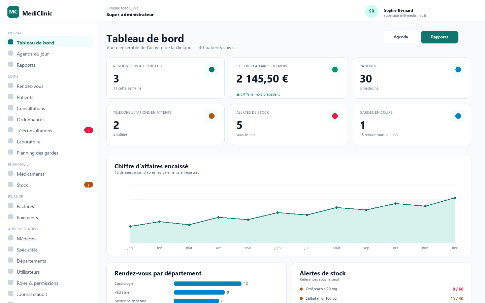
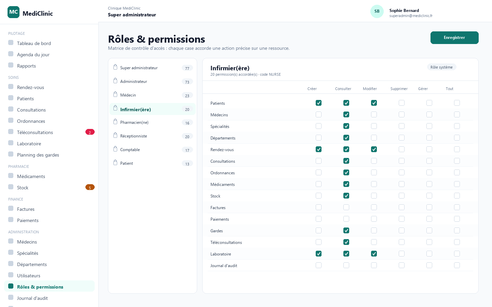

# MediClinic — Plateforme de gestion de clinique médicale

> Projet académique de gestion complète d'une clinique médicale multi-départements :
> prise de rendez-vous en ligne, dossier patient informatisé, téléconsultation,
> pharmacie, facturation et administration RBAC.

**Dépôt :** monorepo npm workspaces · **Stack :** React 18 + TypeScript + Vite + Tailwind ·
Node/Express + TypeScript · MySQL 8 (SQL brut, **aucun ORM**) · Zoom (Server-to-Server OAuth + Meeting SDK)

---

## Table des matières

1. [Objectifs et fonctionnalités](#1-objectifs-et-fonctionnalités)
2. [Architecture du projet](#2-architecture-du-projet)
3. [Modèle de données (MCD et schéma relationnel)](#3-modèle-de-données-mcd-et-schéma-relationnel)
4. [Prérequis](#4-prérequis)
5. [Installation](#5-installation)
6. [Configuration](#6-configuration)
7. [Création et remplissage de la base de données](#7-création-et-remplissage-de-la-base-de-données)
8. [Lancement de l'application](#8-lancement-de-lapplication)
9. [Comptes de démonstration](#9-comptes-de-démonstration)
10. [Contrôle d'accès (RBAC)](#10-contrôle-daccès-rbac)
11. [Captures d'écran](#11-captures-décran)
12. [Étapes de test et de reproduction](#12-étapes-de-test-et-de-reproduction)
13. [Tests automatisés](#13-tests-automatisés)
14. [Dépannage](#14-dépannage)
15. [Documentation complémentaire](#15-documentation-complémentaire)

---

## 1. Objectifs et fonctionnalités

### Objectif du projet

Concevoir et développer une application web complète de gestion d'une clinique
médicale pluridisciplinaire, couvrant l'intégralité du parcours de soin — de la
prise de rendez-vous en ligne jusqu'à la facturation — avec un contrôle d'accès
fin basé sur des rôles modulaires.

Le projet répond à quatre exigences structurantes :

- **Couverture fonctionnelle complète** : tous les services de la clinique
  (consultations, pharmacie, laboratoire, gardes, téléconsultation, facturation)
  sont gérés par l'application.
- **Séparation des espaces** : un site public, un espace patient et un back-office
  professionnel, avec des habilitations distinctes.
- **Traçabilité** : toute action sensible est journalisée (qui, quoi, quand, d'où).
- **SQL maîtrisé** : aucune couche ORM, toutes les requêtes sont écrites à la main
  et préparées, avec des triggers pour garantir l'intégrité métier.

### Fonctionnalités par domaine

#### Site public (sans authentification)

| Fonctionnalité | Description |
| --- | --- |
| Page d'accueil | Présentation de la clinique, spécialités, praticiens, horaires |
| Annuaire des médecins | Recherche par spécialité et par nom, tarifs, disponibilité |
| Liste des spécialités | 10 spécialités avec description et lien vers les praticiens |
| Prise de rendez-vous en ligne | Assistant en 3 étapes : praticien → créneau → coordonnées |
| Demande de téléconsultation | Formulaire de demande soumis à validation administrative |
| Inscription patient | Création du compte et du dossier médical en une transaction |

#### Espace patient (authentifié)

| Fonctionnalité | Description |
| --- | --- |
| Tableau de bord | Prochain rendez-vous, ordonnances, factures, téléconsultations |
| Mes rendez-vous | Liste à venir et historique, annulation possible |
| Mon dossier médical | Identité, groupe sanguin, allergies, antécédents, chronologie |
| Mes ordonnances | Détail des prescriptions, téléchargement PDF |
| Mes factures | Montants, statut, reste à payer, téléchargement PDF |
| Mes téléconsultations | Accès à la salle de visioconférence dans la fenêtre autorisée |
| Mon profil | Modification des coordonnées et des informations déclaratives |

#### Back-office (personnel)

| Module | Fonctionnalités |
| --- | --- |
| **Tableau de bord** | 6 indicateurs, 5 graphiques Recharts, activité récente |
| **Rendez-vous** | Liste filtrable, agenda, création, changement de statut, annulation |
| **Patients** | Recherche multicritère, dossier détaillé, chronologie, export PDF |
| **Consultations** | Comptes-rendus, diagnostics, suivi, impression |
| **Ordonnances** | Création, détail des lignes, dispensation (décrémente le stock) |
| **Médicaments** | Catalogue, prix, seuils d'alerte, péremption |
| **Stock** | Mouvements entrées/sorties, alertes, valeur du stock |
| **Factures** | Émission, lignes, TVA, statuts, règlements, PDF |
| **Paiements** | Journal des encaissements, moyens de paiement |
| **Gardes** | Planning mensuel coloré par médecin, charge par praticien, PDF |
| **Téléconsultations** | Validation des demandes, création des réunions Zoom |
| **Laboratoire** | Catalogue d'analyses, demandes, saisie des résultats |
| **Médecins** | Profils, spécialités, tarifs, disponibilité |
| **Spécialités / Départements** | Référentiels, chefs de département |
| **Utilisateurs** | Comptes, rôles, activation, réinitialisation de mot de passe |
| **Rôles & permissions** | Matrice RBAC complète (77 permissions × 8 rôles) |
| **Journal d'audit** | Filtres par utilisateur, ressource, action, période |
| **Rapports** | CA, rendez-vous, stock, activité, démographie + export CSV |
| **Paramètres** | Identité de la clinique, devise, TVA, état Zoom |

#### Téléconsultation (Zoom)

- Validation d'une demande par un administrateur → création de la réunion.
- Génération d'une signature **Meeting SDK** côté serveur (le secret ne quitte
  jamais le back-end).
- Fenêtre de connexion limitée : de **10 minutes avant** le début jusqu'à la fin prévue.
- **Mode dégradé** : sans identifiants Zoom, les réunions sont simulées et
  l'application reste entièrement fonctionnelle (voir §6).

#### Documents PDF (pdfkit)

Six modèles professionnels, chacun avec en-tête (logo/nom, adresse, contact) et
pied de page (pagination `Page X / Y`, date d'édition, mention de confidentialité) :

1. Dossier patient complet
2. Ordonnance
3. Compte-rendu de consultation
4. Facture (avec détail TVA et paiements)
5. Bon de dispensation pharmacie
6. Planning des gardes

---

## 2. Architecture du projet

### Organisation du dépôt

```
mediclinic/
├── apps/
│   ├── api/                       # Back-end Express + TypeScript
│   │   ├── src/
│   │   │   ├── config/            # env, db, jwt, zoom
│   │   │   ├── middlewares/       # auth, rbac, validate, audit, error, upload
│   │   │   ├── modules/           # 24 modules métier
│   │   │   │   └── <module>/      # .repository → .service → .controller → .routes
│   │   │   ├── routes/            # agrégation des routeurs
│   │   │   ├── utils/             # pdf.generator, email, pagination, datetime…
│   │   │   ├── app.ts             # construction de l'application Express
│   │   │   └── server.ts          # point d'entrée
│   │   └── CONVENTIONS.md         # conventions de code (normatif)
│   └── web/                       # Front-end React + Vite + Tailwind
│       └── src/
│           ├── components/        # UI kit, layouts, Can, MeetingRoom
│           ├── contexts/          # AuthContext
│           ├── hooks/             # useListQuery, useTheme, useDebounce
│           ├── lib/               # apiClient, queryClient, pdf, utils
│           ├── pages/             # public, auth, admin, patient, errors
│           └── routes/            # AppRoutes, ProtectedRoute, navigation
├── packages/
│   └── shared/                    # Types, schémas Zod, constantes, permissions
├── database/
│   ├── migrations/
│   │   ├── 001_init.sql           # 26 tables, 10 triggers, contraintes
│   │   ├── 002_views.sql          # 14 vues de lecture
│   │   └── 003_seed.sql           # jeu de démonstration complet
│   ├── diagrams/                  # MCD, MLD, MPD, dictionnaire de données
│   └── scripts/                   # reset-db.mjs, verify-sql.mjs
├── docs/                          # API.md, ARCHITECTURE.md, BCNF.md, SCREENSHOTS/
├── .env.example
├── docker-compose.yml             # MySQL + phpMyAdmin + MailHog
├── Makefile
└── package.json                   # workspaces npm
```

### Architecture en couches du back-end

Chaque module respecte strictement la même séparation :

```
Route  →  Controller  →  Service  →  Repository  →  SQL brut
```

| Couche | Responsabilité | Interdictions |
| --- | --- | --- |
| **Route** | Déclarer le chemin, brancher les middlewares | Aucun SQL, aucune règle métier |
| **Controller** | Lire `req`, valider (Zod), appeler le service, formater la réponse | Aucune règle métier, aucun SQL |
| **Service** | Règles métier, vérifications, transactions, orchestrations | Aucun SQL |
| **Repository** | Requêtes SQL préparées (`?`), mapping des lignes | Aucune règle métier |

Cette séparation rend chaque couche testable isolément et permet de remplacer la
couche de persistance sans toucher au métier.

### Chaîne de middlewares d'une route d'écriture

```ts
router.post(
  '/',
  authenticate,                          // 1. jeton JWT valide, req.user renseigné
  requirePermission('patient:create'),   // 2. permission RBAC vérifiée en base
  validate({ body: createPatientSchema }), // 3. validation Zod partagée avec le front
  auditTrail('CREATE', 'patient'),       // 4. journalisation en fin de requête
  controller.create,                     // 5. contrôleur
);
```

### Choix techniques

| Choix | Justification |
| --- | --- |
| **SQL brut sans ORM** | Maîtrise complète des requêtes, des index et des plans d'exécution ; exigence explicite du cahier des charges |
| **Triggers SQL** | Le stock et les totaux de facture sont garantis cohérents même en cas d'écriture hors application |
| **Vues SQL** | Contrat stable entre la base et l'API ; les jointures complexes sont écrites une seule fois |
| **Zod partagé** | Une seule définition de règle de validation pour le front et le back : aucune divergence possible |
| **TanStack Query** | Cache, invalidation et états de chargement gérés de façon déclarative |
| **React.lazy** | Le bundle initial ne contient que le site public ; le back-office est chargé à la demande |
| **JWT court + refresh opaque** | Le jeton d'accès (15 min) limite l'exposition ; le refresh est révocable et à usage unique |

---

## 3. Modèle de données (MCD et schéma relationnel)

### Vue d'ensemble

La base compte **26 tables**, **14 vues** et **10 triggers**, organisées en neuf
domaines :

```
RBAC            roles ─┬─ role_permissions ─ permissions
                       └─ user_roles ─ users

Personnes       users ─┬─ patients
                       └─ doctors ─┬─ specialties
                                   └─ departments

Soins           appointments ─ consultations ─┬─ prescriptions ─ prescription_items ─ medications
                                              └─ invoices ─ invoice_items
                                                          └─ payments

Pharmacie       medications ─ stock_movements

Téléconsult.    meetings ─ appointments

RH              shifts ─ doctors, departments

Labo            lab_requests ─ lab_tests

Transverse      audit_logs, notifications, clinic_settings, refresh_tokens
```

### Entités principales et cardinalités

| Relation | Cardinalités | Traduction |
| --- | --- | --- |
| User ↔ Role | (0,N) — (0,N) | Table de jointure `user_roles` |
| Role ↔ Permission | (0,N) — (0,N) | Table de jointure `role_permissions` |
| User → Patient | (0,1) — (0,1) | `patients.user_id` (unique, nullable) |
| User → Doctor | (0,1) — (0,1) | `doctors.user_id` (unique) |
| Specialty → Doctor | (1,N) — (1,1) | `doctors.specialty_id` |
| Department → Doctor | (0,N) — (0,1) | `doctors.department_id` (nullable) |
| Patient → Appointment | (0,N) — (1,1) | `appointments.patient_id` |
| Doctor → Appointment | (0,N) — (1,1) | `appointments.doctor_id` |
| Appointment → Consultation | (0,1) — (1,1) | `consultations.appointment_id` (unique) |
| Consultation → Prescription | (0,N) — (1,1) | `prescriptions.consultation_id` |
| Prescription → PrescriptionItem | (1,N) — (1,1) | `prescription_items.prescription_id` |
| Medication → PrescriptionItem | (0,N) — (1,1) | `prescription_items.medication_id` |
| Medication → StockMovement | (0,N) — (1,1) | `stock_movements.medication_id` |
| Patient → Invoice | (0,N) — (1,1) | `invoices.patient_id` |
| Invoice → InvoiceItem | (1,N) — (1,1) | `invoice_items.invoice_id` |
| Invoice → Payment | (0,N) — (1,1) | `payments.invoice_id` |
| Patient → Meeting | (0,N) — (1,1) | `meetings.patient_id` |
| Doctor → Shift | (0,N) — (1,1) | `shifts.doctor_id` |

### Schéma relationnel (extrait)

```
users(#id, email, password_hash, first_name, last_name, phone, is_active, last_login_at)
roles(#id, code, name, description, is_system)
permissions(#id, code, resource, action, description)
user_roles(#user_id, #role_id)
role_permissions(#role_id, #permission_id)

patients(#id, *user_id, first_name, last_name, birth_date, gender, address, city,
         postal_code, phone, email, blood_group, allergies, medical_history,
         emergency_contact_name, emergency_contact_phone, insurance_number)
specialties(#id, name, description)
departments(#id, name, description, *head_doctor_id)
doctors(#id, *user_id, *specialty_id, *department_id, license_number,
        consultation_fee, bio, is_accepting_patients)

appointments(#id, *patient_id, *doctor_id, *department_id, scheduled_at, duration,
             status, type, reason, notes, cancelled_reason, *created_by)
consultations(#id, *appointment_id, *doctor_id, diagnosis, notes, follow_up_at)
prescriptions(#id, *consultation_id, *doctor_id, issued_at, status)
prescription_items(#id, *prescription_id, *medication_id, dosage, frequency,
                   duration, instructions, quantity)

medications(#id, name, category, unit, price, stock_quantity, alert_threshold,
            expiry_date, supplier)
stock_movements(#id, *medication_id, type, quantity, reason, *user_id)

invoices(#id, number, *patient_id, *consultation_id, subtotal, vat_rate, vat_amount,
         total_amount, paid_amount, status, issued_at, due_date, *created_by)
invoice_items(#id, *invoice_id, label, quantity, unit_price, line_total GÉNÉRÉE)
payments(#id, *invoice_id, amount, method, paid_at, reference, *recorded_by)

shifts(#id, *doctor_id, *department_id, start_at, end_at, type, status, notes)
meetings(#id, *appointment_id, *patient_id, *doctor_id, reason, preferred_at,
         duration, zoom_meeting_id, join_url, start_url, password, start_time,
         status, rejection_reason, *requested_by, *approved_by)

lab_tests(#id, name, category, price, turnaround_hours)
lab_requests(#id, *patient_id, *doctor_id, *lab_test_id, status, notes,
             result_text, requested_at, completed_at)

audit_logs(#id, *user_id, action, resource, resource_id, old_value JSON,
           new_value JSON, ip_address, user_agent)
notifications(#id, *user_id, title, message, type, is_read, link)
clinic_settings(#id CHECK id=1, name, address, phone, email, currency, vat_rate, logo_url)
refresh_tokens(#id, *user_id, token_hash, expires_at, revoked_at, user_agent, ip_address)
```

### Corrections de normalisation (BCNF)

Deux écarts du modèle initial du cahier des charges ont été corrigés pour
respecter la forme normale de Boyce-Codd :

1. **`users.role_id` → table `user_roles`.** Un utilisateur peut cumuler
   plusieurs rôles (le SUPER_ADMIN en porte deux). Une colonne unique aurait
   introduit une dépendance partielle et empêché le cumul.
2. **`consultations.prescription_id` supprimé.** La relation est déjà portée par
   `prescriptions.consultation_id`. La conserver créait une dépendance circulaire
   et une redondance, donc un risque d'incohérence.

Les colonnes dérivées conservées (`invoices.subtotal/vat_amount/total_amount/paid_amount`,
`medications.stock_quantity`, `invoice_items.line_total`) ne violent pas la BCNF :
elles sont soit **calculées par trigger** (donc jamais désynchronisées), soit des
**colonnes générées `STORED`** non inscriptibles.

> Analyse complète : [`docs/BCNF.md`](docs/BCNF.md) ·
> Diagrammes : [`database/diagrams/`](database/diagrams/) (MCD, MLD, MPD,
> dictionnaire de données)

### Triggers métier

| Trigger | Événement | Rôle |
| --- | --- | --- |
| `trg_stock_movement_before_insert` | BEFORE INSERT | Refuse une sortie supérieure au stock disponible |
| `trg_stock_movement_after_insert` | AFTER INSERT | Incrémente ou décrémente `medications.stock_quantity` |
| `trg_stock_movement_after_delete` | AFTER DELETE | Rétablit le stock en cas d'annulation |
| `trg_invoice_item_after_insert/update/delete` | AFTER | Recalcule `subtotal`, `vat_amount`, `total_amount` |
| `trg_invoice_before_update` | BEFORE UPDATE | Recalcule les montants si le taux de TVA change |
| `trg_payment_after_insert/update/delete` | AFTER | Met à jour `paid_amount` et le statut de la facture |

---

## 4. Prérequis

| Outil | Version minimale | Vérification |
| --- | --- | --- |
| **Node.js** | 20 (22 recommandé) | `node --version` |
| **npm** | 10 | `npm --version` |
| **MySQL** | 8.0 | `mysql --version` |
| **Docker** *(optionnel)* | 24 | `docker --version` |

> **Note** : Docker n'est utile que pour lancer MySQL, phpMyAdmin et MailHog sans
> installation locale. Une installation MySQL classique fonctionne parfaitement.

---

## 5. Installation

### 5.1 Récupérer le projet

```bash
cd mediclinic
```

### 5.2 Installer les dépendances

```bash
npm install
```

Cette commande installe les dépendances des trois workspaces
(`packages/shared`, `apps/api`, `apps/web`) en une seule fois.

### 5.3 Créer le fichier d'environnement

```bash
cp .env.example .env
```

Sous Windows (PowerShell) :

```powershell
Copy-Item .env.example .env
```

Puis **adaptez les identifiants MySQL** dans `.env` (§6).

---

## 6. Configuration

Le fichier `.env` (à la racine) est validé au démarrage par Zod : l'application
**refuse de démarrer** si une variable obligatoire est absente ou mal formée,
ce qui évite les erreurs découvertes tardivement.

### Variables essentielles

| Variable | Défaut | Description |
| --- | --- | --- |
| `PORT` | `4000` | Port d'écoute de l'API |
| `APP_URL` | `http://localhost:5173` | URL du front (liens dans les emails) |
| `API_URL` | `http://localhost:4000` | URL publique de l'API |
| `CORS_ORIGINS` | `http://localhost:5173` | Origines autorisées (séparées par des virgules) |
| `DB_HOST` | `127.0.0.1` | Hôte MySQL |
| `DB_PORT` | `3306` | Port MySQL |
| `DB_USER` | `mediclinic` | Utilisateur MySQL |
| `DB_PASSWORD` | `mediclinic` | Mot de passe MySQL |
| `DB_NAME` | `mediclinic` | Nom de la base |
| `JWT_ACCESS_SECRET` | *(dev)* | **À remplacer** — ≥ 64 caractères aléatoires |
| `JWT_REFRESH_SECRET` | *(dev)* | **À remplacer** — ≥ 64 caractères aléatoires |
| `ACCESS_TOKEN_TTL` | `15m` | Durée du jeton d'accès |
| `REFRESH_TOKEN_TTL` | `7d` | Durée du jeton de rafraîchissement |
| `BCRYPT_ROUNDS` | `12` | Coût du hachage des mots de passe |

### Générer des secrets robustes

```bash
# Linux / macOS
node -e "console.log(require('crypto').randomBytes(64).toString('hex'))"

# PowerShell
node -e "console.log(require('crypto').randomBytes(64).toString('hex'))"
```

### Messagerie (développement)

Par défaut, l'application pointe vers **MailHog** (`127.0.0.1:1025`) : aucun email
réel n'est envoyé. L'interface web de MailHog (`http://localhost:8025`) permet de
lire les messages. En production, renseignez un vrai serveur SMTP.

### Zoom

```ini
ZOOM_ACCOUNT_ID=
ZOOM_CLIENT_ID=
ZOOM_CLIENT_SECRET=
ZOOM_USER_ID=me
ZOOM_SDK_KEY=
ZOOM_SDK_SECRET=
```

**Deux modes de fonctionnement :**

| Mode | Condition | Comportement |
| --- | --- | --- |
| **Réel** | Les 3 variables `ZOOM_*` OAuth et les 2 `ZOOM_SDK_*` sont remplies | Réunions créées via l'API Zoom, visioconférence fonctionnelle |
| **Simulé** | Identifiants absents *(configuration par défaut du dépôt)* | Réunions fictives générées, salle de démonstration affichée, **application 100 % fonctionnelle** |

Le mode simulé est **volontaire** : il permet de soutenir et démontrer le projet
sans compte Zoom ni connexion internet. L'interface affiche clairement le mode actif
dans **Administration → Paramètres** et sur l'écran des téléconsultations.

> Les secrets Zoom ne sont **jamais** transmis au navigateur : la signature du
> Meeting SDK est calculée côté serveur et l'API ne renvoie qu'un booléen d'état.

---

## 7. Création et remplissage de la base de données

### Option A — Script automatique (recommandé, multiplateforme)

```bash
# Structure + vues uniquement
npm run db:create

# Structure + vues + jeu de démonstration complet
npm run db:reset
```

Le script `database/scripts/reset-db.mjs` lit `.env`, crée la base si nécessaire,
puis exécute les trois migrations dans l'ordre. Il demande une confirmation
explicite avant de supprimer des tables existantes (utilisez `--yes` pour
l'automatiser).

```bash
node database/scripts/reset-db.mjs --seed --yes
```

### Option B — Ligne de commande MySQL

```bash
mysql -u root -p < database/migrations/001_init.sql
mysql -u root -p < database/migrations/002_views.sql
mysql -u root -p < database/migrations/003_seed.sql
```

### Option C — Docker (initialisation automatique)

```bash
docker compose up -d mysql
```

Les trois scripts sont montés dans `/docker-entrypoint-initdb.d` : MySQL les
exécute **automatiquement** au premier démarrage du conteneur.

| Service | URL | Identifiants |
| --- | --- | --- |
| MySQL | `localhost:3306` | `mediclinic` / `mediclinic` |
| phpMyAdmin | http://localhost:8081 | `mediclinic` / `mediclinic` |
| MailHog (web) | http://localhost:8025 | — |
| MailHog (SMTP) | `localhost:1025` | — |

### Option D — Makefile

```bash
make install     # npm install
make env         # copie .env.example → .env
make up          # docker compose up -d
make db-init     # 001_init.sql
make db-views    # 002_views.sql
make db-seed     # 003_seed.sql
make db-reset    # tout réinitialiser avec les données de démo
make dev         # API + front en parallèle
```

> `make help` affiche toutes les cibles disponibles.

### Vérifier l'initialisation

```bash
node database/scripts/verify-sql.mjs
```

Ce script contrôle **21 points** sans nécessiter de serveur MySQL : présence des
26 tables, des 14 vues et des 10 triggers, équilibre des parenthèses, résolution
des 40 clés étrangères, conformité des 77 permissions, volumétrie du seed.

Puis, directement en base :

```sql
USE mediclinic;
SELECT COUNT(*) FROM users;          -- 53
SELECT COUNT(*) FROM patients;       -- 30
SELECT COUNT(*) FROM appointments;   -- 50
SELECT COUNT(*) FROM consultations;  -- 40
SELECT COUNT(*) FROM prescriptions;  -- 30
SELECT COUNT(*) FROM invoices;       -- 25
SELECT COUNT(*) FROM medications;    -- 20
SELECT COUNT(*) FROM shifts;         -- 15
SELECT COUNT(*) FROM meetings;       -- 5
```

### Volumétrie du jeu de démonstration

| Table | Lignes | Détail |
| --- | --- | --- |
| `users` | 53 | 3 admins, 8 médecins, 5 infirmiers, 2 pharmaciens, 3 réceptionnistes, 2 comptables, 30 patients |
| `roles` / `permissions` | 8 / 77 | Matrice `role_permissions` complète |
| `specialties` / `departments` | 10 / 8 | Avec chefs de département |
| `doctors` | 8 | Tarifs de 35 à 75 € |
| `patients` | 30 | Pathologies et allergies variées |
| `medications` | 20 | 5 références sous le seuil d'alerte |
| `stock_movements` | 40 | Entrées initiales et sorties cumulées |
| `appointments` | 50 | Répartis sur 3 mois, tous statuts représentés |
| `consultations` | 40 | Un compte-rendu par rendez-vous terminé |
| `prescriptions` / `prescription_items` | 30 / 60 | Deux lignes par ordonnance |
| `invoices` / `invoice_items` / `payments` | 25 / 50 / 19 | Statuts variés, dont une annulée |
| `shifts` | 15 | Passées, en cours et futures |
| `meetings` | 5 | Zoom simulé, tous statuts |
| `lab_tests` / `lab_requests` | 10 / 12 | Résultats saisis pour un tiers |
| `notifications` / `audit_logs` | 20 / 30 | Activité récente crédible |

Les dates sont **calculées à partir de `CURDATE()`** : le jeu reste donc
d'actualité quelle que soit la date d'exécution du script.

---

## 8. Lancement de l'application

### Mode développement (recommandé)

```bash
npm run dev
```

Démarre simultanément :

- **API** : http://localhost:4000 (`tsx watch`, rechargement à chaud)
- **Front** : http://localhost:5173 (Vite, HMR)

### Lancement séparé

```bash
npm run dev:api    # API uniquement
npm run dev:web    # Front uniquement
```

### Vérifier que tout fonctionne

```bash
curl http://localhost:4000/api/health
```

Réponse attendue :

```json
{
  "data": {
    "status": "ok",
    "database": "connected",
    "databaseVersion": "8.0.x",
    "zoom": "simulated",
    "environment": "development"
  }
}
```

> Si `database` vaut `unreachable`, MySQL n'est pas démarré ou les identifiants
> du `.env` sont incorrects. L'API démarre malgré tout : elle signale le problème
> au lieu de planter, ce qui facilite le diagnostic.

### Build de production

```bash
npm run build
```

| Sortie | Emplacement |
| --- | --- |
| API compilée | `apps/api/dist/` |
| Front statique | `apps/web/dist/` |

```bash
npm run start --workspace @mediclinic/api   # démarre l'API compilée
npm run preview --workspace @mediclinic/web # prévisualise le front
```

### Autres commandes utiles

```bash
npm run typecheck     # TypeScript strict sur tous les workspaces
npm run lint          # ESLint
npm run format        # Prettier
npm run test          # tous les tests
npm run test:api      # tests de l'API
npm run test:web      # tests du front
npm run test:shared   # tests du paquet partagé
```

---

## 9. Comptes de démonstration

**Mot de passe commun à tous les comptes : `Passw0rd!2026`**

| Rôle | Email | Usage démontré |
| --- | --- | --- |
| **SUPER_ADMIN** | `superadmin@mediclinic.fr` | Accès total, matrice des rôles |
| **ADMIN** | `admin@mediclinic.fr` | Gestion complète hors matrice |
| **ADMIN** | `direction@mediclinic.fr` | Second administrateur |
| **DOCTOR** | `amine.haddad@mediclinic.fr` | Cardiologie, consultations, ordonnances |
| **DOCTOR** | `elodie.marchand@mediclinic.fr` | Dermatologie |
| **DOCTOR** | `karim.benali@mediclinic.fr` | Pédiatrie |
| **DOCTOR** | `nathalie.roussel@mediclinic.fr` | Gynécologie |
| **DOCTOR** | `thomas.girard@mediclinic.fr` | Médecine générale |
| **NURSE** | `claire.dubois@mediclinic.fr` | Accueil, constantes |
| **PHARMACIST** | `paul.mercier@mediclinic.fr` | Stock, dispensation |
| **RECEPTIONIST** | `emma.gautier@mediclinic.fr` | Rendez-vous, facturation |
| **ACCOUNTANT** | `hugo.charpentier@mediclinic.fr` | Factures, paiements, rapports |
| **PATIENT** | `lucie.durand@email.fr` | Espace patient complet |
| **PATIENT** | `pierre.lambert@email.fr` | Second patient |

> La page de connexion rappelle les cinq comptes principaux pour faciliter la
> soutenance.

---

## 10. Contrôle d'accès (RBAC)

### Principes

Le modèle est **entièrement modulaire** : les rôles, les permissions et leurs
associations vivent en base (`roles`, `permissions`, `role_permissions`,
`user_roles`). Accorder un droit se fait par une ligne SQL ou depuis l'interface
**Administration → Rôles & permissions**, sans redéploiement.

- **8 rôles** prédéfinis, **77 permissions** nommées `resource:action`.
- **21 ressources** : `patient`, `doctor`, `appointment`, `consultation`,
  `prescription`, `medication`, `stock`, `invoice`, `payment`, `shift`,
  `meeting`, `lab`, `audit`, `role`, `user`, `dashboard`, `report`,
  `notification`, `settings`, `specialty`, `department`.
- **5 actions** : `create`, `read`, `update`, `delete`, `manage`.
- **Héritage** : `resource:manage` implique `create`, `read`, `update` et `delete`
  sur la même ressource.

### Application côté API

```ts
authenticate                                  // jeton valide + compte actif
requirePermission('invoice:create')           // permission vérifiée en base
requireAnyPermission('invoice:read', 'report:read')
requireRole('SUPER_ADMIN')                    // contrôle grossier
requireStaff()                                // exclut les patients
```

Les rôles et permissions sont **rechargés à chaque requête** : une révocation est
donc effective immédiatement, sans attendre l'expiration du jeton.

### Application côté interface

```tsx
<Can permission="patient:create">
  <Button>Nouveau patient</Button>
</Can>

<Can anyOf={['invoice:create', 'invoice:manage']} fallback={<p>Accès restreint</p>}>
  <InvoiceForm />
</Can>
```

Le menu du back-office est **généré dynamiquement** à partir des permissions : un
pharmacien ne voit pas le module de facturation, un comptable ne voit pas la pharmacie.

### Matrice résumée

| Rôle | Portée principale | Restrictions notables |
| --- | --- | --- |
| SUPER_ADMIN | Toutes les permissions | Aucune |
| ADMIN | Tout sauf `role:*` | Ne peut pas modifier la matrice RBAC |
| DOCTOR | Consultations, ordonnances, téléconsultations, labo | Pas de facturation, pas de stock |
| NURSE | Patients, rendez-vous, constantes, labo | Pas de prescription |
| PHARMACIST | Catalogue, stock, dispensation | Pas de facturation |
| RECEPTIONIST | Rendez-vous, patients, encaissement | Pas de prescription, pas de stock |
| ACCOUNTANT | Factures, paiements, rapports | Pas de prescription, pas de stock |
| PATIENT | Ses rendez-vous, ordonnances, factures | Uniquement ses propres données |

### Isolation des données patient

Au-delà des permissions, un contrôle supplémentaire empêche un patient d'accéder
aux données d'un autre :

```ts
// Dans le service
if (user.roles.length === 1 && user.roles[0] === 'PATIENT') {
  if (user.patientId !== requestedPatientId) throw AppError.forbidden(…);
}
```

Cette règle s'applique aux dossiers, rendez-vous, ordonnances, factures et
**documents PDF**.

---

## 11. Captures d'écran

Le dossier [`docs/SCREENSHOTS/`](docs/SCREENSHOTS/) contient les visuels des
écrans principaux :

| Fichier | Écran |
| --- | --- |
| `01-accueil.png` | Page d'accueil publique |
| `02-connexion.png` | Page de connexion |
| `03-prise-rdv.png` | Assistant de prise de rendez-vous |
| `04-dashboard-admin.png` | Tableau de bord (indicateurs + graphiques) |
| `05-patients.png` | Liste des patients |
| `06-roles-permissions.png` | Matrice RBAC |
| `07-facture-pdf.png` | Facture PDF générée |
| `08-espace-patient.png` | Tableau de bord patient |
| `09-planning-gardes.png` | Planning mensuel des gardes |
| `10-journal-audit.png` | Journal d'audit |





> **Note de transparence** : ces visuels ont été produits par composition
> graphique (script `database/scripts/generate-screenshots.py`) à partir de la
> palette, des libellés et des données de démonstration réels de l'application.
> L'environnement de développement de ce dépôt ne dispose pas de navigateur
> headless permettant une capture photographique. La procédure pour capturer les
> écrans depuis votre propre instance est documentée dans
> [`docs/SCREENSHOTS/README.md`](docs/SCREENSHOTS/README.md).

---

## 12. Étapes de test et de reproduction

Scénario complet à dérouler pour valider le projet de bout en bout.

### Scénario 1 — Inscription et prise de rendez-vous publique

1. Ouvrir http://localhost:5173.
2. Cliquer sur **Prendre rendez-vous**.
3. Choisir une spécialité, puis un praticien → **Continuer**.
4. Sélectionner une date et un créneau libre → **Continuer**.
5. Renseigner prénom, nom, date de naissance, email, téléphone → **Confirmer**.
6. **Attendu** : écran de confirmation avec le numéro de rendez-vous. Un dossier
   patient a été créé automatiquement si l'email était inconnu.
7. Vérifier en base : `SELECT * FROM appointments ORDER BY id DESC LIMIT 1;`
   → statut `PENDING`, `created_by` NULL.

### Scénario 2 — Connexion et contrôle d'accès

1. Se connecter avec `paul.mercier@mediclinic.fr` (PHARMACIST).
2. **Attendu** : le menu affiche Médicaments, Stock, Ordonnances, Téléconsultations —
   **mais pas** Factures, Utilisateurs ni Rôles.
3. Tenter d'accéder directement à http://localhost:5173/admin/factures.
4. **Attendu** : redirection vers la page **Accès refusé**.
5. Tester l'API : `curl -H "Authorization: Bearer <token>" http://localhost:4000/api/users`
6. **Attendu** : `403` avec `{"error":{"code":"PERMISSION_DENIED",…}}`.

### Scénario 3 — Cycle de consultation complet

1. Se connecter en **ADMIN**, aller dans **Rendez-vous**, créer un rendez-vous
   pour un patient et un médecin, à une date passée.
2. Passer son statut à `CHECKED_IN`, puis `IN_PROGRESS`.
3. Aller dans **Consultations** → créer la consultation liée : diagnostic,
   observations, date de suivi.
4. **Attendu** : le rendez-vous passe automatiquement à `COMPLETED`.
5. Créer une ordonnance avec 2 médicaments.
6. Se connecter en **PHARMACIST** → **Ordonnances** → **Dispenser**.
7. **Attendu** : statut `DISPENSED`, et le stock des deux médicaments a diminué
   exactement des quantités prescrites (`SELECT stock_quantity FROM medications WHERE id IN (…)`).

### Scénario 4 — Intégrité du stock (garde-fou SQL)

1. Relever le stock d'un médicament : `SELECT stock_quantity FROM medications WHERE id = 1;`
2. Tenter une sortie supérieure au stock disponible :
   ```sql
   INSERT INTO stock_movements (medication_id, type, quantity, reason, user_id)
   VALUES (1, 'OUT', 999999, 'Test', 1);
   ```
3. **Attendu** : MySQL rejette l'insertion avec
   `Stock insuffisant pour enregistrer cette sortie.` (SQLSTATE 45000).
   Via l'API, la même opération renvoie **409** avec le code
   `BUSINESS_RULE_VIOLATION`.

### Scénario 5 — Facturation et encaissement

1. En **RECEPTIONIST** ou **ACCOUNTANT**, aller dans **Factures**.
2. Créer une facture avec deux lignes (consultation + actes).
3. **Attendu** : les totaux HT, TVA et TTC sont calculés **par la base**, pas par
   le formulaire — vérifier `SELECT subtotal, vat_amount, total_amount FROM invoices ORDER BY id DESC LIMIT 1;`
4. Encaisser un montant **partiel** → statut `PARTIALLY_PAID`.
5. Encaisser le solde → statut `PAID`, `paid_amount = total_amount`.
6. Tenter d'encaisser un montant supérieur au solde → **422** avec le solde restant.
7. Télécharger la facture en PDF → vérifier l'en-tête, les lignes, la TVA et le
   pied de page numéroté.

### Scénario 6 — Téléconsultation et mode dégradé

1. Depuis le site public, **Demander une téléconsultation** : choisir un médecin,
   un motif, un créneau.
2. Se connecter en **ADMIN** → **Téléconsultations** : la demande apparaît en
   `PENDING`, avec un bandeau indiquant le **mode simulé**.
3. **Approuver** → **Attendu** : statut `APPROVED`, identifiant de réunion et lien
   générés, rendez-vous créé automatiquement.
4. Cliquer sur **Rejoindre** → la salle de démonstration s'ouvre avec les contrôles
   micro/caméra.
5. Vérifier que la fenêtre de connexion est respectée : le bouton est inactif plus
   de 10 minutes avant l'heure prévue.

### Scénario 7 — Matrice RBAC

1. Se connecter en **SUPER_ADMIN** → **Rôles & permissions**.
2. Sélectionner le rôle **NURSE**, cocher `prescription:read` s'il ne l'est pas,
   puis **Enregistrer**.
3. Se connecter en **NURSE** → le module **Ordonnances** apparaît désormais dans le menu.
4. Décocher la permission, se reconnecter → le module disparaît.
5. Vérifier que le rôle `SUPER_ADMIN` ne peut pas être supprimé (badge « Rôle système »).

### Scénario 8 — Journal d'audit

1. Effectuer plusieurs actions (création, modification, connexion, téléchargement PDF).
2. Aller dans **Administration → Journal d'audit**.
3. Filtrer par ressource `patient` et par action `CREATE`.
4. **Attendu** : chaque entrée porte l'utilisateur, l'horodatage, l'adresse IP,
   l'agent utilisateur, et les valeurs avant/après (dépliables).
5. Vérifier en base : `SELECT action, COUNT(*) FROM audit_logs GROUP BY action;`

### Scénario 9 — Documents PDF

Télécharger les six documents et vérifier pour chacun :

- [ ] En-tête avec le nom de la clinique et ses coordonnées
- [ ] Pied de page avec `Page X / Y`, la date d'édition et la mention de confidentialité
- [ ] Aucune ligne de tableau coupée entre deux pages
- [ ] Tous les montants au format français (`1 234,50 €`)
- [ ] Toutes les dates au format `JJ/MM/AAAA`

### Scénario 10 — Portail patient

1. Se connecter avec `lucie.durand@email.fr`.
2. **Tableau de bord** : prochain rendez-vous, compteurs, notifications.
3. **Mon dossier médical** : identité, groupe sanguin, allergies, chronologie
   complète avec badges par type d'événement.
4. **Mes factures** : totaux, reste à payer, téléchargement PDF.
5. Télécharger son propre dossier patient en PDF.
6. **Attendu** : succès. Puis vérifier qu'un patient **ne peut pas** télécharger le
   dossier d'un autre en modifiant l'URL → **403**.

### Scénario 11 — Rapports et export

1. En **ADMIN** → **Rapports**.
2. Sélectionner une période (mois courant, année).
3. Vérifier les cinq onglets : CA, rendez-vous, stock, activité, patients.
4. Cliquer sur **Exporter en CSV** → ouvrir dans un tableur.
5. **Attendu** : séparateur `;`, accents corrects (BOM UTF-8).

### Scénario 12 — Résilience

1. Arrêter MySQL, recharger l'application.
2. **Attendu** : l'API reste démarrée et renvoie `503` avec un message explicite ;
   l'interface affiche un état d'erreur avec un bouton **Réessayer** — pas d'écran blanc.
3. Redémarrer MySQL → l'application redevient fonctionnelle sans redémarrage.

---

## 13. Tests automatisés

Le projet compte **68 tests** répartis sur les trois workspaces.

```bash
npm run test            # tous les tests
```

| Workspace | Fichier | Tests | Objet |
| --- | --- | --- | --- |
| `shared` | `src/shared.test.ts` | 27 | Schémas Zod, formateurs, sérialisation |
| `api` | `src/modules/auth/rbac.test.ts` | 16 | Matrice RBAC, héritage `manage`, isolation |
| `api` | `src/utils/pagination.test.ts` | 14 | Pagination, tri en liste blanche, anti-injection |
| `web` | `src/components/Can.test.tsx` | 11 | Composant `<Can>`, contrôle d'affichage |

### Ce que couvrent les tests

- **Sécurité** : la matrice RBAC est vérifiée rôle par rôle (le patient ne peut
  pas créer de dossier, le pharmacien ne facture pas, etc.) ; l'injection SQL via
  le tri est impossible ; `resource:manage` implique bien les quatre actions.
- **Validation** : les schémas refusent les emails invalides, les mots de passe
  faibles, les dates futures, les quantités nulles, les durées hors bornes.
- **Affichage conditionnel** : `<Can>` masque et affiche correctement selon les
  permissions, les rôles et l'état de connexion.

### Vérification statique du SQL

```bash
node database/scripts/verify-sql.mjs
```

21 contrôles sur les scripts de migration — utile car l'environnement de
développement de ce dépôt ne dispose pas de serveur MySQL.

---

## 14. Dépannage

### `ECONNREFUSED 127.0.0.1:3306`

MySQL n'est pas démarré ou écoute ailleurs.

```bash
# Vérifier que le service tourne
docker compose ps            # avec Docker
Get-Service MySQL*           # Windows
sudo systemctl status mysql  # Linux
```

Contrôler ensuite `DB_HOST` et `DB_PORT` dans `.env`.

### `ER_ACCESS_DENIED_ERROR`

Identifiants refusés. Vérifier `DB_USER` / `DB_PASSWORD`. Avec Docker, créer
l'utilisateur applicatif :

```sql
CREATE USER 'mediclinic'@'%' IDENTIFIED BY 'mediclinic';
GRANT ALL PRIVILEGES ON mediclinic.* TO 'mediclinic'@'%';
FLUSH PRIVILEGES;
```

### `Configuration invalide : …`

Une variable du `.env` est absente ou mal formée. Le message liste précisément
les champs fautifs. Les secrets JWT doivent faire **au moins 32 caractères**.

### `Port 4000 already in use`

```bash
# Windows
netstat -ano | findstr :4000
taskkill /PID <pid> /F

# Linux / macOS
lsof -i :4000
kill -9 <pid>
```

Ou changez `PORT` dans `.env` (et `API_URL` en conséquence).

### Le front ne joint pas l'API (erreur CORS)

Vérifier que l'origine du front figure dans `CORS_ORIGINS` :

```ini
CORS_ORIGINS=http://localhost:5173,http://127.0.0.1:5173
```

### Les PDF ne se téléchargent pas

Le jeton est transmis dans l'en-tête `Authorization`. Les fonctions
`downloadPdf` / `openPdfInNewTab` s'en chargent automatiquement. Un accès direct
par URL (`window.open('/api/pdf/…')`) échouera : c'est le comportement attendu.

### Erreur de politique d'exécution PowerShell (`npm.ps1`)

```powershell
Set-ExecutionPolicy -Scope CurrentUser -ExecutionPolicy RemoteSigned
```

Ou préfixez les commandes : `cmd /c "npm run dev"`.

### `Access is denied` lors du build Vite (Windows)

esbuild ne peut pas écrire dans le dossier temporaire système. Rediriger `TMP` :

```powershell
$env:TMP = "$PWD\.tmp"; $env:TEMP = $env:TMP
New-Item -ItemType Directory -Force -Path $env:TMP | Out-Null
npm run build
```

### Les emails ne partent pas

En développement, l'application écrit dans **MailHog** (`127.0.0.1:1025`). Si
MailHog n'est pas lancé, l'envoi échoue **silencieusement** — c'est volontaire :
une erreur d'email ne doit jamais faire échouer une opération métier. Consulter
http://localhost:8025 après `docker compose up -d mailhog`.

---

## 15. Documentation complémentaire

| Document | Contenu |
| --- | --- |
| [`docs/API.md`](docs/API.md) | Référence complète : 150+ routes, paramètres, réponses, codes d'erreur |
| [`docs/ARCHITECTURE.md`](docs/ARCHITECTURE.md) | Décisions d'architecture, diagrammes de séquence, stratégie de sécurité |
| [`docs/BCNF.md`](docs/BCNF.md) | Analyse de normalisation, dépendances fonctionnelles, preuves BCNF |
| [`database/diagrams/01_mcd.md`](database/diagrams/01_mcd.md) | Modèle Conceptuel de Données (règles de gestion, entités, associations) |
| [`database/diagrams/02_mld.md`](database/diagrams/02_mld.md) | Modèle Logique (schéma relationnel, clés étrangères, index) |
| [`database/diagrams/03_mpd.md`](database/diagrams/03_mpd.md) | Modèle Physique (types MySQL, triggers, vues, volumétrie) |
| [`database/diagrams/04_dictionnaire_donnees.md`](database/diagrams/04_dictionnaire_donnees.md) | Dictionnaire de données exhaustif |
| [`apps/api/CONVENTIONS.md`](apps/api/CONVENTIONS.md) | Conventions de développement du back-end |
| [`docs/SCREENSHOTS/README.md`](docs/SCREENSHOTS/README.md) | Procédure de capture et index des visuels |
| [`docs/DEMO.md`](docs/DEMO.md) | Checklist de démonstration pour la soutenance |

### Structure de l'API

Toutes les routes sont préfixées par `/api`. Les réponses suivent un format constant :

| Cas | Corps |
| --- | --- |
| Ressource | `{ "data": { … } }` |
| Liste paginée | `{ "data": [ … ], "meta": { page, limit, total, totalPages } }` |
| Erreur | `{ "error": { "code", "message", "details"? } }` |

```bash
# Exemple : authentification
curl -X POST http://localhost:4000/api/auth/login \
  -H "Content-Type: application/json" \
  -d '{"email":"superadmin@mediclinic.fr","password":"Passw0rd!2026"}'

# Puis, avec le jeton renvoyé
curl http://localhost:4000/api/dashboard/stats \
  -H "Authorization: Bearer <accessToken>"
```

---

## Licence et contexte

Projet académique réalisé dans le cadre d'un cursus de développement web.
Les données du jeu de démonstration sont entièrement fictives et ne correspondent
à aucune personne réelle.

**Aucune donnée de santé réelle ne doit être saisie dans cette application.**
