# 01 — Modèle Conceptuel de Données (MCD) — MediClinic

> **Fichiers SQL de référence** : `database/migrations/001_init.sql` (structure),
> `database/migrations/002_views.sql` (vues), `database/migrations/003_seed.sql` (jeu de
> démonstration).
> **Documents liés** : [`README.md`](README.md) · [`02_mld.md`](02_mld.md) ·
> [`03_mpd.md`](03_mpd.md) · [`04_dictionnaire_donnees.md`](04_dictionnaire_donnees.md) ·
> [`../../docs/BCNF.md`](../../docs/BCNF.md).

Ce document décrit le **MCD** de MediClinic : il est **indépendant de tout SGBD** et
exprime uniquement le vocabulaire métier de la clinique et les règles de gestion
recueillies. Il constitue le contrat fonctionnel à partir duquel le
[MLD](02_mld.md) puis le [MPD](03_mpd.md) ont été dérivés.

**Périmètre** : 24 entités conceptuelles, 2 associations N-N matérialisées en tables, et
39 associations binaires, soit **26 tables** au niveau physique (24 tables du noyau
applicatif + 2 tables du module optionnel « laboratoire »).

---

## 1. Démarche et règles de gestion recueillies

### 1.1 Démarche

La démarche suivie est la démarche Merise :

1. **Recueil** — entretiens avec les services de la clinique (accueil, secrétariat
   médical, pôle médical, pharmacie, laboratoire, facturation, direction) et lecture du
   cahier des charges. Chaque besoin exprimé est traduit en **règle de gestion** notée
   `RG-nn`.
2. **Modélisation conceptuelle** — regroupement des règles en **entités**, **associations**
   et **cardinalités** (le présent document). Aucun choix technique à ce stade.
3. **Modélisation logique** — passage au relationnel : association N-N → table de
   jointure, association 1-N → clé étrangère du côté « N », association 1-1 → clé
   étrangère + index unique ([`02_mld.md`](02_mld.md) §1).
4. **Modélisation physique** — choix du SGBD, des types, des index, des triggers et des
   vues ([`03_mpd.md`](03_mpd.md)).
5. **Contrôles transverses** — dictionnaire de données
   ([`04_dictionnaire_donnees.md`](04_dictionnaire_donnees.md)) et normalisation BCNF
   ([`../../docs/BCNF.md`](../../docs/BCNF.md)).

### 1.2 Conventions de cardinalité

La cardinalité inscrite à côté d'une entité `E` quantifie le nombre minimal et maximal
d'occurrences de **l'autre** entité associées à **une** occurrence de `E`. Ainsi
`UTILISATEUR (1,N) —— (0,N) ROLE` se lit :

- à côté de `UTILISATEUR`, `(1,N)` : *un utilisateur possède de 1 à N rôles* ;
- à côté de `ROLE`, `(0,N)` : *un rôle est porté par 0 à N utilisateurs*.

« N » désigne un nombre quelconque non borné par le modèle.

### 1.3 Règles de gestion

#### Identité, accès et sécurité

| Code | Règle de gestion |
|---|---|
| **RG-01** | La clinique gère des comptes utilisateurs (personnel et patients). Chaque compte est identifié par une **adresse e-mail unique** et protégé par un mot de passe stocké **haché** (jamais en clair). |
| **RG-02** | Un compte peut porter **plusieurs rôles** (par exemple super administrateur *et* administrateur) ; un rôle peut être porté par plusieurs comptes. La relation compte ↔ rôle est donc **N-N**. |
| **RG-03** | Un rôle regroupe un ensemble de **permissions atomiques** nommées `ressource:action` (`patient:read`, `invoice:manage`…). La relation rôle ↔ permission est **N-N** : la matrice d'habilitations est modifiable sans changement de code. |
| **RG-04** | Les rôles fournis par l'application sont marqués « système » et ne peuvent pas être supprimés ; l'administrateur peut créer des rôles personnalisés. |
| **RG-05** | Chaque connexion délivre un **jeton de rafraîchissement** à durée de vie limitée, révocable et **stocké haché** (SHA-256). Un compte peut avoir plusieurs jetons simultanés (plusieurs appareils). |
| **RG-06** | Tout compte doit disposer d'**au moins un rôle** pour être exploitable ; cette règle est garantie par l'application (aucune contrainte SQL ne peut vérifier une cardinalité minimale inter-tables). |
| **RG-34** | Toute ligne de données porte les dates techniques de **création** et de **mise à jour**, afin de permettre l'audit et la synchronisation côté client. |

#### Patients et personnel médical

| Code | Règle de gestion |
|---|---|
| **RG-07** | Un **patient** peut exister **sans compte en ligne** : le dossier est créé au secrétariat lors de la première visite. Inversement, un compte peut exister sans dossier patient (comptes du personnel). La relation compte ↔ patient est donc **facultative des deux côtés** (0,1)–(0,1). |
| **RG-08** | Le numéro d'assurance (ou de mutuelle) d'un patient est **unique lorsqu'il est renseigné** ; il est facultatif car un patient étranger ou non assuré peut être accueilli. |
| **RG-09** | Un **médecin** est un utilisateur doté d'un profil professionnel : **numéro d'ordre unique**, tarif de consultation, biographie, acceptation ou non de nouveaux patients. Un utilisateur ne peut avoir qu'un seul profil médecin. |
| **RG-10** | Un médecin exerce dans **une et une seule spécialité** ; il est rattaché à **au plus un département**. |
| **RG-11** | Un département peut être dirigé par **au plus un médecin chef** ; si ce médecin est supprimé, le département subsiste sans chef. |
| **RG-12** | Les spécialités et les départements constituent des référentiels administrables (création, modification, suppression contrôlée par les habilitations). |

#### Parcours de soin

| Code | Règle de gestion |
|---|---|
| **RG-13** | Un **rendez-vous** concerne **un patient** et **un médecin**, pour un créneau horaire donné, avec une durée comprise entre **10 et 240 minutes**. |
| **RG-14** | Un rendez-vous peut être rattaché à un **département d'accueil** (facultatif) et possède un **statut** (en attente, confirmé, arrivé, en cours, terminé, annulé, absent) ainsi qu'un **type** (présentiel ou téléconsultation). |
| **RG-15** | Un rendez-vous est **enregistré par** un utilisateur (secrétariat, infirmier, patient lui-même via le portail) : cette traçabilité est facultative mais conservée. |
| **RG-16** | Un rendez-vous honoré donne lieu à **au plus une consultation** ; une consultation se rattache à **exactement un** rendez-vous. La relation est de type **1-1**. |
| **RG-17** | Une **consultation** est rédigée par un médecin, comporte un **diagnostic obligatoire**, des notes libres et, si nécessaire, une **date de suivi**. |
| **RG-18** | Une consultation peut donner lieu à **0 à N ordonnances** ; une ordonnance se rattache à **exactement une** consultation et est signée par le médecin qui l'a rédigée. |
| **RG-19** | Une ordonnance comporte **au moins une ligne** ; chaque ligne porte sur un médicament du catalogue avec posologie, fréquence, durée, instructions et une **quantité strictement positive**. |
| **RG-20** | Les **analyses de laboratoire** (module optionnel) sont prescrites par un médecin à un patient ; chaque demande porte sur **un test du catalogue**, suit un cycle de statuts et peut recevoir un résultat textuel et une date d'achèvement. |

#### Pharmacie et stock

| Code | Règle de gestion |
|---|---|
| **RG-21** | Le catalogue des médicaments est identifié par le couple **nom + unité** (un même nom peut exister en comprimés et en flacons). Chaque référence porte un prix, un seuil d'alerte et une date de péremption facultative. |
| **RG-22** | **Le stock est la conséquence d'un journal de mouvements**, et non une donnée saisie : chaque entrée ou sortie est un enregistrement de `stock_movements`. La quantité courante affichée est un **cache recalculé automatiquement**. |
| **RG-23** | Un mouvement de sortie dont la quantité dépasse le stock disponible est **refusé** : le stock ne peut jamais devenir négatif. |
| **RG-24** | Tout mouvement de stock est **imputé à un utilisateur** identifié (pharmacien, préparateur) ; cette imputation ne peut pas être supprimée, même si le compte est désactivé. |
| **RG-25** | Une référence dont la quantité courante atteint ou passe sous le seuil d'alerte est signalée ; une référence périmée ou proche de la péremption (30 jours) est également signalée. |

#### Facturation et encaissement

| Code | Règle de gestion |
|---|---|
| **RG-26** | Une **facture** est émise au nom d'un patient et peut être rattachée à une consultation (facturation d'actes hors consultation possible). |
| **RG-27** | Le **numéro de facture** est unique et non réutilisable ; il sert de référence légale et apparaît sur le PDF remis au patient. |
| **RG-28** | Le **détail d'une facture** est constitué de lignes libres (honoraires de consultation, actes complémentaires, examens) avec quantité et prix unitaire. Le **total de chaque ligne** est le produit quantité × prix unitaire. |
| **RG-29** | Les **totaux de la facture** (HT, TVA, TTC) sont **calculés à partir des lignes** et du taux de TVA de la facture ; ils ne sont jamais saisis à la main. |
| **RG-30** | Une facture peut être réglée par **plusieurs paiements partiels** ; le montant payé et le statut de la facture (émise, partiellement payée, payée, annulée) en découlent automatiquement. Une facture annulée ou en brouillon conserve le montant payé mais ne change pas de statut automatiquement. |
| **RG-31** | Chaque paiement est **encaissé et enregistré par un utilisateur** (réceptionniste, comptable) selon un mode de règlement (espèces, carte, virement, assurance, chèque) ; le montant est **strictement positif**. |

#### Organisation du travail, supervision et paramétrage

| Code | Règle de gestion |
|---|---|
| **RG-32** | Les **gardes** planifient un médecin dans un département sur un créneau horaire cohérent (**fin strictement postérieure au début**), avec un type (jour, nuit, astreinte) et un statut. |
| **RG-33** | Une **téléconsultation** (Zoom) peut être demandée par un patient ou un soignant, puis **approuvée ou refusée** par un valideur ; elle peut être rattachée à un rendez-vous (0 ou 1) mais peut aussi être demandée avant tout rendez-vous. |
| **RG-35** | Les **actions sensibles** (connexion, création, modification, suppression, approbation, accès à un PDF, ajustement de stock) sont **journalisées** dans un journal d'audit avec l'état avant/après au format JSON, l'adresse IP et l'agent utilisateur. Le journal **survit à la suppression du compte** qui l'a produit. |
| **RG-36** | Les **notifications** sont adressées à un utilisateur (titre, message, type, lien, statut lu/non lu) et sont **supprimées avec lui**. |
| **RG-37** | Les **paramètres de la clinique** forment une **ligne unique** : identité (nom, adresse, téléphone, e-mail, logo), devise, taux de TVA par défaut et identifiants du compte Zoom. |

### 1.4 Traçabilité règles → entités

| Domaine | Règles | Entités concernées |
|---|---|---|
| Accès et sécurité | RG-01 → RG-06, RG-34 | `UTILISATEUR`, `ROLE`, `PERMISSION`, `JETON_RAFRAICHISSEMENT` |
| Patients et personnel | RG-07 → RG-12 | `PATIENT`, `MEDECIN`, `SPECIALITE`, `DEPARTEMENT` |
| Parcours de soin | RG-13 → RG-20 | `RENDEZ_VOUS`, `CONSULTATION`, `ORDONNANCE`, `LIGNE_ORDONNANCE`, `ANALYSE`, `DEMANDE_ANALYSE` |
| Pharmacie et stock | RG-21 → RG-25 | `MEDICAMENT`, `MOUVEMENT_STOCK` |
| Facturation | RG-26 → RG-31 | `FACTURE`, `LIGNE_FACTURE`, `PAIEMENT` |
| Organisation et supervision | RG-32 → RG-37 | `GARDE`, `TELECONSULTATION`, `JOURNAL_AUDIT`, `NOTIFICATION`, `PARAMETRES_CLINIQUE` |

---

## 2. Entités et attributs

**Convention de lecture** : dans chaque fiche, l'**identifiant** (clé primaire) est
**souligné et annoté**. Les attributs `created_at` / `updated_at` sont des attributs
techniques de traçabilité (RG-34) mais ils sont conservés au niveau conceptuel car ils
sont utilisés par les écrans et les rapports. Les types indiqués ici sont **conceptuels**
(`entier`, `chaîne`, `date`, `booléen`, `énuméré`, `texte`, `décimal`, `JSON`) ; les types
physiques exacts sont dans le [MPD](03_mpd.md) §3 et le
[dictionnaire de données](04_dictionnaire_donnees.md).

### 2.1 UTILISATEUR — table `users`

> Compte d'authentification d'une personne : membre du personnel ou patient du portail.
> Implémente RG-01, RG-34.

Attributs : **_`id`_** *(identifiant souligné, entier auto-incrémenté)* · `email` ·
`password_hash` · `first_name` · `last_name` · `phone` · `is_active` · `last_login_at` ·
`created_at` · `updated_at`.

### 2.2 ROLE — table `roles`

> Rôle applicatif, prédéfini ou personnalisé, support du RBAC modulaire. Implémente
> RG-02, RG-04.

Attributs : **_`id`_** *(identifiant)* · `code` · `name` · `description` · `is_system` ·
`created_at` · `updated_at`.

### 2.3 PERMISSION — table `permissions`

> Permission atomique nommée `ressource:action`. Implémente RG-03.

Attributs : **_`id`_** *(identifiant)* · `code` · `resource` · `action` · `description`.

### 2.4 JETON_RAFRAICHISSEMENT — table `refresh_tokens`

> Jeton de rafraîchissement d'une session, stocké haché et révocable. Implémente RG-05.

Attributs : **_`id`_** *(identifiant)* · `token_hash` · `expires_at` · `revoked_at` ·
`user_agent` · `ip_address` · `created_at`.

### 2.5 PATIENT — table `patients`

> Dossier administratif et médical de base d'un patient. Implémente RG-07, RG-08.

Attributs : **_`id`_** *(identifiant)* · `first_name` · `last_name` · `birth_date` ·
`gender` · `address` · `city` · `postal_code` · `phone` · `email` · `blood_group` ·
`allergies` · `medical_history` · `emergency_contact_name` · `emergency_contact_phone` ·
`insurance_number` · `created_at` · `updated_at`.

### 2.6 SPECIALITE — table `specialties`

> Spécialité médicale (cardiologie, pédiatrie…). Implémente RG-12.

Attributs : **_`id`_** *(identifiant)* · `name` · `description` · `created_at` ·
`updated_at`.

### 2.7 DEPARTEMENT — table `departments`

> Département ou service de la clinique. Implémente RG-11, RG-12. Le médecin chef est
> porté par l'**association** `DIRIGE`, non par un attribut : c'est une donnée dépendant
> d'un couple (département, médecin).

Attributs : **_`id`_** *(identifiant)* · `name` · `description` · `created_at` ·
`updated_at`.

### 2.8 MEDECIN — table `doctors`

> Profil professionnel d'un utilisateur médecin. Implémente RG-09, RG-10.

Attributs : **_`id`_** *(identifiant)* · `license_number` · `consultation_fee` · `bio` ·
`is_accepting_patients` · `created_at` · `updated_at`.

### 2.9 RENDEZ_VOUS — table `appointments`

> Créneau de consultation planifié entre un patient et un médecin. Implémente
> RG-13 → RG-16.

Attributs : **_`id`_** *(identifiant)* · `scheduled_at` · `duration` · `status` · `type` ·
`reason` · `notes` · `cancelled_reason` · `created_at` · `updated_at`.

### 2.10 CONSULTATION — table `consultations`

> Compte rendu médical d'un rendez-vous honoré. Implémente RG-16, RG-17.

Attributs : **_`id`_** *(identifiant)* · `diagnosis` · `notes` · `follow_up_at` ·
`created_at` · `updated_at`.

### 2.11 ORDONNANCE — table `prescriptions`

> Ordonnance émise à l'issue d'une consultation. Implémente RG-18.

Attributs : **_`id`_** *(identifiant)* · `issued_at` · `status` · `created_at`.

### 2.12 LIGNE_ORDONNANCE — table `prescription_items`

> Ligne d'ordonnance : **entité-association** issue de l'association porteuse
> « un médicament est prescrit dans une ordonnance ». Implémente RG-19.

Attributs : **_`id`_** *(identifiant propre, ajouté pour permettre la modification
unitaire d'une ligne)* · `dosage` · `frequency` · `duration` · `instructions` ·
`quantity`.

### 2.13 MEDICAMENT — table `medications`

> Référence du catalogue pharmaceutique et cache de son stock courant. Implémente
> RG-21, RG-22, RG-25.

Attributs : **_`id`_** *(identifiant)* · `name` · `category` · `unit` · `price` ·
`stock_quantity` *(dérivé, cf. §5.4)* · `alert_threshold` · `expiry_date` · `supplier` ·
`created_at` · `updated_at`.

### 2.14 MOUVEMENT_STOCK — table `stock_movements`

> Journal immuable des entrées et sorties de stock ; **source de vérité** du stock
> (RG-22, RG-23, RG-24).

Attributs : **_`id`_** *(identifiant)* · `type` *(entrée/sortie)* · `quantity` ·
`reason` · `created_at`.

### 2.15 FACTURE — table `invoices`

> Facture émise au nom d'un patient. Implémente RG-26 → RG-30.

Attributs : **_`id`_** *(identifiant)* · `number` · `subtotal` *(dérivé)* ·
`vat_rate` · `vat_amount` *(dérivé)* · `total_amount` *(dérivé)* · `paid_amount`
*(dérivé)* · `status` · `issued_at` · `due_date` · `created_at` · `updated_at`.

### 2.16 LIGNE_FACTURE — table `invoice_items`

> Ligne de facturation libre (honoraires, acte complémentaire). Implémente RG-28.

Attributs : **_`id`_** *(identifiant)* · `label` · `quantity` · `unit_price` ·
`line_total` *(dérivé : `quantity` × `unit_price`)*.

### 2.17 PAIEMENT — table `payments`

> Encaissement, total ou partiel, affecté à une facture. Implémente RG-31.

Attributs : **_`id`_** *(identifiant)* · `amount` · `method` · `paid_at` · `reference` ·
`created_at`.

### 2.18 GARDE — table `shifts`

> Créneau de garde ou d'astreinte d'un médecin dans un département. Implémente RG-32.

Attributs : **_`id`_** *(identifiant)* · `start_at` · `end_at` · `type` · `status` ·
`notes` · `created_at` · `updated_at`.

### 2.19 TELECONSULTATION — table `meetings`

> Demande de téléconsultation Zoom et ses paramètres techniques. Implémente RG-33.

Attributs : **_`id`_** *(identifiant)* · `reason` · `preferred_at` · `duration` ·
`zoom_meeting_id` · `join_url` · `start_url` · `password` · `start_time` · `status` ·
`rejection_reason` · `created_at` · `updated_at`.

### 2.20 ANALYSE — table `lab_tests` *(module optionnel « laboratoire »)*

> Test ou examen de laboratoire du catalogue. Implémente RG-20.

Attributs : **_`id`_** *(identifiant)* · `name` · `category` · `price` ·
`turnaround_hours`.

### 2.21 DEMANDE_ANALYSE — table `lab_requests` *(module optionnel « laboratoire »)*

> Demande d'analyse prescrite par un médecin à un patient. Implémente RG-20.

Attributs : **_`id`_** *(identifiant)* · `status` · `notes` · `result_text` ·
`requested_at` · `completed_at`.

### 2.22 JOURNAL_AUDIT — table `audit_logs`

> Entrée du journal d'audit : qui a fait quoi, quand, sur quelle ressource, avec
> l'état avant/après. Implémente RG-35.

Attributs : **_`id`_** *(identifiant, entier 64 bits : le volume du journal dépasse
largement celui des autres tables)* · `action` · `resource` · `resource_id` ·
`old_value` *(JSON)* · `new_value` *(JSON)* · `ip_address` · `user_agent` ·
`created_at`.

### 2.23 NOTIFICATION — table `notifications`

> Notification applicative adressée à un utilisateur. Implémente RG-36.

Attributs : **_`id`_** *(identifiant)* · `title` · `message` · `type` · `is_read` ·
`link` · `created_at`.

### 2.24 PARAMETRES_CLINIQUE — table `clinic_settings`

> Paramètres généraux de la clinique, **entité singleton** : une seule occurrence
> autorisée. Implémente RG-37.

Attributs : **_`id`_** *(identifiant, contraint à la valeur 1)* · `name` · `address` ·
`phone` · `email` · `currency` · `vat_rate` · `logo_url` · `zoom_account_id` ·
`zoom_client_id` · `zoom_client_secret` · `updated_at`.

### 2.25 Synthèse des entités

| # | Entité MCD | Table physique | Identifiant | Domaine |
|---|---|---|---|---|
| 1 | `UTILISATEUR` | `users` | `id` | Accès |
| 2 | `ROLE` | `roles` | `id` | Accès |
| 3 | `PERMISSION` | `permissions` | `id` | Accès |
| 4 | `JETON_RAFRAICHISSEMENT` | `refresh_tokens` | `id` | Accès |
| 5 | `PATIENT` | `patients` | `id` | Patients |
| 6 | `SPECIALITE` | `specialties` | `id` | Organisation |
| 7 | `DEPARTEMENT` | `departments` | `id` | Organisation |
| 8 | `MEDECIN` | `doctors` | `id` | Organisation |
| 9 | `RENDEZ_VOUS` | `appointments` | `id` | Parcours de soin |
| 10 | `CONSULTATION` | `consultations` | `id` | Parcours de soin |
| 11 | `ORDONNANCE` | `prescriptions` | `id` | Parcours de soin |
| 12 | `LIGNE_ORDONNANCE` | `prescription_items` | `id` | Parcours de soin |
| 13 | `MEDICAMENT` | `medications` | `id` | Pharmacie |
| 14 | `MOUVEMENT_STOCK` | `stock_movements` | `id` | Pharmacie |
| 15 | `FACTURE` | `invoices` | `id` | Facturation |
| 16 | `LIGNE_FACTURE` | `invoice_items` | `id` | Facturation |
| 17 | `PAIEMENT` | `payments` | `id` | Facturation |
| 18 | `GARDE` | `shifts` | `id` | Organisation |
| 19 | `TELECONSULTATION` | `meetings` | `id` | Téléconsultation |
| 20 | `ANALYSE` | `lab_tests` | `id` | Laboratoire *(bonus)* |
| 21 | `DEMANDE_ANALYSE` | `lab_requests` | `id` | Laboratoire *(bonus)* |
| 22 | `JOURNAL_AUDIT` | `audit_logs` | `id` | Supervision |
| 23 | `NOTIFICATION` | `notifications` | `id` | Supervision |
| 24 | `PARAMETRES_CLINIQUE` | `clinic_settings` | `id` | Paramétrage |

---

## 3. Associations

### 3.1 Lecture du tableau

- **Cardinalités** : notation Merise `(min,max)` de part et d'autre de l'association,
  dans l'ordre `entité A (card. de A) —— (card. de B) entité B`.
- **Attributs portés** : attributs qui n'appartiennent à aucune des deux entités mais au
  **lien** lui-même (règle Merise : une donnée qui dépend du couple devient attribut de
  l'association).
- **Traduction MLD** : conséquence au passage au modèle logique (voir
  [`02_mld.md`](02_mld.md) §1).

### 3.2 Associations N-N (matérialisées en tables)

| Code | Association | Entités reliées et cardinalités | Attributs portés | Traduction MLD |
|---|---|---|---|---|
| **A01** | `DISPOSE_DE` | `UTILISATEUR (1,N) —— (0,N) ROLE` | `created_at` : date d'attribution du rôle au compte | Table de jointure `user_roles(#user_id, #role_id, created_at)` — la date d'attribution dépend du **couple** (utilisateur, rôle), elle ne peut donc être stockée ni dans `users` ni dans `roles`. |
| **A02** | `ACCORDE` | `ROLE (0,N) —— (0,N) PERMISSION` | aucun (le simple fait d'accorder suffit) | Table de jointure `role_permissions(#role_id, #permission_id)` sans attribut propre. |

> RG-02 et RG-03 interdisent formellement de stocker un identifiant de rôle dans
> `users` (voir §5.1 et [`../../docs/BCNF.md`](../../docs/BCNF.md) §5.1). Ces deux
> associations sont donc la traduction directe de règles métier, et non un choix
> d'implémentation.

### 3.3 Associations 1-N (traduites par une clé étrangère du côté « N »)

| Code | Association | Entités reliées et cardinalités | Attributs portés | Traduction MLD |
|---|---|---|---|---|
| **A03** | `POSSEDE` | `UTILISATEUR (0,N) —— (1,1) JETON_RAFRAICHISSEMENT` | — | `refresh_tokens.user_id` (NOT NULL). |
| **A04** | `EXERCE_DANS` | `SPECIALITE (0,N) —— (1,1) MEDECIN` | — | `doctors.specialty_id` (NOT NULL, `ON DELETE RESTRICT`). |
| **A05** | `EST_AFFECTE_A` | `DEPARTEMENT (0,N) —— (0,1) MEDECIN` | — | `doctors.department_id` (NULL autorisé). |
| **A06** | `DIRIGE` | `DEPARTEMENT (0,1) —— (0,N) MEDECIN` | — | `departments.head_doctor_id` (NULL autorisé, `ON DELETE SET NULL`). Association **facultative des deux côtés** : un département peut ne pas avoir de chef, un médecin peut ne diriger aucun département. |
| **A07** | `PREND` | `PATIENT (0,N) —— (1,1) RENDEZ_VOUS` | — | `appointments.patient_id` (NOT NULL). |
| **A08** | `EST_PRIS_PAR` | `MEDECIN (0,N) —— (1,1) RENDEZ_VOUS` | — | `appointments.doctor_id` (NOT NULL, `ON DELETE RESTRICT`). |
| **A09** | `SE_DEROULE_DANS` | `DEPARTEMENT (0,N) —— (0,1) RENDEZ_VOUS` | — | `appointments.department_id` (NULL autorisé). |
| **A10** | `ENREGISTRE` | `UTILISATEUR (0,N) —— (0,1) RENDEZ_VOUS` | — | `appointments.created_by` (NULL autorisé). |
| **A11** | `REALISE` | `MEDECIN (0,N) —— (1,1) CONSULTATION` | — | `consultations.doctor_id` (NOT NULL, `ON DELETE RESTRICT`). |
| **A12** | `CONCERNE` | `CONSULTATION (0,N) —— (1,1) ORDONNANCE` | — | `prescriptions.consultation_id` (NOT NULL). |
| **A13** | `REDIGE` | `MEDECIN (0,N) —— (1,1) ORDONNANCE` | — | `prescriptions.doctor_id` (NOT NULL, `ON DELETE RESTRICT`). |
| **A14** | `COMPOSE` | `ORDONNANCE (1,N) —— (1,1) LIGNE_ORDONNANCE` | — | `prescription_items.prescription_id` (NOT NULL). La cardinalité minimale de 1 traduit RG-19 (au moins une ligne). |
| **A15** | `PORTE_SUR` | `MEDICAMENT (0,N) —— (1,1) LIGNE_ORDONNANCE` | — | `prescription_items.medication_id` (NOT NULL, `ON DELETE RESTRICT`). |
| **A16** | `ENTRETIENT` | `MEDICAMENT (0,N) —— (1,1) MOUVEMENT_STOCK` | — | `stock_movements.medication_id` (NOT NULL, `ON DELETE RESTRICT`). |
| **A17** | `REALISE_MOUVEMENT` | `UTILISATEUR (0,N) —— (1,1) MOUVEMENT_STOCK` | — | `stock_movements.user_id` (NOT NULL, `ON DELETE RESTRICT` : RG-24). |
| **A18** | `FACTURE` | `PATIENT (0,N) —— (1,1) FACTURE` | — | `invoices.patient_id` (NOT NULL, `ON DELETE RESTRICT`). |
| **A19** | `FACTURE_POUR` | `CONSULTATION (0,N) —— (0,1) FACTURE` | — | `invoices.consultation_id` (NULL autorisé, `ON DELETE SET NULL`). |
| **A20** | `EMET` | `UTILISATEUR (0,N) —— (0,1) FACTURE` | — | `invoices.created_by` (NULL autorisé). |
| **A21** | `DETAILLE` | `FACTURE (1,N) —— (1,1) LIGNE_FACTURE` | — | `invoice_items.invoice_id` (NOT NULL). |
| **A22** | `REGLE_PAR` | `FACTURE (0,N) —— (1,1) PAIEMENT` | — | `payments.invoice_id` (NOT NULL). |
| **A23** | `ENCAISSE` | `UTILISATEUR (0,N) —— (1,1) PAIEMENT` | — | `payments.recorded_by` (NOT NULL, `ON DELETE RESTRICT`). |
| **A24** | `ASSURE` | `MEDECIN (0,N) —— (1,1) GARDE` | — | `shifts.doctor_id` (NOT NULL). |
| **A25** | `COUVRE` | `DEPARTEMENT (0,N) —— (1,1) GARDE` | — | `shifts.department_id` (NOT NULL). |
| **A26** | `PLANIFIE` | `UTILISATEUR (0,N) —— (0,1) GARDE` | — | `shifts.created_by` (NULL autorisé). |
| **A27** | `CONCERNE_PATIENT_TC` | `PATIENT (0,N) —— (1,1) TELECONSULTATION` | — | `meetings.patient_id` (NOT NULL). |
| **A28** | `ANIME` | `MEDECIN (0,N) —— (1,1) TELECONSULTATION` | — | `meetings.doctor_id` (NOT NULL, `ON DELETE RESTRICT`). |
| **A29** | `DEMANDE` | `UTILISATEUR (0,N) —— (1,1) TELECONSULTATION` | — | `meetings.requested_by` (NOT NULL, `ON DELETE RESTRICT`). |
| **A30** | `APPROUVE` | `UTILISATEUR (0,N) —— (0,1) TELECONSULTATION` | — | `meetings.approved_by` (NULL autorisé). |
| **A31** | `CONCERNE_PATIENT_LAB` | `PATIENT (0,N) —— (1,1) DEMANDE_ANALYSE` | — | `lab_requests.patient_id` (NOT NULL). |
| **A32** | `PRESCRIT` | `MEDECIN (0,N) —— (1,1) DEMANDE_ANALYSE` | — | `lab_requests.doctor_id` (NOT NULL, `ON DELETE RESTRICT`). |
| **A33** | `RELATIVE_A` | `ANALYSE (0,N) —— (1,1) DEMANDE_ANALYSE` | — | `lab_requests.lab_test_id` (NOT NULL, `ON DELETE RESTRICT`). |
| **A34** | `TRACE` | `UTILISATEUR (0,N) —— (0,1) JOURNAL_AUDIT` | — | `audit_logs.user_id` (NULL autorisé, `ON DELETE SET NULL` : RG-35, le journal survit au compte). |
| **A35** | `DESTINE_A` | `UTILISATEUR (0,N) —— (1,1) NOTIFICATION` | — | `notifications.user_id` (NOT NULL, `ON DELETE CASCADE` : RG-36). |

### 3.4 Associations 1-1 (traduites par une clé étrangère + index unique)

| Code | Association | Entités reliées et cardinalités | Attributs portés | Traduction MLD |
|---|---|---|---|---|
| **A36** | `EST_RATTACHE_A` | `UTILISATEUR (0,1) —— (0,1) PATIENT` | — | `patients.user_id` (NULL autorisé, `ON DELETE SET NULL`) **+ index unique `uq_patients_user`**. La cardinalité maximale de 1 côté patient est garantie par l'unicité ; la facultativité des deux côtés traduit RG-07. |
| **A37** | `DONNE_LIEU_A` | `RENDEZ_VOUS (0,1) —— (1,1) CONSULTATION` | — | `consultations.appointment_id` (NOT NULL) **+ index unique `uq_consultations_appointment`**. |
| **A38** | `APPORTE` | `RENDEZ_VOUS (0,1) —— (0,1) TELECONSULTATION` | — | `meetings.appointment_id` (NULL autorisé) **+ index unique `uq_meetings_appointment`** : au plus une téléconsultation par rendez-vous. |

### 3.5 Entité sans association

| Entité | Commentaire |
|---|---|
| `PARAMETRES_CLINIQUE` | Entité **singleton** : elle ne dépend d'aucune autre entité et n'entretient aucune association. Sa singularité est exprimée par une **contrainte de domaine** (`id = 1`, cf. [MPD](03_mpd.md) §4), et non par une cardinalité. |

### 3.6 Synthèse quantitative

| Nature | Nombre | Détail |
|---|---|---|
| Entités | **24** | dont 2 entités du module optionnel « laboratoire » |
| Associations N-N matérialisées | **2** | A01 `user_roles`, A02 `role_permissions` |
| Associations 1-N | **35** | A03 → A35 |
| Associations 1-1 | **3** | A36, A37, A38 |
| **Tables physiques résultantes** | **26** | 24 entités + 2 tables de jointure |

---

## 4. Diagramme du MCD

### 4.1 Diagramme Mermaid

```mermaid
erDiagram
    UTILISATEUR {
        int id PK "Identifiant du compte"
        string email UK "Adresse de connexion unique"
        string password_hash "Empreinte bcrypt 12 rounds"
        string first_name "Prenom"
        string last_name "Nom"
        string phone "Telephone"
        bool is_active "Compte actif"
        datetime last_login_at "Derniere connexion"
        datetime created_at "Date de creation"
        datetime updated_at "Date de mise a jour"
    }

    ROLE {
        int id PK "Identifiant du role"
        string code UK "Code technique ex DOCTOR"
        string name UK "Libelle affiche"
        string description "Description du role"
        bool is_system "Role non supprimable"
        datetime created_at
        datetime updated_at
    }

    PERMISSION {
        int id PK "Identifiant de la permission"
        string code UK "Code ressource:action"
        string resource "Ressource visee"
        string action "create read update delete manage"
        string description
    }

    JETON_RAFRAICHISSEMENT {
        int id PK
        string token_hash UK "SHA-256 du jeton"
        datetime expires_at "Fin de validite"
        datetime revoked_at "Date de revocation"
        string user_agent "Navigateur client"
        string ip_address "Adresse IP"
        datetime created_at
    }

    PATIENT {
        int id PK "Numero de dossier"
        string first_name "Prenom"
        string last_name "Nom"
        date birth_date "Date de naissance"
        string gender "MALE FEMALE OTHER"
        string address "Adresse postale"
        string city "Ville"
        string postal_code "Code postal"
        string phone "Telephone"
        string email "Courriel"
        string blood_group "Groupe sanguin"
        text allergies "Allergies connues"
        text medical_history "Antecedents medicaux"
        string emergency_contact_name "Contact d urgence"
        string emergency_contact_phone "Telephone du contact"
        string insurance_number UK "Numero d assurance"
        datetime created_at
        datetime updated_at
    }

    SPECIALITE {
        int id PK
        string name UK "Nom de la specialite"
        string description
        datetime created_at
        datetime updated_at
    }

    DEPARTEMENT {
        int id PK
        string name UK "Nom du departement"
        string description
        datetime created_at
        datetime updated_at
    }

    MEDECIN {
        int id PK "Profil medecin"
        string license_number UK "Numero d ordre"
        decimal consultation_fee "Tarif de consultation"
        text bio "Presentation du medecin"
        bool is_accepting_patients "Accepte de nouveaux patients"
        datetime created_at
        datetime updated_at
    }

    RENDEZ_VOUS {
        int id PK
        datetime scheduled_at "Date et heure prevues"
        int duration "Duree en minutes 10 a 240"
        string status "Statut du rendez-vous"
        string type "IN_PERSON ou TELEMEDICINE"
        string reason "Motif exprime par le patient"
        text notes "Notes internes"
        string cancelled_reason "Motif d annulation"
        datetime created_at
        datetime updated_at
    }

    CONSULTATION {
        int id PK
        text diagnosis "Diagnostic obligatoire"
        text notes "Observations cliniques"
        date follow_up_at "Date de suivi conseillee"
        datetime created_at
        datetime updated_at
    }

    ORDONNANCE {
        int id PK
        datetime issued_at "Date d emission"
        string status "ISSUED DISPENSED CANCELLED"
        datetime created_at
    }

    LIGNE_ORDONNANCE {
        int id PK
        string dosage "Posologie"
        string frequency "Frequence de prise"
        string duration "Duree du traitement"
        string instructions "Conseils de prise"
        int quantity "Quantite prescrite"
    }

    MEDICAMENT {
        int id PK
        string name "Nom commercial"
        string category "Classe therapeutique"
        string unit "Unite de conditionnement"
        decimal price "Prix unitaire"
        int stock_quantity "Stock courant derive du journal"
        int alert_threshold "Seuil d alerte"
        date expiry_date "Date de peremption"
        string supplier "Fournisseur"
        datetime created_at
        datetime updated_at
    }

    MOUVEMENT_STOCK {
        int id PK
        string type "IN entree ou OUT sortie"
        int quantity "Quantite deplacee"
        string reason "Motif du mouvement"
        datetime created_at "Horodatage du mouvement"
    }

    FACTURE {
        int id PK
        string number UK "Numero legal unique"
        decimal subtotal "Total hors taxes derive"
        decimal vat_rate "Taux de TVA applique"
        decimal vat_amount "Montant de TVA derive"
        decimal total_amount "Total TTC derive"
        decimal paid_amount "Montant encaisse derive"
        string status "Statut de la facture"
        datetime issued_at "Date d emission"
        date due_date "Date d echeance"
        datetime created_at
        datetime updated_at
    }

    LIGNE_FACTURE {
        int id PK
        string label "Libelle facture"
        int quantity "Quantite facturee"
        decimal unit_price "Prix unitaire"
        decimal line_total "Total de ligne calcule"
    }

    PAIEMENT {
        int id PK
        decimal amount "Montant encaisse"
        string method "Mode de reglement"
        datetime paid_at "Date de l encaissement"
        string reference "Reference externe"
        datetime created_at
    }

    GARDE {
        int id PK
        datetime start_at "Debut de garde"
        datetime end_at "Fin de garde"
        string type "DAY NIGHT ON_CALL"
        string status "Statut de la garde"
        string notes "Consignes"
        datetime created_at
        datetime updated_at
    }

    TELECONSULTATION {
        int id PK
        string reason "Motif de la demande"
        datetime preferred_at "Creneau souhaite"
        int duration "Duree en minutes 10 a 240"
        string zoom_meeting_id "Identifiant Zoom"
        string join_url "Lien patient"
        string start_url "Lien praticien"
        string password "Mot de passe Zoom"
        datetime start_time "Debut reel"
        string status "Statut de la demande"
        string rejection_reason "Motif de refus"
        datetime created_at
        datetime updated_at
    }

    ANALYSE {
        int id PK
        string name UK "Nom de l analyse"
        string category "Hematologie Biochimie Imagerie"
        decimal price "Tarif de l analyse"
        int turnaround_hours "Delai de rendu en heures"
    }

    DEMANDE_ANALYSE {
        int id PK
        string status "Statut de la demande"
        string notes "Contexte clinique"
        text result_text "Resultat rendu"
        datetime requested_at "Date de prescription"
        datetime completed_at "Date d achevement"
    }

    JOURNAL_AUDIT {
        bigint id PK
        string action "Action journalisee"
        string resource "Ressource concernee"
        string resource_id "Identifiant de la ressource"
        json old_value "Etat avant modification"
        json new_value "Etat apres modification"
        string ip_address "Adresse IP de l auteur"
        string user_agent "Agent utilisateur"
        datetime created_at "Horodatage"
    }

    NOTIFICATION {
        int id PK
        string title "Titre affiche"
        string message "Corps du message"
        string type "INFO SUCCESS WARNING ERROR"
        bool is_read "Lue ou non"
        string link "Lien de navigation"
        datetime created_at
    }

    PARAMETRES_CLINIQUE {
        int id PK "Toujours egal a 1"
        string name "Nom de la clinique"
        string address "Adresse postale"
        string phone "Telephone"
        string email "Courriel de contact"
        string currency "Devise ISO ex EUR"
        decimal vat_rate "Taux de TVA par defaut"
        string logo_url "Logo des documents"
        string zoom_account_id
        string zoom_client_id
        string zoom_client_secret
        datetime updated_at
    }

    UTILISATEUR }o--|{ ROLE : "DISPOSE_DE (0,N)-(1,N)"
    ROLE }o--o{ PERMISSION : "ACCORDE (0,N)-(0,N)"
    UTILISATEUR ||--o{ JETON_RAFRAICHISSEMENT : "POSSEDE (0,N)-(1,1)"
    UTILISATEUR |o--o| PATIENT : "EST_RATTACHE_A (0,1)-(0,1)"
    SPECIALITE ||--o{ MEDECIN : "EXERCE_DANS (0,N)-(1,1)"
    DEPARTEMENT |o--o{ MEDECIN : "EST_AFFECTE_A (0,N)-(0,1)"
    DEPARTEMENT }o--o| MEDECIN : "DIRIGE (0,1)-(0,N)"
    PATIENT ||--o{ RENDEZ_VOUS : "PREND (0,N)-(1,1)"
    MEDECIN ||--o{ RENDEZ_VOUS : "EST_PRIS_PAR (0,N)-(1,1)"
    DEPARTEMENT |o--o{ RENDEZ_VOUS : "SE_DEROULE_DANS (0,N)-(0,1)"
    UTILISATEUR |o--o{ RENDEZ_VOUS : "ENREGISTRE (0,N)-(0,1)"
    RENDEZ_VOUS ||--o| CONSULTATION : "DONNE_LIEU_A (0,1)-(1,1)"
    MEDECIN ||--o{ CONSULTATION : "REALISE (0,N)-(1,1)"
    CONSULTATION ||--o{ ORDONNANCE : "CONCERNE (0,N)-(1,1)"
    MEDECIN ||--o{ ORDONNANCE : "REDIGE (0,N)-(1,1)"
    ORDONNANCE ||--|{ LIGNE_ORDONNANCE : "COMPOSE (1,N)-(1,1)"
    MEDICAMENT ||--o{ LIGNE_ORDONNANCE : "PORTE_SUR (0,N)-(1,1)"
    MEDICAMENT ||--o{ MOUVEMENT_STOCK : "ENTRETIENT (0,N)-(1,1)"
    UTILISATEUR ||--o{ MOUVEMENT_STOCK : "REALISE_MOUVEMENT (0,N)-(1,1)"
    PATIENT ||--o{ FACTURE : "FACTURE (0,N)-(1,1)"
    CONSULTATION |o--o{ FACTURE : "FACTURE_POUR (0,N)-(0,1)"
    UTILISATEUR |o--o{ FACTURE : "EMET (0,N)-(0,1)"
    FACTURE ||--|{ LIGNE_FACTURE : "DETAILLE (1,N)-(1,1)"
    FACTURE ||--o{ PAIEMENT : "REGLE_PAR (0,N)-(1,1)"
    UTILISATEUR ||--o{ PAIEMENT : "ENCAISSE (0,N)-(1,1)"
    MEDECIN ||--o{ GARDE : "ASSURE (0,N)-(1,1)"
    DEPARTEMENT ||--o{ GARDE : "COUVRE (0,N)-(1,1)"
    UTILISATEUR |o--o{ GARDE : "PLANIFIE (0,N)-(0,1)"
    PATIENT ||--o{ TELECONSULTATION : "CONCERNE_PATIENT_TC (0,N)-(1,1)"
    MEDECIN ||--o{ TELECONSULTATION : "ANIME (0,N)-(1,1)"
    RENDEZ_VOUS |o--o| TELECONSULTATION : "APPORTE (0,1)-(0,1)"
    UTILISATEUR ||--o{ TELECONSULTATION : "DEMANDE (0,N)-(1,1)"
    UTILISATEUR |o--o{ TELECONSULTATION : "APPROUVE (0,N)-(0,1)"
    PATIENT ||--o{ DEMANDE_ANALYSE : "CONCERNE_PATIENT_LAB (0,N)-(1,1)"
    MEDECIN ||--o{ DEMANDE_ANALYSE : "PRESCRIT (0,N)-(1,1)"
    ANALYSE ||--o{ DEMANDE_ANALYSE : "RELATIVE_A (0,N)-(1,1)"
    UTILISATEUR |o--o{ JOURNAL_AUDIT : "TRACE (0,N)-(0,1)"
    UTILISATEUR ||--o{ NOTIFICATION : "DESTINE_A (0,N)-(1,1)"
```



**Clé de lecture des relations Mermaid** : dans `A <gauche>--<droite> B`, le symbole de
**gauche** indique combien de `A` sont liés à un `B`, le symbole de **droite** combien de
`B` sont liés à un `A`. Par exemple
`CONSULTATION |o--o{ FACTURE : "FACTURE_POUR (0,N)-(0,1)"` se lit : *une facture concerne
0 ou 1 consultation ; une consultation peut être facturée 0 à N fois*.

### 4.2 Version ASCII / texte (pour les lecteurs sans rendu Mermaid)

#### 4.2.1 Vue d'ensemble (par domaine)

```
Notation :
    ENTITE (cardinalite Merise) --[ASSOCIATION]-- (cardinalite) ENTITE
    Une association materialisee en table de jointure est notee [ nom_table ].
    La cardinalite indiquee pres d'une entite compte les occurrences de
    l'AUTRE entite liees a une occurrence de celle-ci (§1.2).

--- ACCES / RBAC ---------------------------------------------------------
    UTILISATEUR (0,N) --[DISPOSE_DE : user_roles]--------- (1,N) ROLE
    ROLE        (0,N) --[ACCORDE : role_permissions]------ (0,N) PERMISSION
    UTILISATEUR (0,N) --[POSSEDE]------------------------- (1,1) JETON_RAFRAICHISSEMENT
    UTILISATEUR (0,1) --[EST_RATTACHE_A]------------------ (0,1) PATIENT

--- ORGANISATION MEDICALE ------------------------------------------------
    SPECIALITE  (0,N) --[EXERCE_DANS]--------------------- (1,1) MEDECIN
    DEPARTEMENT (0,N) --[EST_AFFECTE_A]------------------- (0,1) MEDECIN
    DEPARTEMENT (0,1) --[DIRIGE]-------------------------- (0,N) MEDECIN
                        (cycle de creation : FK differee)

--- PARCOURS DE SOIN -----------------------------------------------------
    PATIENT      (0,N) --[PREND]-------------------------- (1,1) RENDEZ_VOUS
    MEDECIN      (0,N) --[EST_PRIS_PAR]------------------- (1,1) RENDEZ_VOUS
    DEPARTEMENT  (0,N) --[SE_DEROULE_DANS]---------------- (0,1) RENDEZ_VOUS
    UTILISATEUR  (0,N) --[ENREGISTRE]--------------------- (0,1) RENDEZ_VOUS
    RENDEZ_VOUS  (0,1) --[DONNE_LIEU_A]------------------- (1,1) CONSULTATION
    MEDECIN      (0,N) --[REALISE]------------------------ (1,1) CONSULTATION
    CONSULTATION (0,N) --[CONCERNE]----------------------- (1,1) ORDONNANCE
    MEDECIN      (0,N) --[REDIGE]------------------------- (1,1) ORDONNANCE
    ORDONNANCE   (1,N) --[COMPOSE]------------------------ (1,1) LIGNE_ORDONNANCE
    MEDICAMENT   (0,N) --[PORTE_SUR]---------------------- (1,1) LIGNE_ORDONNANCE

--- PHARMACIE ------------------------------------------------------------
    MEDICAMENT  (0,N) --[ENTRETIENT]---------------------- (1,1) MOUVEMENT_STOCK
    UTILISATEUR (0,N) --[REALISE_MOUVEMENT]--------------- (1,1) MOUVEMENT_STOCK

--- FACTURATION ----------------------------------------------------------
    PATIENT      (0,N) --[FACTURE]------------------------ (1,1) FACTURE
    CONSULTATION (0,N) --[FACTURE_POUR]------------------- (0,1) FACTURE
    UTILISATEUR  (0,N) --[EMET]--------------------------- (0,1) FACTURE
    FACTURE      (1,N) --[DETAILLE]----------------------- (1,1) LIGNE_FACTURE
    FACTURE      (0,N) --[REGLE_PAR]---------------------- (1,1) PAIEMENT
    UTILISATEUR  (0,N) --[ENCAISSE]----------------------- (1,1) PAIEMENT

--- ORGANISATION DU TRAVAIL ET TELECONSULTATION --------------------------
    MEDECIN      (0,N) --[ASSURE]------------------------- (1,1) GARDE
    DEPARTEMENT  (0,N) --[COUVRE]------------------------- (1,1) GARDE
    UTILISATEUR  (0,N) --[PLANIFIE]----------------------- (0,1) GARDE
    PATIENT      (0,N) --[CONCERNE_PATIENT_TC]------------ (1,1) TELECONSULTATION
    MEDECIN      (0,N) --[ANIME]-------------------------- (1,1) TELECONSULTATION
    RENDEZ_VOUS  (0,1) --[APPORTE]------------------------ (0,1) TELECONSULTATION
    UTILISATEUR  (0,N) --[DEMANDE]------------------------ (1,1) TELECONSULTATION
    UTILISATEUR  (0,N) --[APPROUVE]----------------------- (0,1) TELECONSULTATION

--- LABORATOIRE (module optionnel) ---------------------------------------
    PATIENT (0,N) --[CONCERNE_PATIENT_LAB]---------------- (1,1) DEMANDE_ANALYSE
    MEDECIN (0,N) --[PRESCRIT]---------------------------- (1,1) DEMANDE_ANALYSE
    ANALYSE (0,N) --[RELATIVE_A]-------------------------- (1,1) DEMANDE_ANALYSE

--- SUPERVISION ET PARAMETRAGE ------------------------------------------
    UTILISATEUR (0,N) --[TRACE]--------------------------- (0,1) JOURNAL_AUDIT
    UTILISATEUR (0,N) --[DESTINE_A]----------------------- (1,1) NOTIFICATION
    PARAMETRES_CLINIQUE : entite independante (singleton, id = 1),
                          aucune association.
```

#### 4.2.2 Cheminement type d'un patient (lecture narrative)

```
   PATIENT
      |
      | (0,N) PREND
      v
   RENDEZ_VOUS --(0,1) DONNE_LIEU_A--> CONSULTATION
                                          |
                        +-----------------+------------------+
                        | (0,N) CONCERNE                     | (0,N) REALISE
                        v                                    v
                    ORDONNANCE                             MEDECIN
                        |
                        | (1,N) COMPOSE
                        v
                LIGNE_ORDONNANCE --(0,N) PORTE_SUR--> MEDICAMENT
                                                            |
                                                            | (0,N) ENTRETIENT
                                                            v
                                                      MOUVEMENT_STOCK

   PATIENT --(0,N) FACTURE--> FACTURE --(1,N) DETAILLE--> LIGNE_FACTURE
                                |
                                | (0,N) REGLE_PAR
                                v
                             PAIEMENT

   PATIENT --(0,N) CONCERNE_PATIENT_LAB--> DEMANDE_ANALYSE
                                       --(0,N) RELATIVE_A--> ANALYSE
   PATIENT --(0,N) CONCERNE_PATIENT_TC--> TELECONSULTATION
                                       --(0,1) APPORTE--> RENDEZ_VOUS

   Lecture : l'entite de depart est en tete de ligne ; la cardinalite entre
   parentheses est celle portee par l'entite de depart (nombre d'occurrences
   de l'entite cible pour une occurrence de l'entite de depart).
```

> Les deux blocs ASCII ci-dessus couvrent **l'intégralité** des 39 associations du
> §3 ; ils sont destinés aux lecteurs qui consultent la documentation dans un terminal
> ou un rendu Markdown sans support Mermaid.

---

## 5. Explication des choix conceptuels

### 5.1 Pourquoi `users` / `roles` est une association N-N

**Règle métier (RG-02).** Le cahier des charges prévoit qu'un membre du personnel puisse
cumuler des responsabilités : un médecin qui assure aussi la direction
administrative, un pharmacien qui gère également le stock de plusieurs services. Le jeu
de démonstration matérialise d'ailleurs ce cas : l'utilisateur n° 1 (super
administrateur) porte **deux rôles** (`SUPER_ADMIN` et `ADMIN`) via deux lignes de
`user_roles` (`database/migrations/003_seed.sql`, lignes 329-343).

**Conséquence conceptuelle.** Avec un attribut `role_id` dans `UTILISATEUR`, la
cardinalité serait `(1,1)` côté rôle : un compte ne pourrait porter qu'un seul rôle, ce
qui contredit RG-02. La relation est donc bien `UTILISATEUR (1,N) —— (0,N) ROLE`, et
l'association devient la table de jointure `user_roles`.

**Bénéfices constatés.**

| Bénéfice | Explication |
|---|---|
| Fidélité au métier | Un compte peut cumuler n'importe quelle combinaison de rôles sans modification du schéma. |
| Pas de redondance | Les noms et descriptions des rôles restent stockés **une seule fois** dans `roles`. |
| Traçabilité | La date d'attribution du rôle est portée par l'association (`user_roles.created_at`), donc par le couple (utilisateur, rôle). |
| Normalisation | La suppression de `users.role_id` fait disparaître une dépendance fonctionnelle partielle : voir [`../../docs/BCNF.md`](../../docs/BCNF.md) §5.1. |

### 5.2 Pourquoi `patients.user_id` est facultatif

**Deux règles métier se croisent.**

1. **RG-07** : le secrétariat crée le dossier d'un patient qui se présente au guichet,
   **avant** qu'il n'ouvre un compte sur le portail, et certains patients (personnes
   âgées, patients pris en charge par un tiers, urgences) n'ouvriront jamais de compte.
   → un patient **peut** ne pas avoir de compte.
2. **RG-01/RG-09** : tous les membres du personnel (médecins, infirmiers, pharmaciens,
   réceptionnistes, comptables, administrateurs) possèdent un compte mais **ne sont pas
   des patients** de la clinique. → un compte **peut** ne pas avoir de dossier patient.

**Conséquence conceptuelle.** L'association `EST_RATTACHE_A` est facultative **des deux
côtés** : `UTILISATEUR (0,1) —— (0,1) PATIENT`. La colonne correspondante
(`patients.user_id`) est donc nullable, et l'unicité (`uq_patients_user`) garantit
qu'un compte ne peut être relié qu'à **un seul** dossier patient.

**Pourquoi ne pas avoir fusionné les deux entités ?** Parce qu'elles ne portent ni les
mêmes attributs ni les mêmes règles :

| Critère | `UTILISATEUR` | `PATIENT` |
|---|---|---|
| Nature | Compte technique (`email`, `password_hash`, `is_active`, `last_login_at`) | Dossier métier (`birth_date`, `blood_group`, `allergies`, `medical_history`, `insurance_number`) |
| Cycle de vie | Créé/supprimé par un administrateur | Créé au secrétariat, conservé 20 ans (obligation de conservation du dossier médical) |
| Présence obligatoire | 1 par membre du personnel | 0 pour le personnel, 1 pour un patient du portail |
| Règle de suppression | Supprimer un compte ne doit **pas** détruire un dossier médical → `ON DELETE SET NULL` | Un dossier ne se supprime que selon la procédure médicale |

Fusionner aurait conduit à une table à la fois sur-contrainte (colonnes médicales
obligatoires pour les comptes techniques) et sous-contrainte (colonnes d'authentification
obligatoires pour les patients sans portail). La séparation en deux entités reliées par
une association 1-1 facultative est la traduction exacte du métier.

### 5.3 Pourquoi `consultations` ne porte pas `prescription_id`

**Le modèle initial du cahier des charges** prévoyait `consultations.prescription_id`
*et* `prescriptions.consultation_id`. Cette double liaison crée deux défauts :

1. **Redondance** : l'information « cette ordonnance appartient à cette consultation »
   serait stockée deux fois, avec un risque de désynchronisation (une consultation
   pointant vers une ordonnance qui pointe vers une autre consultation).
2. **Dépendance circulaire d'insertion** : pour insérer une consultation il faudrait
   connaître l'ordonnance, et réciproquement. La création d'une consultation **sans**
   ordonnance (cas majoritaire : 40 consultations pour 30 ordonnances dans
   `database/migrations/003_seed.sql`) deviendrait impossible sans valeur nulle
   supplémentaire.

**Correction retenue.** La relation est portée **par un seul côté**, celui de
l'ordonnance : `CONSULTATION (0,N) —— (1,1) ORDONNANCE`, matérialisée par
`prescriptions.consultation_id` (NOT NULL). Ce choix :

- respecte la cardinalité réelle **1-N** (une consultation peut produire **plusieurs**
  ordonnances — ordonnance initiale puis ordonnance de renouvellement —, une ordonnance
  n'appartient qu'à une consultation) ; un attribut `prescription_id` unique côté
  consultation interdirait implicitement la deuxième ordonnance ;
- supprime la dépendance circulaire : la consultation est créée d'abord, l'ordonnance
  ensuite ;
- rend la suppression d'une consultation sans effet orphelin : la clause
  `ON DELETE CASCADE` de `prescriptions.consultation_id` nettoie les ordonnances
  rattachées.

La justification formelle (dépendance fonctionnelle, BCNF) figure en
[`../../docs/BCNF.md`](../../docs/BCNF.md) §5.2.

### 5.4 Comment `stock_movements` porte la vérité du stock

**Le problème métier.** Trois besoins contradictoires coexistent : afficher
instantanément la quantité disponible (lecture très fréquente), pouvoir **expliquer**
chaque variation (exigence pharmaceutique et d'audit) et **interdire** un stock négatif
(RG-23).

**Le choix conceptuel.** `MOUVEMENT_STOCK` est une entité **journal** :

- chaque entrée (`IN`) ou sortie (`OUT`) est une **occurrence immuable**, datée,
  quantifiée, motivée et imputée à un utilisateur (RG-24) ;
- la quantité courante de `MEDICAMENT` n'est **jamais saisie** : elle est la
  **conséquence** du journal. Conceptuellement, `stock_quantity` est donc un attribut
  **dérivé** — `stock_quantity = Σ entrées − Σ sorties` ;
- la règle RG-23 (« pas de sortie supérieure au disponible ») s'exprime au niveau du
  journal : un mouvement `OUT` dont la quantité dépasse le disponible est **refusé**.

**Traduction physique** (détail en [`03_mpd.md`](03_mpd.md) §5.1) : le SGBD ne sait pas
maintenir nativement un attribut dérivé par agrégat de lignes ; MySQL 8.0 ne permet pas
davantage de contrainte `CHECK` inter-tables. La solution retenue est un **couple de
triggers** :

| Trigger | Moment | Rôle |
|---|---|---|
| `trg_stock_movement_before_insert` | `BEFORE INSERT` | Verrouille la ligne médicament (`SELECT … FOR UPDATE`) et **refuse** un `OUT` supérieur au stock disponible (erreur `SQLSTATE 45000`). |
| `trg_stock_movement_after_insert` | `AFTER INSERT` | Incrémente ou décrémente `medications.stock_quantity`. |
| `trg_stock_movement_after_delete` | `AFTER DELETE` | Rétablit le stock lors de l'annulation d'un mouvement saisi par erreur. |

**Pourquoi ne pas calculer le stock à la demande (`SUM` sur le journal) ?** Parce que
l'écran pharmacie et la vue `v_low_stock_medications` interrogent la quantité à chaque
affichage, et que le journal croît indéfiniment (≈ 20 mouvements/jour, cf.
[`03_mpd.md`](03_mpd.md) §7). Le cache `stock_quantity`, protégé par un index
(`idx_medications_stock`) et **exclusivement** maintenu par les triggers, offre une
lecture en temps constant sans renoncer à la traçabilité du journal. Le jeu de
démonstration applique scrupuleusement ce principe : les 20 médicaments sont créés avec
`stock_quantity = 0` puis alimentés par 40 mouvements (`database/migrations/003_seed.sql`,
lignes 441-478), et le script de contrôle vérifie qu'aucun stock n'est négatif.

### 5.5 Autres choix conceptuels notables

| Choix | Justification |
|---|---|
| **`DEPARTEMENT` ↔ `MEDECIN` en deux associations distinctes** (`EST_AFFECTE_A` et `DIRIGE`) | Un médecin *travaille dans* un département et *peut diriger* un département : ce sont deux responsabilités indépendantes. Les fusionner rendrait impossible le cas « le chef de service exerce dans un autre département ». La seconde association crée un **cycle** entre les deux entités, résolu physiquement par l'ajout différé de la contrainte (`ALTER TABLE departments` après la création de `doctors`). |
| **`LIGNE_ORDONNANCE` et `LIGNE_FACTURE` promues en entités** | L'association « prescrire un médicament » porte **cinq** attributs (posologie, fréquence, durée, instructions, quantité) et l'association « détailler une facture » porte un libellé libre qui ne référence aucune entité (`label`). Merise recommande de promouvoir en **entité-association** toute association porteuse de plusieurs attributs ou destinée à être manipulée unitairement (ajout/suppression d'une ligne à l'écran). L'identifiant propre (`id`) est ajouté pour permettre ces manipulations ligne à ligne. |
| **`MEDECIN` séparé de `UTILISATEUR`** | Tous les médecins sont des utilisateurs, mais tous les utilisateurs ne sont pas médecins. Les attributs professionnels (numéro d'ordre, tarif, biographie) ne s'appliquent qu'aux médecins : les placer dans `users` créerait des colonnes nulles pour 45 des 53 comptes du jeu de démonstration. |
| **`MEDICAMENT` identifié par le couple `name` + `unit`** | Un même nom commercial existe en comprimés et en flacons (analgésique sirop et comprimés) : ce sont deux références de stock distinctes. L'unicité sur le couple traduit cette réalité. |
| **`RENDEZ_VOUS` et `TELECONSULTATION` en deux entités** | Toutes les téléconsultations ne viennent pas d'un rendez-vous (demande directe du patient sur le portail : RG-33) et tous les rendez-vous ne sont pas téléconsultés. La liaison est donc `(0,1) —— (0,1)`, et la téléconsultation porte ses propres données techniques Zoom. |
| **`FACTURE` peut exister sans consultation** | La clinique facture aussi des actes hors consultation (vaccination au guichet, délivrance de documents, examens de laboratoire). L'association `FACTURE_POUR` est donc facultative côté facture. |
| **`PARAMETRES_CLINIQUE` en entité singleton** | Les paramètres (nom, TVA par défaut, identifiants Zoom) doivent pouvoir être lus par toutes les applications sans duplication. Une table de type clé/valeur serait plus souple mais perdrait le typage fort ; une table d'une seule ligne typée a été préférée et la singularité est contrainte par la base (`CHECK (id = 1)`). |
| **`JOURNAL_AUDIT` indépendant de `UTILISATEUR` en cascade** | Un journal d'audit qui disparaît avec le compte qu'il surveille n'a aucune valeur probante. La suppression d'un compte met donc `audit_logs.user_id` à `NULL` (l'entrée est conservée) tandis que les notifications, purement fonctionnelles, sont supprimées en cascade. |

---

## 6. Contrôles de cohérence du MCD

| Contrôle | Résultat |
|---|---|
| Chaque règle de gestion est couverte par au moins une entité ou association | ✅ RG-01 → RG-37 |
| Toute entité possède un identifiant unique | ✅ 24 entités, identifiant `id` (le couple `name`+`unit` de `MEDICAMENT` est une **unicité métier** supplémentaire, pas l'identifiant) |
| Toute association est binaire | ✅ Aucune association n-aire (les regroupements métier passent par des entités) |
| Aucune association N-N n'est stockée par un attribut | ✅ A01 et A02 sont matérialisées en tables de jointure |
| Aucune donnée dépendant d'un couple n'est stockée dans une entité | ✅ Date d'attribution des rôles portée par `user_roles`, médecin chef porté par `DIRIGE` |
| Aucun cycle d'association non résolvable | ⚠️ `DEPARTEMENT ↔ MEDECIN` présente un cycle, résolu par la création différée de la contrainte |
| Cardinalité maximale de 1 garantie par la base | ✅ Via les index uniques `uq_patients_user`, `uq_consultations_appointment`, `uq_meetings_appointment`, `uq_doctors_user` |
| Cardinalité minimale garantie par la base | ⚠️ Non garantie par le SGBD (RG-06, RG-19) : assurée par la couche applicative et vérifiée dans les tests |
| Toutes les entités correspondent à une table créée | ✅ Voir §2.25 et `database/migrations/001_init.sql` |

---

*Fin du document — poursuivre avec le [Modèle Logique de Données](02_mld.md).*
