# 02 — Modèle Logique de Données (MLD) — MediClinic

> **Fichiers SQL de référence** : `database/migrations/001_init.sql` (structure),
> `database/migrations/002_views.sql` (vues).
> **Documents liés** : [`README.md`](README.md) · [`01_mcd.md`](01_mcd.md) ·
> [`03_mpd.md`](03_mpd.md) · [`04_dictionnaire_donnees.md`](04_dictionnaire_donnees.md) ·
> [`../../docs/BCNF.md`](../../docs/BCNF.md).

Le **MLD** est la traduction du [MCD](01_mcd.md) dans le **modèle relationnel**. Il est
encore indépendant du SGBD : il décrit des tables, des clés et des index logiques, mais
pas encore les types physiques ni les moteurs de stockage (voir [`03_mpd.md`](03_mpd.md)).

**Périmètre** : **26 tables** — 24 tables du noyau applicatif et 2 tables du module
optionnel « laboratoire » (`lab_tests`, `lab_requests`, signalées *[bonus]* dans les
tableaux ci-dessous). Le détail de la répartition est en [`README.md`](README.md) §1.

---

## 1. Règles de passage MCD → MLD

Le passage du modèle conceptuel au modèle logique applique quatre règles mécaniques,
complétées par la règle des associations porteuses d'attributs.

### 1.1 Règle 1 — Toute entité devient une table

L'identifiant de l'entité devient la **clé primaire** de la table ; les autres attributs
deviennent des colonnes.

| Entité MCD | Table | Clé primaire |
|---|---|---|
| `UTILISATEUR` | `users` | `id` |
| `PATIENT` | `patients` | `id` |
| `MEDECIN` | `doctors` | `id` |
| … (24 entités) | … | … |

### 1.2 Règle 2 — Association N-N → table de jointure

Une association dont les deux cardinalités maximales valent `N` **ne peut pas** être
traduite par une colonne : elle devient une **table de jointure** dont la clé primaire est
la **concaténation des deux identifiants**.

| Association MCD | Cardinalités | Table de jointure | Clé primaire |
|---|---|---|---|
| `DISPOSE_DE` (A01) | `UTILISATEUR (1,N) —— (0,N) ROLE` | `user_roles` | `(user_id, role_id)` |
| `ACCORDE` (A02) | `ROLE (0,N) —— (0,N) PERMISSION` | `role_permissions` | `(role_id, permission_id)` |

Les deux colonnes de la clé sont **aussi** des clés étrangères : elles portent
respectivement `ON DELETE CASCADE` vers `users`/`roles` et `roles`/`permissions`, car une
ligne de jointure n'a aucun sens si l'une des deux entités disparaît.

Un **index secondaire** est créé sur le second membre de la clé composite
(`idx_user_roles_role`, `idx_role_permissions_permission`) : sans lui, la recherche des
utilisateurs portant un rôle donné imposerait un balayage complet de la table, la clé
primaire composite étant ordonnée d'abord par `user_id`/`role_id`.

### 1.3 Règle 3 — Association 1-N → clé étrangère du côté « N »

La clé étrangère est placée dans la table correspondant à l'entité de **cardinalité
maximale `N`**. Sa nullabilité découle de la **cardinalité minimale** :

- cardinalité minimale `1` → colonne `NOT NULL` ;
- cardinalité minimale `0` → colonne `NULL` autorisée.

| Association MCD | Cardinalités | Colonne créée | Nullabilité |
|---|---|---|---|
| `POSSEDE` (A03) | `UTILISATEUR (0,N) —— (1,1) JETON` | `refresh_tokens.user_id` | `NOT NULL` (min = 1 côté jeton) |
| `EXERCE_DANS` (A04) | `SPECIALITE (0,N) —— (1,1) MEDECIN` | `doctors.specialty_id` | `NOT NULL` |
| `EST_AFFECTE_A` (A05) | `DEPARTEMENT (0,N) —— (0,1) MEDECIN` | `doctors.department_id` | `NULL` (min = 0 côté département) |
| `CONCERNE` (A12) | `CONSULTATION (0,N) —— (1,1) ORDONNANCE` | `prescriptions.consultation_id` | `NOT NULL` |
| `FACTURE_POUR` (A19) | `CONSULTATION (0,N) —— (0,1) FACTURE` | `invoices.consultation_id` | `NULL` |
| … (35 associations 1-N) | … | … | … |

> **Cas particulier du cycle `DEPARTEMENT ↔ MEDECIN`.** L'association `DIRIGE` (A06) crée
> un cycle de dépendances : `departments.head_doctor_id` référence `doctors`, qui
> référence lui-même `departments`. La table `departments` est donc créée **sans** sa
> contrainte, puis celle-ci est ajoutée par un `ALTER TABLE` après la création de
> `doctors` (`database/migrations/001_init.sql`, lignes 249-297). Le MLD n'enregistre
> que le résultat : deux clés étrangères croisées, toutes deux nullables.

### 1.4 Règle 4 — Association 1-1 → clé étrangère + index unique

Une association dont une cardinalité maximale vaut `1` des deux côtés se traduit par une
clé étrangère **placée du côté dont la cardinalité minimale vaut 1** (le côté obligé),
accompagnée d'un **index unique** qui garantit la maximalité `1` de l'autre côté.

| Association MCD | Cardinalités | Colonne | Index unique |
|---|---|---|---|
| `EST_RATTACHE_A` (A36) | `UTILISATEUR (0,1) —— (0,1) PATIENT` | `patients.user_id` | `uq_patients_user` — un compte ne peut être relié qu'à **un** dossier patient |
| `DONNE_LIEU_A` (A37) | `RENDEZ_VOUS (0,1) —— (1,1) CONSULTATION` | `consultations.appointment_id` | `uq_consultations_appointment` — un rendez-vous donne lieu à **au plus une** consultation |
| `APPORTE` (A38) | `RENDEZ_VOUS (0,1) —— (0,1) TELECONSULTATION` | `meetings.appointment_id` | `uq_meetings_appointment` — un rendez-vous porte **au plus une** téléconsultation |

L'index unique joue un **double rôle** : il garantit la règle métier **et** il sert
d'index de jointure pour la requête inverse (retrouver le rendez-vous d'une
consultation), ce qui évite un index supplémentaire.

### 1.5 Règle 5 — Association porteuse d'attributs

Deux situations sont distinguées :

1. **L'association porte un ou plusieurs attributs et devient une table à part entière.**
   C'est le cas de `DISPOSE_DE` (attribut `created_at` : date d'attribution du rôle),
   matérialisée par `user_roles`.
2. **L'association est promue en entité-association au MCD** parce qu'elle porte
   plusieurs attributs. C'est le cas de `LIGNE_ORDONNANCE` (`prescription_items`) qui
   porte `dosage`, `frequency`, `duration`, `instructions`, `quantity`, et de
   `LIGNE_FACTURE` (`invoice_items`) qui porte un libellé libre. Ces tables reçoivent un
   **identifiant propre (`id`)** au lieu d'une clé primaire composite : cela permet de
   modifier ou de supprimer **une seule ligne** d'ordonnance ou de facture sans toucher
   aux autres, ce qui est le comportement attendu des écrans de saisie.

> **Contre-exemple volontaire.** Une clé primaire composite
> `(prescription_id, medication_id)` aurait interdit de prescrire **deux fois le même
> médicament** dans une ordonnance (posologie du matin et du soir par exemple),
> interdiction absente de toute règle de gestion. L'identifiant propre est donc le seul
> choix compatible avec le métier.

### 1.6 Retrait des attributs dérivés du raisonnement logique

Certaines colonnes sont conservées tout en étant **dérivées** d'autres données. Elles ne
sont pas justifiées par le MCD mais par les contraintes de performance et de cohérence,
et sont **exclusivement** maintenues par les triggers décrits en [`03_mpd.md`](03_mpd.md)
§5 :

| Table | Colonne dérivée | Formule / origine | Qui l'écrit |
|---|---|---|---|
| `medications` | `stock_quantity` | `Σ mouvements IN − Σ mouvements OUT` | Triggers `trg_stock_movement_*` |
| `invoices` | `subtotal` | `Σ invoice_items.line_total` | Triggers `trg_invoice_item_*` |
| `invoices` | `vat_amount` | `subtotal × vat_rate / 100` | Triggers `trg_invoice_item_*` et `trg_invoice_before_update` |
| `invoices` | `total_amount` | `subtotal × (1 + vat_rate / 100)` | Triggers `trg_invoice_item_*` et `trg_invoice_before_update` |
| `invoices` | `paid_amount` | `Σ payments.amount` | Triggers `trg_payment_*` |
| `invoice_items` | `line_total` | `quantity × unit_price` | **Colonne générée `STORED`** : MySQL la recalcule, l'application ne peut pas l'écrire |

La justification formelle de la non-violation de la BCNF par ces colonnes figure en
[`../../docs/BCNF.md`](../../docs/BCNF.md) §6.

---

## 2. Schéma relationnel complet

**Notation** : `table(#clé_primaire, attributs, *clé_étrangère*)` — `#` identifie la clé
primaire (soulignée au sens Merise), `*` identifie une clé étrangère, `(U)` identifie une
contrainte d'unicité. Les colonnes sont listées dans l'ordre physique de création, qui
place conventionnellement les clés en tête de table.

```text
-- =========================================================================
-- 1. RBAC MODULAIRE
-- =========================================================================
roles(#id, code(U), name(U), description, is_system, created_at, updated_at)

permissions(#id, code(U), resource, action, description)

role_permissions(#*role_id, #*permission_id)

-- =========================================================================
-- 2. UTILISATEURS & PATIENTS
-- =========================================================================
users(#id, email(U), password_hash, first_name, last_name, phone,
      is_active, last_login_at, created_at, updated_at)

user_roles(#*user_id, #*role_id, created_at)

refresh_tokens(#id, *user_id, token_hash(U), expires_at, revoked_at,
               user_agent, ip_address, created_at)

patients(#id, *user_id(U), first_name, last_name, birth_date, gender,
         address, city, postal_code, phone, email, blood_group, allergies,
         medical_history, emergency_contact_name, emergency_contact_phone,
         insurance_number(U), created_at, updated_at)

-- =========================================================================
-- 3. ORGANISATION MÉDICALE
-- =========================================================================
specialties(#id, name(U), description, created_at, updated_at)

departments(#id, name(U), description, *head_doctor_id, created_at, updated_at)

doctors(#id, *user_id(U), *specialty_id, *department_id, license_number(U),
        consultation_fee, bio, is_accepting_patients, created_at, updated_at)

-- =========================================================================
-- 4. RENDEZ-VOUS & CONSULTATIONS
-- =========================================================================
appointments(#id, *patient_id, *doctor_id, *department_id, scheduled_at,
             duration, status, type, reason, notes, cancelled_reason,
             *created_by, created_at, updated_at)

consultations(#id, *appointment_id(U), *doctor_id, diagnosis, notes,
              follow_up_at, created_at, updated_at)

prescriptions(#id, *consultation_id, *doctor_id, issued_at, status, created_at)

-- =========================================================================
-- 5. PHARMACIE
-- =========================================================================
medications(#id, name, category, unit, price, stock_quantity,
            alert_threshold, expiry_date, supplier, created_at, updated_at)
            -- contrainte d'unicité métier : (name, unit)

prescription_items(#id, *prescription_id, *medication_id, dosage, frequency,
                   duration, instructions, quantity)

stock_movements(#id, *medication_id, type, quantity, reason, *user_id, created_at)

-- =========================================================================
-- 6. FACTURATION
-- =========================================================================
invoices(#id, number(U), *patient_id, *consultation_id, subtotal, vat_rate,
         vat_amount, total_amount, paid_amount, status, issued_at, due_date,
         *created_by, created_at, updated_at)

invoice_items(#id, *invoice_id, label, quantity, unit_price, line_total[générée])

payments(#id, *invoice_id, amount, method, paid_at, reference, *recorded_by,
         created_at)

-- =========================================================================
-- 7. RESSOURCES HUMAINES — GARDES
-- =========================================================================
shifts(#id, *doctor_id, *department_id, start_at, end_at, type, status,
       notes, *created_by, created_at, updated_at)

-- =========================================================================
-- 8. TÉLÉCONSULTATION (ZOOM)
-- =========================================================================
meetings(#id, *appointment_id(U), *patient_id, *doctor_id, reason,
         preferred_at, duration, zoom_meeting_id, join_url, start_url,
         password, start_time, status, rejection_reason, *requested_by,
         *approved_by, created_at, updated_at)

-- =========================================================================
-- 9. LABORATOIRE [module optionnel / bonus]
-- =========================================================================
lab_tests(#id, name(U), category, price, turnaround_hours)

lab_requests(#id, *patient_id, *doctor_id, *lab_test_id, status, notes,
             result_text, requested_at, completed_at)

-- =========================================================================
-- 10. AUDIT, NOTIFICATIONS, PARAMÈTRES
-- =========================================================================
audit_logs(#id, *user_id, action, resource, resource_id, old_value,
           new_value, ip_address, user_agent, created_at)

notifications(#id, *user_id, title, message, type, is_read, link, created_at)

clinic_settings(#id, name, address, phone, email, currency, vat_rate,
                logo_url, zoom_account_id, zoom_client_id, zoom_client_secret,
                updated_at)
```

### 2.1 Index des relations (lecture rapide)

| Table | Pointée par | Pointe vers |
|---|---|---|
| `roles` | `role_permissions`, `user_roles` | — |
| `permissions` | `role_permissions` | — |
| `role_permissions` | — | `roles`, `permissions` |
| `users` | `user_roles`, `refresh_tokens`, `patients`, `doctors`, `appointments`, `stock_movements`, `invoices`, `payments`, `shifts`, `meetings`, `audit_logs`, `notifications` | — |
| `user_roles` | — | `users`, `roles` |
| `refresh_tokens` | — | `users` |
| `patients` | `appointments`, `invoices`, `meetings`, `lab_requests` | `users` |
| `specialties` | `doctors` | — |
| `departments` | `doctors`, `appointments`, `shifts` | `doctors` |
| `doctors` | `appointments`, `consultations`, `prescriptions`, `shifts`, `meetings`, `lab_requests`, `departments` | `users`, `specialties`, `departments` |
| `appointments` | `consultations`, `meetings` | `patients`, `doctors`, `departments`, `users` |
| `consultations` | `prescriptions`, `invoices` | `appointments`, `doctors` |
| `prescriptions` | `prescription_items` | `consultations`, `doctors` |
| `medications` | `prescription_items`, `stock_movements` | — |
| `prescription_items` | — | `prescriptions`, `medications` |
| `stock_movements` | — | `medications`, `users` |
| `invoices` | `invoice_items`, `payments` | `patients`, `consultations`, `users` |
| `invoice_items` | — | `invoices` |
| `payments` | — | `invoices`, `users` |
| `shifts` | — | `doctors`, `departments`, `users` |
| `meetings` | — | `appointments`, `patients`, `doctors`, `users` (×2) |
| `lab_tests` | `lab_requests` | — |
| `lab_requests` | — | `patients`, `doctors`, `lab_tests` |
| `audit_logs` | — | `users` |
| `notifications` | — | `users` |
| `clinic_settings` | — | — (table singleton, isolée) |

---

## 3. Diagramme du MLD

### 3.1 Diagramme Mermaid

```mermaid
erDiagram
    roles {
        int id PK
        varchar code UK
        varchar name UK
        varchar description
        bool is_system
        datetime created_at
        datetime updated_at
    }
    permissions {
        int id PK
        varchar code UK
        varchar resource
        varchar action
        varchar description
    }
    role_permissions {
        int role_id PK, FK
        int permission_id PK, FK
    }
    users {
        int id PK
        varchar email UK
        varchar password_hash
        varchar first_name
        varchar last_name
        varchar phone
        bool is_active
        datetime last_login_at
        datetime created_at
        datetime updated_at
    }
    user_roles {
        int user_id PK, FK
        int role_id PK, FK
        datetime created_at
    }
    refresh_tokens {
        int id PK
        int user_id FK
        char token_hash UK
        datetime expires_at
        datetime revoked_at
        varchar user_agent
        varchar ip_address
        datetime created_at
    }
    patients {
        int id PK
        int user_id FK
        varchar first_name
        varchar last_name
        date birth_date
        varchar gender
        varchar address
        varchar city
        varchar postal_code
        varchar phone
        varchar email
        varchar blood_group
        text allergies
        text medical_history
        varchar emergency_contact_name
        varchar emergency_contact_phone
        varchar insurance_number
        datetime created_at
        datetime updated_at
    }
    specialties {
        int id PK
        varchar name UK
        varchar description
        datetime created_at
        datetime updated_at
    }
    departments {
        int id PK
        varchar name UK
        varchar description
        int head_doctor_id FK
        datetime created_at
        datetime updated_at
    }
    doctors {
        int id PK
        int user_id FK
        int specialty_id FK
        int department_id FK
        varchar license_number UK
        decimal consultation_fee
        text bio
        bool is_accepting_patients
        datetime created_at
        datetime updated_at
    }
    appointments {
        int id PK
        int patient_id FK
        int doctor_id FK
        int department_id FK
        datetime scheduled_at
        int duration
        varchar status
        varchar type
        varchar reason
        text notes
        varchar cancelled_reason
        int created_by FK
        datetime created_at
        datetime updated_at
    }
    consultations {
        int id PK
        int appointment_id FK
        int doctor_id FK
        text diagnosis
        text notes
        date follow_up_at
        datetime created_at
        datetime updated_at
    }
    prescriptions {
        int id PK
        int consultation_id FK
        int doctor_id FK
        datetime issued_at
        varchar status
        datetime created_at
    }
    medications {
        int id PK
        varchar name
        varchar category
        varchar unit
        decimal price
        int stock_quantity
        int alert_threshold
        date expiry_date
        varchar supplier
        datetime created_at
        datetime updated_at
    }
    prescription_items {
        int id PK
        int prescription_id FK
        int medication_id FK
        varchar dosage
        varchar frequency
        varchar duration
        varchar instructions
        int quantity
    }
    stock_movements {
        int id PK
        int medication_id FK
        varchar type
        int quantity
        varchar reason
        int user_id FK
        datetime created_at
    }
    invoices {
        int id PK
        varchar number UK
        int patient_id FK
        int consultation_id FK
        decimal subtotal
        decimal vat_rate
        decimal vat_amount
        decimal total_amount
        decimal paid_amount
        varchar status
        datetime issued_at
        date due_date
        int created_by FK
        datetime created_at
        datetime updated_at
    }
    invoice_items {
        int id PK
        int invoice_id FK
        varchar label
        int quantity
        decimal unit_price
        decimal line_total
    }
    payments {
        int id PK
        int invoice_id FK
        decimal amount
        varchar method
        datetime paid_at
        varchar reference
        int recorded_by FK
        datetime created_at
    }
    shifts {
        int id PK
        int doctor_id FK
        int department_id FK
        datetime start_at
        datetime end_at
        varchar type
        varchar status
        varchar notes
        int created_by FK
        datetime created_at
        datetime updated_at
    }
    meetings {
        int id PK
        int appointment_id FK
        int patient_id FK
        int doctor_id FK
        varchar reason
        datetime preferred_at
        int duration
        varchar zoom_meeting_id
        varchar join_url
        varchar start_url
        varchar password
        datetime start_time
        varchar status
        varchar rejection_reason
        int requested_by FK
        int approved_by FK
        datetime created_at
        datetime updated_at
    }
    lab_tests {
        int id PK
        varchar name UK
        varchar category
        decimal price
        int turnaround_hours
    }
    lab_requests {
        int id PK
        int patient_id FK
        int doctor_id FK
        int lab_test_id FK
        varchar status
        varchar notes
        text result_text
        datetime requested_at
        datetime completed_at
    }
    audit_logs {
        bigint id PK
        int user_id FK
        varchar action
        varchar resource
        varchar resource_id
        json old_value
        json new_value
        varchar ip_address
        varchar user_agent
        datetime created_at
    }
    notifications {
        int id PK
        int user_id FK
        varchar title
        varchar message
        varchar type
        bool is_read
        varchar link
        datetime created_at
    }
    clinic_settings {
        int id PK
        varchar name
        varchar address
        varchar phone
        varchar email
        char currency
        decimal vat_rate
        varchar logo_url
        varchar zoom_account_id
        varchar zoom_client_id
        varchar zoom_client_secret
        datetime updated_at
    }

    users ||--o{ user_roles : "1,N roles par compte"
    roles ||--o{ user_roles : "0,N comptes par role"
    roles ||--o{ role_permissions : "0,N permissions par role"
    permissions ||--o{ role_permissions : "0,N roles par permission"
    users ||--o{ refresh_tokens : "0,N jetons par compte"
    users |o--o| patients : "0,1 dossier par compte"
    specialties ||--o{ doctors : "0,N medecins par specialite"
    departments |o--o{ doctors : "0,1 departement par medecin"
    doctors |o--o{ departments : "0,1 chef par departement"
    patients ||--o{ appointments : "0,N rendez-vous par patient"
    doctors ||--o{ appointments : "0,N rendez-vous par medecin"
    departments |o--o{ appointments : "0,1 departement par rendez-vous"
    users |o--o{ appointments : "0,1 auteur par rendez-vous"
    appointments ||--o| consultations : "0,1 consultation par rendez-vous"
    doctors ||--o{ consultations : "0,N consultations par medecin"
    consultations ||--o{ prescriptions : "0,N ordonnances par consultation"
    doctors ||--o{ prescriptions : "0,N ordonnances par medecin"
    prescriptions ||--|{ prescription_items : "1,N lignes par ordonnance"
    medications ||--o{ prescription_items : "0,N lignes par medicament"
    medications ||--o{ stock_movements : "0,N mouvements par medicament"
    users ||--o{ stock_movements : "0,N mouvements par utilisateur"
    patients ||--o{ invoices : "0,N factures par patient"
    consultations |o--o{ invoices : "0,1 consultation par facture"
    users |o--o{ invoices : "0,1 emetteur par facture"
    invoices ||--|{ invoice_items : "1,N lignes par facture"
    invoices ||--o{ payments : "0,N paiements par facture"
    users ||--o{ payments : "0,N encaissements par utilisateur"
    doctors ||--o{ shifts : "0,N gardes par medecin"
    departments ||--o{ shifts : "0,N gardes par departement"
    users |o--o{ shifts : "0,1 planificateur par garde"
    patients ||--o{ meetings : "0,N teleconsultations par patient"
    doctors ||--o{ meetings : "0,N teleconsultations par medecin"
    appointments |o--o| meetings : "0,1 teleconsultation par rendez-vous"
    users ||--o{ meetings : "0,N demandes par utilisateur"
    users |o--o{ meetings : "0,1 approbateur par teleconsultation"
    patients ||--o{ lab_requests : "0,N demandes par patient"
    doctors ||--o{ lab_requests : "0,N demandes par medecin"
    lab_tests ||--o{ lab_requests : "0,N demandes par analyse"
    users |o--o{ audit_logs : "0,1 auteur par entree d audit"
    users ||--o{ notifications : "0,N notifications par utilisateur"
```



### 3.2 Version textuelle du MLD

```text
users (#id)
  +--< user_roles >-- roles (#id)
  |                     +--< role_permissions >-- permissions (#id)
  +--< refresh_tokens (#id)
  +--o patients (#id)                 [1-1 facultatif : uq_patients_user]
  +--< appointments (#id)             [via created_by]
  +--< stock_movements (#id)
  +--< invoices (#id)                 [via created_by]
  +--< payments (#id)                 [via recorded_by]
  +--< shifts (#id)                   [via created_by]
  +--< meetings (#id)                 [via requested_by, approved_by]
  +--< audit_logs (#id)               [facultatif : ON DELETE SET NULL]
  +--< notifications (#id)

specialties (#id) --< doctors (#id) --< appointments (#id)
                           |                 |
                           |                 +--o consultations (#id)
                           |                        |
                           |                        +--< prescriptions (#id)
                           |                        |        |
                           |                        |        +--< prescription_items (#id)
                           |                        |                 |
                           |                        |                 +--> medications (#id)
                           |                        |                          |
                           |                        |                          +--< stock_movements (#id)
                           |                        |
                           |                        +--o invoices (#id) --< invoice_items (#id)
                           |                                 |          |
                           |                                 |          +--< payments (#id)
                           |                                 |
                           |                                 +--> patients (#id)
                           |
                           +--< shifts (#id) --> departments (#id)
                           |                          |
                           |                          +--< doctors (#id)  [head_doctor_id]
                           |
                           +--< lab_requests (#id) --> lab_tests (#id)
                           +--< meetings (#id) --> appointments (#id)

patients (#id) --< appointments / invoices / meetings / lab_requests
clinic_settings (#id)   : table singleton isolée (id = 1)

Légende :  --<  un-à-plusieurs      --o  un-à-zéro-ou-un
           -->  clé étrangère sortante
```

---

## 4. Tableau récapitulatif des clés étrangères

**41 contraintes de clés étrangères** (recherche exhaustive dans
`database/migrations/001_init.sql`). Les règles `ON UPDATE CASCADE` sont uniformes : un
identifiant technique n'a pas vocation à changer, mais si une opération de maintenance le
faisait, les références doivent suivre sans rupture d'intégrité.

### 4.1 RBAC et comptes

| # | Table source | Colonne | Table cible | Contrainte | `ON DELETE` | `ON UPDATE` | Justification métier |
|---|---|---|---|---|---|---|---|
| 1 | `role_permissions` | `role_id` | `roles` | `fk_role_permissions_role` | `CASCADE` | `CASCADE` | Supprimer un rôle supprime ses habilitations ; une ligne de matrice orpheline n'a aucun sens. |
| 2 | `role_permissions` | `permission_id` | `permissions` | `fk_role_permissions_permission` | `CASCADE` | `CASCADE` | Retirer une permission du référentiel la retire de tous les rôles qui la détenaient. |
| 3 | `user_roles` | `user_id` | `users` | `fk_user_roles_user` | `CASCADE` | `CASCADE` | Un compte supprimé ne doit plus porter aucun rôle. |
| 4 | `user_roles` | `role_id` | `roles` | `fk_user_roles_role` | `CASCADE` | `CASCADE` | Un rôle supprimé est retiré de tous les comptes qui le portaient. |
| 5 | `refresh_tokens` | `user_id` | `users` | `fk_refresh_tokens_user` | `CASCADE` | `CASCADE` | Les sessions d'un compte supprimé doivent être invalidées immédiatement (sécurité). |

### 4.2 Patients, organisation médicale

| # | Table source | Colonne | Table cible | Contrainte | `ON DELETE` | `ON UPDATE` | Justification métier |
|---|---|---|---|---|---|---|---|
| 6 | `patients` | `user_id` | `users` | `fk_patients_user` | `SET NULL` | `CASCADE` | Supprimer un compte portail **ne doit pas** détruire le dossier médical (obligation de conservation) : le dossier devient simplement « sans accès en ligne ». |
| 7 | `doctors` | `user_id` | `users` | `fk_doctors_user` | `CASCADE` | `CASCADE` | Un profil médecin n'existe pas sans compte : il est supprimé avec lui (les rendez-vous et consultations sont protégés par des `RESTRICT` en aval). |
| 8 | `doctors` | `specialty_id` | `specialties` | `fk_doctors_specialty` | `RESTRICT` | `CASCADE` | Une spécialité encore exercée ne peut pas être supprimée : il faut d'abord réaffecter les médecins. |
| 9 | `doctors` | `department_id` | `departments` | `fk_doctors_department` | `SET NULL` | `CASCADE` | La fermeture d'un département ne supprime pas les médecins : ils redeviennent simplement « non affectés ». |
| 10 | `departments` | `head_doctor_id` | `doctors` | `fk_departments_head_doctor` | `SET NULL` | `CASCADE` | Le départ du chef de service ne doit pas supprimer le département : celui-ci reste sans chef jusqu'à nouvelle nomination. |

### 4.3 Parcours de soin

| # | Table source | Colonne | Table cible | Contrainte | `ON DELETE` | `ON UPDATE` | Justification métier |
|---|---|---|---|---|---|---|---|
| 11 | `appointments` | `patient_id` | `patients` | `fk_appointments_patient` | `CASCADE` | `CASCADE` | Les rendez-vous d'un dossier patient supprimé n'ont plus d'objet. |
| 12 | `appointments` | `doctor_id` | `doctors` | `fk_appointments_doctor` | `RESTRICT` | `CASCADE` | On ne supprime pas un médecin qui a un historique de rendez-vous : la trace du parcours de soin doit être préservée. |
| 13 | `appointments` | `department_id` | `departments` | `fk_appointments_department` | `SET NULL` | `CASCADE` | L'historique du rendez-vous reste valable même si le département d'accueil a fermé. |
| 14 | `appointments` | `created_by` | `users` | `fk_appointments_created_by` | `SET NULL` | `CASCADE` | La suppression d'un compte de secrétariat ne doit pas effacer les rendez-vous qu'il a saisis. |
| 15 | `consultations` | `appointment_id` | `appointments` | `fk_consultations_appointment` | `CASCADE` | `CASCADE` | Une consultation n'existe que rattachée à son rendez-vous (relation 1-1) : elle suit sa suppression. |
| 16 | `consultations` | `doctor_id` | `doctors` | `fk_consultations_doctor` | `RESTRICT` | `CASCADE` | Le compte rendu d'un médecin ne peut pas être supprimé : valeur médico-légale. |
| 17 | `prescriptions` | `consultation_id` | `consultations` | `fk_prescriptions_consultation` | `CASCADE` | `CASCADE` | Les ordonnances d'une consultation supprimée deviennent orphelines : elles sont supprimées avec elle. |
| 18 | `prescriptions` | `doctor_id` | `doctors` | `fk_prescriptions_doctor` | `RESTRICT` | `CASCADE` | Le prescripteur est une donnée réglementaire non effaçable. |
| 19 | `prescription_items` | `prescription_id` | `prescriptions` | `fk_prescription_items_prescription` | `CASCADE` | `CASCADE` | Les lignes d'une ordonnance supprimée n'ont plus de support. |
| 20 | `prescription_items` | `medication_id` | `medications` | `fk_prescription_items_medication` | `RESTRICT` | `CASCADE` | On ne retire pas du catalogue une référence encore prescrite (traçabilité des traitements). |

### 4.4 Pharmacie et stock

| # | Table source | Colonne | Table cible | Contrainte | `ON DELETE` | `ON UPDATE` | Justification métier |
|---|---|---|---|---|---|---|---|
| 21 | `stock_movements` | `medication_id` | `medications` | `fk_stock_movements_medication` | `RESTRICT` | `CASCADE` | Le journal de stock est la **preuve** des mouvements : aucune ligne ne peut être perdue par suppression d'une référence. |
| 22 | `stock_movements` | `user_id` | `users` | `fk_stock_movements_user` | `RESTRICT` | `CASCADE` | RG-24 : l'imputation nominative d'un mouvement de stock est obligatoire et ne peut pas être effacée. Un compte concerné est **désactivé** (`is_active = FALSE`), jamais supprimé. |

### 4.5 Facturation

| # | Table source | Colonne | Table cible | Contrainte | `ON DELETE` | `ON UPDATE` | Justification métier |
|---|---|---|---|---|---|---|---|
| 23 | `invoices` | `patient_id` | `patients` | `fk_invoices_patient` | `RESTRICT` | `CASCADE` | Une facture est une pièce comptable : elle ne peut pas disparaître par suppression d'un dossier patient. |
| 24 | `invoices` | `consultation_id` | `consultations` | `fk_invoices_consultation` | `SET NULL` | `CASCADE` | La facture reste valable et exigible même si la consultation est retirée du système : elle perd seulement son lien clinique. |
| 25 | `invoices` | `created_by` | `users` | `fk_invoices_created_by` | `SET NULL` | `CASCADE` | L'émetteur d'une facture peut avoir quitté la clinique : la facture demeure. |
| 26 | `invoice_items` | `invoice_id` | `invoices` | `fk_invoice_items_invoice` | `CASCADE` | `CASCADE` | Supprimer une facture (brouillon jamais émis) supprime ses lignes. |
| 27 | `payments` | `invoice_id` | `invoices` | `fk_payments_invoice` | `CASCADE` | `CASCADE` | Un encaissement ne peut pas exister sans facture à régler. |
| 28 | `payments` | `recorded_by` | `users` | `fk_payments_user` | `RESTRICT` | `CASCADE` | RG-31 : la caisse doit rester imputable nominativement (contrôle comptable). |

### 4.6 Gardes, téléconsultation, laboratoire, supervision

| # | Table source | Colonne | Table cible | Contrainte | `ON DELETE` | `ON UPDATE` | Justification métier |
|---|---|---|---|---|---|---|---|
| 29 | `shifts` | `doctor_id` | `doctors` | `fk_shifts_doctor` | `CASCADE` | `CASCADE` | Le planning de gardes d'un médecin retiré du tableau n'a plus d'objet. |
| 30 | `shifts` | `department_id` | `departments` | `fk_shifts_department` | `CASCADE` | `CASCADE` | Les gardes sont définies **par département** : sans département, pas de garde. |
| 31 | `shifts` | `created_by` | `users` | `fk_shifts_created_by` | `SET NULL` | `CASCADE` | Le planificateur peut avoir quitté la clinique sans invalider le planning. |
| 32 | `meetings` | `appointment_id` | `appointments` | `fk_meetings_appointment` | `SET NULL` | `CASCADE` | La téléconsultation peut survivre à l'annulation du rendez-vous (demande initiale conservée). |
| 33 | `meetings` | `patient_id` | `patients` | `fk_meetings_patient` | `CASCADE` | `CASCADE` | Une demande de téléconsultation sans patient n'existe pas. |
| 34 | `meetings` | `doctor_id` | `doctors` | `fk_meetings_doctor` | `RESTRICT` | `CASCADE` | Un médecin sollicité pour des téléconsultations documentées ne peut pas être supprimé. |
| 35 | `meetings` | `requested_by` | `users` | `fk_meetings_requested_by` | `RESTRICT` | `CASCADE` | Le demandeur est la trace de l'origine de la demande (patient ou soignant) : non effaçable. |
| 36 | `meetings` | `approved_by` | `users` | `fk_meetings_approved_by` | `SET NULL` | `CASCADE` | Le valideur peut avoir quitté la clinique : la décision d'approbation reste, son auteur devient inconnu. |
| 37 | `lab_requests` | `patient_id` | `patients` | `fk_lab_requests_patient` | `CASCADE` | `CASCADE` | Une demande d'analyse suit le dossier patient. |
| 38 | `lab_requests` | `doctor_id` | `doctors` | `fk_lab_requests_doctor` | `RESTRICT` | `CASCADE` | Le prescripteur d'un examen est une donnée réglementaire. |
| 39 | `lab_requests` | `lab_test_id` | `lab_tests` | `fk_lab_requests_test` | `RESTRICT` | `CASCADE` | On ne supprime pas une analyse du catalogue encore demandée. |
| 40 | `audit_logs` | `user_id` | `users` | `fk_audit_user` | `SET NULL` | `CASCADE` | RG-35 : le journal **survit** à la suppression du compte ; seule l'identité de l'auteur devient inconnue. |
| 41 | `notifications` | `user_id` | `users` | `fk_notifications_user` | `CASCADE` | `CASCADE` | RG-36 : une notification n'a aucun sens sans destinataire. |

### 4.7 Synthèse des règles de suppression

| Règle | Nombre | Contraintes concernées | Principe |
|---|---|---|---|
| `ON DELETE CASCADE` | **17** | `role_permissions.role_id`, `role_permissions.permission_id`, `user_roles.user_id`, `user_roles.role_id`, `refresh_tokens.user_id`, `doctors.user_id`, `appointments.patient_id`, `consultations.appointment_id`, `prescriptions.consultation_id`, `prescription_items.prescription_id`, `invoice_items.invoice_id`, `payments.invoice_id`, `shifts.doctor_id`, `shifts.department_id`, `meetings.patient_id`, `lab_requests.patient_id`, `notifications.user_id` | L'enfant n'a **pas de sens** sans le parent (lien de composition). |
| `ON DELETE RESTRICT` | **13** | `doctors.specialty_id`, `appointments.doctor_id`, `consultations.doctor_id`, `prescriptions.doctor_id`, `prescription_items.medication_id`, `stock_movements.medication_id`, `stock_movements.user_id`, `invoices.patient_id`, `payments.recorded_by`, `meetings.doctor_id`, `meetings.requested_by`, `lab_requests.doctor_id`, `lab_requests.lab_test_id` | L'enfant possède une **valeur probante** (clinique, comptable ou réglementaire) : le parent ne peut pas être supprimé tant qu'il existe. |
| `ON DELETE SET NULL` | **11** | `patients.user_id`, `doctors.department_id`, `departments.head_doctor_id`, `appointments.department_id`, `appointments.created_by`, `invoices.consultation_id`, `invoices.created_by`, `shifts.created_by`, `meetings.appointment_id`, `meetings.approved_by`, `audit_logs.user_id` | Le lien est **contextuel** : sa disparition ne remet pas en cause l'existence de l'enfant. |

> **Note de comptage.** Le décompte est exhaustif : **17 `CASCADE` + 13 `RESTRICT` +
> 11 `SET NULL` = 41 contraintes**, soit exactement le nombre de clés étrangères
> déclarées dans `database/migrations/001_init.sql` (§4.1 à §4.6). `ON UPDATE CASCADE`
> est appliqué aux 41 contraintes.

### 4.8 Conséquences pratiques à l'usage des développeurs

| Opération applicative | Effet en cascade | Recommandation |
|---|---|---|
| Supprimer un compte utilisateur (`DELETE FROM users`) | Si le compte a des mouvements de stock, des paiements, des consultations, des demandes de laboratoire : **échec** (`RESTRICT`). | Utiliser la **désactivation** (`is_active = FALSE`) plutôt que la suppression, comme le prévoit la permission `user:delete` (« Désactiver un compte utilisateur »). |
| Supprimer un patient | Les rendez-vous, factures, demandes d'analyse, téléconsultations liés bloquent l'opération (`RESTRICT` sur `invoices.patient_id`). | Anonymiser le dossier ou passer par une procédure d'archivage médical. |
| Supprimer un rendez-vous | Consultation et téléconsultation rattachées suivent (`CASCADE` côté consultation, `SET NULL` côté téléconsultation). | Vérifier l'existence d'une consultation avant : l'annulation (`status = 'CANCELLED'`) est préférable. |
| Annuler une facture | Rien n'est supprimé : le statut passe à `CANCELLED` ; les paiements déjà enregistrés restent. | Ne jamais supprimer une facture émise : utiliser `status = 'CANCELLED'` (permission `invoice:manage`). |
| Supprimer un médicament | Bloqué s'il est prescrit ou présent dans le journal de stock (`RESTRICT`). | Retirer la référence du catalogue en la laissant dans l'historique, ou la neutraliser par un stock nul. |
| Supprimer un département | Les médecins et rendez-vous sont détachés (`SET NULL`) ; les gardes sont supprimées (`CASCADE`). | Vérifier le planning de gardes non effectuées. |
| Supprimer une spécialité | Bloqué tant qu'un médecin l'exerce (`RESTRICT`). | Réaffecter les médecins d'abord. |

---

## 5. Index et justification

### 5.1 Bilan

| Catégorie | Nombre | Rôle |
|---|---|---|
| Clés primaires (index `PRIMARY`) | 26 | Unicité de la ligne et accès direct par identifiant (index clusterisé InnoDB). |
| Index uniques secondaires | 16 | Règles métier d'unicité + support de jointure 1-1. |
| Index secondaires non uniques | 50 | Performance des filtres, des tris et des jointures de l'application. |
| **Total** | **92** | — |

### 5.2 Clés primaires

| Table | Clé primaire | Type de clé | Commentaire |
|---|---|---|---|
| `roles`, `permissions`, `users`, `refresh_tokens`, `patients`, `specialties`, `departments`, `doctors`, `appointments`, `consultations`, `prescriptions`, `medications`, `prescription_items`, `stock_movements`, `invoices`, `invoice_items`, `payments`, `shifts`, `meetings`, `lab_tests`, `lab_requests`, `notifications` | `id` | Technique, auto-incrémentée | Surrogate key : identifiant stable, opaque et de taille fixe. |
| `user_roles` | `(user_id, role_id)` | Naturelle, composite | Traduit directement l'association N-N ; l'ordre des colonnes optimise la recherche « les rôles de cet utilisateur ». |
| `role_permissions` | `(role_id, permission_id)` | Naturelle, composite | Optimise la recherche « les permissions de ce rôle » (cas d'usage principal : construction du menu et des habilitations). |
| `audit_logs` | `id` | Technique, `BIGINT UNSIGNED` | 64 bits : c'est la seule table dont le volume dépasse 4 milliards de lignes en théorie ; 32 bits serait insuffisant à terme. |
| `clinic_settings` | `id` | Technique contrainte à `1` | Table singleton : la clé primaire **est** la garantie d'unicité de la ligne de paramètres. |

### 5.3 Index uniques secondaires

| Index | Table | Colonnes | Justification |
|---|---|---|---|
| `uq_roles_code` | `roles` | `code` | Le code (`DOCTOR`, `ADMIN`…) est utilisé par le code applicatif : il doit être unique et indexé pour la résolution des habilitations. |
| `uq_roles_name` | `roles` | `name` | Deux rôles ne peuvent pas porter le même libellé (lisibilité de l'écran d'administration). |
| `uq_permissions_code` | `permissions` | `code` | Le code `ressource:action` est la clé fonctionnelle vérifiée à chaque appel API. |
| `uq_users_email` | `users` | `email` | Identifiant de connexion : l'unicité est une **règle de sécurité** (RG-01) et l'index sert à l'authentification à chaque requête. |
| `uq_refresh_tokens_hash` | `refresh_tokens` | `token_hash` | Vérification du jeton à chaque rafraîchissement de session ; l'unicité empêche toute collision de hachage exploitable. |
| `uq_patients_user` | `patients` | `user_id` | Garantit la cardinalité `(0,1)` de l'association `EST_RATTACHE_A` **et** sert à retrouver le dossier à partir du compte connecté. |
| `uq_patients_insurance` | `patients` | `insurance_number` | Un même numéro d'assurance ne peut désigner deux dossiers (RG-08). Les valeurs `NULL` ne sont pas concernées par l'unicité en MySQL. |
| `uq_specialties_name` | `specialties` | `name` | Référentiel : pas de doublon de spécialité. |
| `uq_departments_name` | `departments` | `name` | Référentiel : pas de doublon de département. |
| `uq_doctors_user` | `doctors` | `user_id` | Un compte = au plus un profil médecin (relation 1-1). |
| `uq_doctors_license` | `doctors` | `license_number` | Numéro d'ordre des médecins : identifiant professionnel unique (RG-09). |
| `uq_consultations_appointment` | `consultations` | `appointment_id` | Garantit « au plus une consultation par rendez-vous » (relation 1-1) et sert d'index de jointure inverse. |
| `uq_medications_name_unit` | `medications` | `(name, unit)` | Deux références distinctes du même nom (comprimé / flacon) sont autorisées ; un doublon strict est interdit (RG-21). |
| `uq_invoices_number` | `invoices` | `number` | Le numéro de facture est une référence légale unique et non réutilisable (RG-27). |
| `uq_meetings_appointment` | `meetings` | `appointment_id` | Garantit « au plus une téléconsultation par rendez-vous ». L'unicité autorise plusieurs `NULL` (téléconsultations hors rendez-vous). |
| `uq_lab_tests_name` | `lab_tests` | `name` | Référentiel d'analyses : pas de doublon. *(module bonus)* |

### 5.4 Index secondaires non uniques

| Table | Index | Colonnes | Justification (écran ou requête servie) |
|---|---|---|---|
| `permissions` | `idx_permissions_resource` | `resource` | Regroupement des permissions par ressource dans la matrice des rôles. |
| `role_permissions` | `idx_role_permissions_permission` | `permission_id` | Requête inverse « quels rôles possèdent cette permission ? » — indispensable, la clé primaire étant ordonnée par `role_id`. |
| `users` | `idx_users_active` | `is_active` | Filtrage des comptes actifs dans les listes du back office et lors de la connexion. |
| `users` | `idx_users_name` | `(last_name, first_name)` | Tri alphabétique et recherche par nom dans l'écran « Utilisateurs » et dans l'annuaire des médecins. |
| `user_roles` | `idx_user_roles_role` | `role_id` | Requête inverse « quels utilisateurs portent ce rôle ? » (écran d'administration des rôles). |
| `refresh_tokens` | `idx_refresh_tokens_user` | `(user_id, expires_at)` | Recherche des jetons valides d'un utilisateur et purge des jetons expirés. |
| `patients` | `idx_patients_name` | `(last_name, first_name)` | Recherche d'un dossier à l'accueil : critère principal « nom puis prénom ». |
| `patients` | `idx_patients_email` | `email` | Recherche rapide d'un dossier à partir de l'e-mail communiqué au guichet. |
| `patients` | `idx_patients_phone` | `phone` | Identification d'un patient au téléphone (prise de rendez-vous). |
| `departments` | `idx_departments_head` | `head_doctor_id` | Jointure d'affichage « département → nom du chef de service » et support de la contrainte de clé étrangère. |
| `doctors` | `idx_doctors_specialty` | `specialty_id` | Filtrage de l'annuaire par spécialité ; support de la contrainte FK. |
| `doctors` | `idx_doctors_department` | `department_id` | Filtrage par département dans le planning et l'annuaire. |
| `appointments` | `idx_appointments_patient` | `(patient_id, scheduled_at)` | Historique chronologique des rendez-vous d'un patient (dossier patient). Index composite : le filtre porte sur le patient, le tri sur la date. |
| `appointments` | `idx_appointments_doctor` | `(doctor_id, scheduled_at)` | **Index le plus sollicité** : agenda du médecin (vue jour/semaine) et contrôle de chevauchement des créneaux. |
| `appointments` | `idx_appointments_status` | `status` | Comptage et filtrage par statut (tableau de bord, relances des rendez-vous en attente). |
| `appointments` | `idx_appointments_scheduled` | `scheduled_at` | Statistiques par période (vue `v_dashboard_stats`, rapports d'activité). |
| `appointments` | `idx_appointments_department` | `department_id` | Vue `v_appointments_by_department` et statistiques par service. |
| `consultations` | `idx_consultations_doctor` | `(doctor_id, created_at)` | Historique des consultations d'un médecin et vue `v_consultations_by_doctor`. |
| `prescriptions` | `idx_prescriptions_consultation` | `consultation_id` | Affichage des ordonnances d'une consultation (écran de compte rendu). |
| `prescriptions` | `idx_prescriptions_doctor` | `doctor_id` | Recherche des ordonnances d'un médecin ; support de la contrainte FK. |
| `prescriptions` | `idx_prescriptions_status` | `status` | File de travail de la pharmacie : ordonnances `ISSUED` à dispenser. |
| `medications` | `idx_medications_category` | `category` | Filtrage du catalogue par classe thérapeutique. |
| `medications` | `idx_medications_expiry` | `expiry_date` | Détection des lots périmés ou proches de la péremption (vue `v_low_stock_medications`). |
| `medications` | `idx_medications_stock` | `stock_quantity` | Alertes de stock bas : `WHERE stock_quantity <= alert_threshold`. |
| `prescription_items` | `idx_prescription_items_prescription` | `prescription_id` | Chargement des lignes d'une ordonnance. |
| `prescription_items` | `idx_prescription_items_medication` | `medication_id` | Vue `v_top_medications` (médicaments les plus prescrits) et support de la contrainte FK. |
| `stock_movements` | `idx_stock_movements_medication` | `(medication_id, created_at)` | Historique des mouvements d'une référence, du plus récent au plus ancien. |
| `stock_movements` | `idx_stock_movements_user` | `user_id` | Contrôle interne : mouvements réalisés par un préparateur donné ; support de la contrainte FK. |
| `stock_movements` | `idx_stock_movements_type` | `type` | Statistiques entrées/sorties et audit des sorties. |
| `invoices` | `idx_invoices_patient` | `(patient_id, issued_at)` | Historique de facturation d'un patient, trié par date d'émission. |
| `invoices` | `idx_invoices_status` | `status` | Relances : factures non soldées, impayées (`status NOT IN ('PAID','CANCELLED')`). |
| `invoices` | `idx_invoices_issued` | `issued_at` | Statistiques d'émission et comptage du chiffre d'affaires facturé par période. |
| `invoices` | `idx_invoices_consultation` | `consultation_id` | Retrouver la facture d'une consultation ; support de la contrainte FK. |
| `invoice_items` | `idx_invoice_items_invoice` | `invoice_id` | Chargement des lignes d'une facture et recalcul par les triggers. |
| `payments` | `idx_payments_invoice` | `(invoice_id, paid_at)` | Somme des encaissements d'une facture (triggers) et historique des règlements. |
| `payments` | `idx_payments_paid_at` | `paid_at` | Vue `v_revenue_by_month` et rapports de recettes par période. |
| `shifts` | `idx_shifts_doctor` | `(doctor_id, start_at)` | Planning d'un médecin (calendrier des gardes). |
| `shifts` | `idx_shifts_department` | `(department_id, start_at)` | Planning par service et vérification de la couverture des gardes. |
| `shifts` | `idx_shifts_period` | `(start_at, end_at)` | Détection des gardes en cours (`NOW() BETWEEN start_at AND end_at`) utilisée par le tableau de bord. |
| `meetings` | `idx_meetings_patient` | `(patient_id, created_at)` | Liste des demandes de téléconsultation d'un patient. |
| `meetings` | `idx_meetings_doctor` | `(doctor_id, start_time)` | Agenda des téléconsultations d'un médecin. |
| `meetings` | `idx_meetings_status` | `status` | File d'attente de validation (`status = 'PENDING'`). |
| `lab_requests` | `idx_lab_requests_patient` | `(patient_id, requested_at)` | Historique des analyses d'un patient. |
| `lab_requests` | `idx_lab_requests_doctor` | `doctor_id` | Analyses prescrites par un médecin ; support de la contrainte FK. |
| `lab_requests` | `idx_lab_requests_status` | `status` | Suivi du laboratoire par statut (en attente / en cours / terminé). |
| `audit_logs` | `idx_audit_user` | `(user_id, created_at)` | « Que faisait cet utilisateur à cette date ? » — enquête interne. |
| `audit_logs` | `idx_audit_resource` | `(resource, resource_id)` | « Qui a touché à cet enregistrement ? » — historique complet d'une entité. |
| `audit_logs` | `idx_audit_action` | `action` | Filtrage par type d'action (connexions échouées, suppressions, approbations). |
| `audit_logs` | `idx_audit_created` | `created_at` | Purge/archivage par ancienneté et rapports de conformité par période. |
| `notifications` | `idx_notifications_user` | `(user_id, is_read, created_at)` | **Index couvrant du besoin principal** : compter et lister les notifications non lues d'un utilisateur, les plus récentes d'abord. |

### 5.5 Index volontairement absents

| Index non créé | Raison |
|---|---|
| Index sur `patients.allergies`, `diagnosis`, `medical_history`, `notes` | Recherche plein texte non nécessaire au cahier des charges ; un index `FULLTEXT` pourra être ajouté sans changement de modèle si le besoin apparaît. |
| Index sur `medications.supplier` | Colonne peu sélective (quelques fournisseurs) et filtrage rare. |
| Index sur `clinic_settings` (hors clé primaire) | Table d'une seule ligne : tout accès est un accès direct. |
| Index supplémentaire sur les colonnes de clés étrangères déjà couvertes | MySQL crée automatiquement l'index nécessaire à une FK s'il n'existe pas ; les index composites existants (`(patient_id, scheduled_at)`, `(doctor_id, start_at)`…) couvrent déjà le préfixe requis. Un index redondant alourdirait les écritures sans bénéfice de lecture. |

---

## 6. Contraintes de domaine (CHECK) et d'unicité

### 6.1 Contraintes `CHECK`

| Contrainte | Table | Expression | Traduction de la règle |
|---|---|---|---|
| `chk_permissions_action` | `permissions` | `action IN ('create','read','update','delete','manage')` | Les seules actions gérées par la matrice d'habilitations (aligné sur `PERMISSION_ACTIONS` de `packages/shared/src/constants.ts`). |
| `chk_patients_birth` | `patients` | `birth_date >= '1900-01-01'` | Garde-fou de saisie : évite les dates aberrantes (erreur de frappe sur l'année). |
| `chk_doctors_fee` | `doctors` | `consultation_fee >= 0` | Un tarif de consultation ne peut pas être négatif (RG-09). |
| `chk_medications_price` | `medications` | `price >= 0` | Prix de vente non négatif. |
| `chk_medications_stock` | `medications` | `stock_quantity >= 0` | **Règle RG-23 au niveau du cache** : double sécurité avec le trigger `BEFORE INSERT`. |
| `chk_medications_threshold` | `medications` | `alert_threshold >= 0` | Seuil d'alerte non négatif. |
| `chk_prescription_items_quantity` | `prescription_items` | `quantity >= 1` | RG-19 : une ligne d'ordonnance prescrit au moins une unité. |
| `chk_stock_movements_quantity` | `stock_movements` | `quantity >= 1` | Un mouvement nul n'a pas de sens ; le sens est porté par `type`. |
| `chk_invoices_totals` | `invoices` | `subtotal >= 0 AND vat_rate >= 0 AND vat_amount >= 0 AND total_amount >= 0 AND paid_amount >= 0` | Cohérence des montants (RG-28, RG-29). |
| `chk_invoice_items_quantity` | `invoice_items` | `quantity >= 1` | Une ligne de facture facture au moins une unité. |
| `chk_invoice_items_price` | `invoice_items` | `unit_price >= 0` | Prix unitaire non négatif. |
| `chk_payments_amount` | `payments` | `amount > 0` | RG-31 : un encaissement est strictement positif. |
| `chk_shifts_dates` | `shifts` | `end_at > start_at` | RG-32 : créneau de garde chronologiquement cohérent. |
| `chk_meetings_duration` | `meetings` | `duration BETWEEN 10 AND 240` | Durée de téléconsultation bornée comme un rendez-vous. |
| `chk_appointments_duration` | `appointments` | `duration BETWEEN 10 AND 240` | RG-13 : ni micro-créneau, ni créneau irréaliste. |
| `chk_lab_tests_price` | `lab_tests` | `price >= 0` | Tarif d'analyse non négatif. *(module bonus)* |
| `chk_clinic_settings_singleton` | `clinic_settings` | `id = 1` | RG-37 : la table ne peut contenir qu'**une seule ligne**. |
| `chk_clinic_settings_vat` | `clinic_settings` | `vat_rate BETWEEN 0 AND 100` | Le taux de TVA par défaut est un pourcentage. |

### 6.2 Contraintes d'unicité (hors clé primaire)

| Contrainte | Table | Colonnes | Nature |
|---|---|---|---|
| `uq_roles_code`, `uq_roles_name` | `roles` | `code` ; `name` | Unicité métier |
| `uq_permissions_code` | `permissions` | `code` | Unicité métier |
| `uq_users_email` | `users` | `email` | Unicité métier (identifiant de connexion) |
| `uq_refresh_tokens_hash` | `refresh_tokens` | `token_hash` | Unicité technique (sécurité) |
| `uq_patients_user` | `patients` | `user_id` | Unicité de liaison 1-1 |
| `uq_patients_insurance` | `patients` | `insurance_number` | Unicité métier |
| `uq_specialties_name`, `uq_departments_name` | `specialties`, `departments` | `name` | Unicité de référentiel |
| `uq_doctors_user`, `uq_doctors_license` | `doctors` | `user_id` ; `license_number` | Unicité de liaison 1-1 + unicité métier |
| `uq_consultations_appointment` | `consultations` | `appointment_id` | Unicité de liaison 1-1 |
| `uq_medications_name_unit` | `medications` | `(name, unit)` | Unicité métier composite |
| `uq_invoices_number` | `invoices` | `number` | Unicité métier (numérotation légale) |
| `uq_meetings_appointment` | `meetings` | `appointment_id` | Unicité de liaison 1-1 |
| `uq_lab_tests_name` | `lab_tests` | `name` | Unicité de référentiel *(module bonus)* |

---

## 7. Contrôles de cohérence du MLD

| Contrôle | Résultat |
|---|---|
| Toute entité du MCD a une table | ✅ 24 / 24 (voir [`01_mcd.md`](01_mcd.md) §2.25) |
| Toute association N-N a une table de jointure | ✅ A01 → `user_roles`, A02 → `role_permissions` |
| Toute association 1-N a une clé étrangère du côté « N » | ✅ 35 associations |
| Toute association 1-1 a une clé étrangère + index unique | ✅ `uq_patients_user`, `uq_consultations_appointment`, `uq_meetings_appointment` |
| Toute clé étrangère référence une clé primaire existante | ✅ 41 / 41 |
| Aucune colonne de clé étrangère n'est laissée sans index | ✅ Index dédiés ou index composites préfixés |
| Aucun cycle de clés étrangères non résolu | ✅ Cycle `departments ↔ doctors` résolu par `ALTER TABLE` différé |
| La nullabilité des clés étrangères correspond aux cardinalités minimales | ✅ Vérifié association par association (§1.3, §1.4) |
| Les colonnes dérivées sont identifiées et tracées | ✅ §1.6 et [`03_mpd.md`](03_mpd.md) §5 |
| Aucune colonne multi-valuée (1FN) | ✅ Voir [`../../docs/BCNF.md`](../../docs/BCNF.md) §3 |

---

*Fin du document — poursuivre avec le [Modèle Physique de Données](03_mpd.md).*
