# 03 — Modèle Physique de Données (MPD) — MediClinic

> **Fichiers SQL de référence** : `database/migrations/001_init.sql` (structure, index,
> contraintes, triggers), `database/migrations/002_views.sql` (14 vues),
> `database/migrations/003_seed.sql` (jeu de démonstration).
> **Documents liés** : [`README.md`](README.md) · [`01_mcd.md`](01_mcd.md) ·
> [`02_mld.md`](02_mld.md) · [`04_dictionnaire_donnees.md`](04_dictionnaire_donnees.md) ·
> [`../../docs/BCNF.md`](../../docs/BCNF.md).

Le **MPD** est la traduction du [MLD](02_mld.md) dans le SGBD réellement utilisé : il
précise les **types physiques**, les moteurs de stockage, les index, les **triggers** et
les **vues**, ainsi que les conséquences de la volumétrie à trois ans.

**Périmètre** : 26 tables (24 tables du noyau + 2 tables du module optionnel
« laboratoire »), 10 triggers, 14 vues.

---

## 1. SGBD cible et conventions

### 1.1 SGBD

| Élément | Valeur | Justification |
|---|---|---|
| SGBD | **MySQL 8.0 ou supérieur** | Fonctionnalités utilisées : contraintes `CHECK` (imposées depuis 8.0.16), colonnes générées `STORED`, colonnes `JSON`, index fonctionnels, CTE. |
| Moteur de stockage | **InnoDB** | Seul moteur transactionnel ACID du projet : indispensable pour les triggers métier de stock et de facturation, les contraintes de clés étrangères et la reprise après incident. |
| Jeu de caractères | **`utf8mb4`** | Support complet de l'Unicode, y compris les caractères accentués français (`Élodie`, `Aïcha`, `Traoré`) et les emojis éventuels dans les champs libres. Le jeu `utf8` (3 octets) est insuffisant. |
| Collation | **`utf8mb4_unicode_ci`** | Comparaison et tri insensibles à la casse et aux accents, conformes à l'usage français (recherche « lea » qui trouve « Léa »). |
| Base de données | **`mediclinic`** | Créée par `CREATE DATABASE IF NOT EXISTS` avec le jeu et la collation par défaut (`database/migrations/001_init.sql`, lignes 23-27). |
| Transaction | `AUTOCOMMIT` par défaut | Les opérations critiques (mise à jour de stock + mouvement, encaissement + statut de facture) s'exécutent dans une même transaction implicite ; les triggers participent à la transaction appelante. |
| Identifiants | Entiers non signés (`UNSIGNED`) | Les identifiants sont toujours positifs ; le type non signé double la plage disponible sans coût de stockage. |

### 1.2 Conventions de nommage

| Élément | Convention | Exemple |
|---|---|---|
| Table | `snake_case` au pluriel | `prescription_items` |
| Colonne | `snake_case` au singulier | `consultation_id` |
| Clé primaire | `id` (ou clé composite naturelle pour les tables de jointure) | `patients.id`, `user_roles(user_id, role_id)` |
| Clé étrangère | `<entité>_id` | `doctor_id` |
| Unicité | `uq_<table>_<sujet>` | `uq_users_email` |
| Index | `idx_<table>_<sujet>` | `idx_appointments_doctor` |
| Contrainte FK | `fk_<table>_<cible>` | `fk_doctors_specialty` |
| Contrainte de domaine | `chk_<table>_<sujet>` | `chk_invoices_totals` |
| Trigger | `trg_<table>_<moment>_<événement>` | `trg_payment_after_insert` |
| Vue | `v_<sujet>` | `v_invoice_details` |

### 1.3 Choix de typage

| Besoin métier | Type retenu | Motif |
|---|---|---|
| Identifiant de table métier | `INT UNSIGNED AUTO_INCREMENT` | 4,29 milliards de valeurs : largement suffisant hors `audit_logs` ; 4 octets contre 8 pour `BIGINT`, ce qui allège les index. |
| Identifiant de journal d'audit | `BIGINT UNSIGNED AUTO_INCREMENT` | Seule table à très fort volume (≈ 440 000 lignes à 3 ans, cf. §7) : 64 bits écartent tout risque d'épuisement. |
| Texte court (nom, code, référence) | `VARCHAR(n)` | Espace proportionnel au contenu réel ; `n` choisi d'après la longueur maximale admise par le domaine. |
| Adresse e-mail indexée | `VARCHAR(190)` | Contrainte historique de taille d'index InnoDB (767 octets / 4 octets par caractère `utf8mb4` ≈ 191 caractères) : 190 est la valeur sûre compatible tous formats de ligne. |
| Texte long (diagnostic, antécédents) | `TEXT` | Jusqu'à 65 535 octets, stockage déporté hors de la ligne principale. |
| Montant | `DECIMAL(p,2)` | **Aucun calcul monétaire en `FLOAT`** : `DECIMAL` garantit l'exactitude au centime. `DECIMAL(10,2)` pour les prix (jusqu'à 99 999 999,99), `DECIMAL(12,2)` pour les totaux de facture. |
| Taux | `DECIMAL(5,2)` | Taux de TVA de 0,00 à 999,99 (en pratique 0 à 100, borné par `CHECK`). |
| Date seule | `DATE` | Date de naissance, échéance, date de suivi, péremption : aucune heure pertinente. |
| Horodatage | `DATETIME` | Pas de conversion de fuseau implicite (contrairement à `TIMESTAMP`) : les heures de rendez-vous sont stockées telles que saisies par la clinique. `TIMESTAMP` est réservé aux colonnes `DEFAULT CURRENT_TIMESTAMP` / `ON UPDATE CURRENT_TIMESTAMP`. |
| Booléen | `BOOLEAN` (= `TINYINT(1)`) | Lisibilité du script ; la valeur reste 0/1. |
| Durée en minutes | `SMALLINT UNSIGNED` | 0 à 65 535 : inutile d'occuper 4 octets, la durée est bornée à 240 par `CHECK`. |
| Liste fermée de valeurs | `ENUM(...)` | Le domaine est fermé et connu : `ENUM` documente les valeurs autorisées, les rend visibles dans `SHOW COLUMNS` et garantit leur alignement avec `packages/shared/src/constants.ts` (cf. §4.2 et [dictionnaire](04_dictionnaire_donnees.md) §28). |
| Structure souple avant/après | `JSON` | Le journal d'audit doit conserver des états dont la forme dépend de la table auditée : `JSON` évite 26 tables d'historique. |
| Montant calculé | Colonne générée `STORED` | `invoice_items.line_total` est calculée par le SGBD : elle ne peut jamais être incohérente ni écrite par l'application. |

### 1.4 Conventions de colonnes techniques

| Colonne | Nature | Présente dans |
|---|---|---|
| `created_at` | `DATETIME NOT NULL DEFAULT CURRENT_TIMESTAMP` | Toutes les tables sauf `permissions`, `prescription_items`, `invoice_items`, `lab_tests` et `clinic_settings` |
| `updated_at` | `DATETIME NOT NULL DEFAULT CURRENT_TIMESTAMP ON UPDATE CURRENT_TIMESTAMP` | `roles`, `users`, `patients`, `specialties`, `departments`, `doctors`, `appointments`, `consultations`, `medications`, `invoices`, `shifts`, `meetings`, `clinic_settings` |
| `created_by` / `requested_by` / `recorded_by` | `INT UNSIGNED` vers `users.id` | Traçabilité de l'auteur d'une création ou d'un encaissement |

---

## 2. Vue d'ensemble des objets physiques

| Catégorie | Nombre | Détail |
|---|---|---|
| Tables | **26** | 24 du noyau + 2 du module bonus « laboratoire » |
| Triggers | **10** | 3 sur le stock, 4 sur la facturation, 3 sur les paiements |
| Vues | **14** | Détail en §6 |
| Contraintes de clé étrangère | **41** | Détail en [`02_mld.md`](02_mld.md) §4 |
| Contraintes `CHECK` | **18** | Détail en §4.1 |
| Index uniques secondaires | **16** | Détail en [`02_mld.md`](02_mld.md) §5.3 |
| Index secondaires non uniques | **50** | Détail en [`02_mld.md`](02_mld.md) §5.4 |

Ordre de création imposé par les dépendances (et donc ordre d'exécution du script) :
`roles` → `permissions` → `role_permissions` → `users` → `user_roles` →
`refresh_tokens` → `patients` → `specialties` → `departments` → `doctors` →
`ALTER TABLE departments` (contrainte différée) → `appointments` → `consultations` →
`prescriptions` → `medications` → `prescription_items` → `stock_movements` →
`invoices` → `invoice_items` → `payments` → `shifts` → `meetings` → `lab_tests` →
`lab_requests` → `audit_logs` → `notifications` → `clinic_settings` → **triggers**.

---

## 3. Description physique des tables

> **Lecture.** Chaque fiche indique le moteur, la collation, la clé primaire, les index,
> les contraintes, puis la liste exhaustive des colonnes. La colonne « Commentaire »
> reprend le `COMMENT` SQL lorsqu'il existe dans `database/migrations/001_init.sql` ; les
> autres libellés sont documentaires. La colonne « Défaut » vaut `—` lorsqu'aucune valeur
> par défaut n'est définie (la colonne est alors obligatoire à l'insertion si elle n'est
> pas nullable).

### 3.1 `roles` — rôles applicatifs

Moteur `InnoDB` · Collation `utf8mb4_unicode_ci` · Clé primaire `id`
Index : `uq_roles_code`, `uq_roles_name`

| Colonne | Type physique | Nullable | Défaut | Commentaire |
|---|---|---|---|---|
| `id` | `INT UNSIGNED AUTO_INCREMENT` | Non | — | Identifiant technique du rôle |
| `code` | `VARCHAR(50)` | Non | — | Code technique, ex. `DOCTOR` (unique) |
| `name` | `VARCHAR(80)` | Non | — | Libellé affiché (unique) |
| `description` | `VARCHAR(255)` | Oui | `NULL` | Description du rôle |
| `is_system` | `BOOLEAN` | Non | `FALSE` | Rôle non supprimable |
| `created_at` | `DATETIME` | Non | `CURRENT_TIMESTAMP` | Date de création |
| `updated_at` | `DATETIME` | Non | `CURRENT_TIMESTAMP ON UPDATE CURRENT_TIMESTAMP` | Date de dernière modification |

### 3.2 `permissions` — permissions atomiques

Moteur `InnoDB` · Collation `utf8mb4_unicode_ci` · Clé primaire `id`
Index : `uq_permissions_code`, `idx_permissions_resource` · Contrainte `chk_permissions_action`

| Colonne | Type physique | Nullable | Défaut | Commentaire |
|---|---|---|---|---|
| `id` | `INT UNSIGNED AUTO_INCREMENT` | Non | — | Identifiant de la permission |
| `code` | `VARCHAR(80)` | Non | — | Code `ressource:action`, ex. `patient:create` (unique) |
| `resource` | `VARCHAR(50)` | Non | — | Ressource visée, ex. `patient` |
| `action` | `VARCHAR(20)` | Non | — | `create`, `read`, `update`, `delete` ou `manage` |
| `description` | `VARCHAR(255)` | Oui | `NULL` | Libellé français de la permission |

### 3.3 `role_permissions` — matrice rôle × permission

Moteur `InnoDB` · Collation `utf8mb4_unicode_ci` · Clé primaire `(role_id, permission_id)`
Index : `idx_role_permissions_permission` · FK : `fk_role_permissions_role` (`CASCADE`), `fk_role_permissions_permission` (`CASCADE`)

| Colonne | Type physique | Nullable | Défaut | Commentaire |
|---|---|---|---|---|
| `role_id` | `INT UNSIGNED` | Non | — | Rôle habilité (composant de la clé primaire) |
| `permission_id` | `INT UNSIGNED` | Non | — | Permission accordée (composant de la clé primaire) |

### 3.4 `users` — comptes d'authentification

Moteur `InnoDB` · Collation `utf8mb4_unicode_ci` · Clé primaire `id`
Index : `uq_users_email`, `idx_users_active`, `idx_users_name`

| Colonne | Type physique | Nullable | Défaut | Commentaire |
|---|---|---|---|---|
| `id` | `INT UNSIGNED AUTO_INCREMENT` | Non | — | Identifiant du compte |
| `email` | `VARCHAR(190)` | Non | — | Adresse de connexion, unique |
| `password_hash` | `VARCHAR(255)` | Non | — | Empreinte bcrypt, 12 rounds |
| `first_name` | `VARCHAR(80)` | Non | — | Prénom |
| `last_name` | `VARCHAR(80)` | Non | — | Nom |
| `phone` | `VARCHAR(30)` | Oui | `NULL` | Téléphone |
| `is_active` | `BOOLEAN` | Non | `TRUE` | Compte actif (désactivation préférée à la suppression) |
| `last_login_at` | `DATETIME` | Oui | `NULL` | Dernière connexion réussie |
| `created_at` | `DATETIME` | Non | `CURRENT_TIMESTAMP` | Date de création |
| `updated_at` | `DATETIME` | Non | `CURRENT_TIMESTAMP ON UPDATE CURRENT_TIMESTAMP` | Date de dernière modification |

### 3.5 `user_roles` — rôles portés par un compte

Moteur `InnoDB` · Collation `utf8mb4_unicode_ci` · Clé primaire `(user_id, role_id)`
Index : `idx_user_roles_role` · FK : `fk_user_roles_user` (`CASCADE`), `fk_user_roles_role` (`CASCADE`)

| Colonne | Type physique | Nullable | Défaut | Commentaire |
|---|---|---|---|---|
| `user_id` | `INT UNSIGNED` | Non | — | Compte concerné (composant de la clé primaire) |
| `role_id` | `INT UNSIGNED` | Non | — | Rôle attribué (composant de la clé primaire) |
| `created_at` | `DATETIME` | Non | `CURRENT_TIMESTAMP` | Date d'attribution du rôle |

### 3.6 `refresh_tokens` — jetons de session

Moteur `InnoDB` · Collation `utf8mb4_unicode_ci` · Clé primaire `id`
Index : `uq_refresh_tokens_hash`, `idx_refresh_tokens_user` · FK : `fk_refresh_tokens_user` (`CASCADE`)

| Colonne | Type physique | Nullable | Défaut | Commentaire |
|---|---|---|---|---|
| `id` | `INT UNSIGNED AUTO_INCREMENT` | Non | — | Identifiant du jeton |
| `user_id` | `INT UNSIGNED` | Non | — | Compte propriétaire du jeton |
| `token_hash` | `CHAR(64)` | Non | — | SHA-256 du jeton (jamais en clair) |
| `expires_at` | `DATETIME` | Non | — | Date d'expiration |
| `revoked_at` | `DATETIME` | Oui | `NULL` | Date de révocation (déconnexion, incident) |
| `user_agent` | `VARCHAR(255)` | Oui | `NULL` | Agent utilisateur du client |
| `ip_address` | `VARCHAR(45)` | Oui | `NULL` | Adresse IP (45 caractères = IPv6 avec zone) |
| `created_at` | `DATETIME` | Non | `CURRENT_TIMESTAMP` | Date d'émission |

### 3.7 `patients` — dossiers patients

Moteur `InnoDB` · Collation `utf8mb4_unicode_ci` · Clé primaire `id`
Index : `uq_patients_user`, `uq_patients_insurance`, `idx_patients_name`, `idx_patients_email`, `idx_patients_phone`
FK : `fk_patients_user` (`SET NULL`) · Contrainte `chk_patients_birth`

| Colonne | Type physique | Nullable | Défaut | Commentaire |
|---|---|---|---|---|
| `id` | `INT UNSIGNED AUTO_INCREMENT` | Non | — | Numéro de dossier |
| `user_id` | `INT UNSIGNED` | **Oui** | `NULL` | Compte portail associé (facultatif : RG-07) |
| `first_name` | `VARCHAR(80)` | Non | — | Prénom |
| `last_name` | `VARCHAR(80)` | Non | — | Nom |
| `birth_date` | `DATE` | Non | — | Date de naissance (≥ 1900-01-01) |
| `gender` | `ENUM('MALE','FEMALE','OTHER')` | Non | — | Sexe |
| `address` | `VARCHAR(255)` | Oui | `NULL` | Adresse postale |
| `city` | `VARCHAR(80)` | Oui | `NULL` | Ville |
| `postal_code` | `VARCHAR(10)` | Oui | `NULL` | Code postal |
| `phone` | `VARCHAR(30)` | Oui | `NULL` | Téléphone |
| `email` | `VARCHAR(190)` | Oui | `NULL` | Courriel de contact |
| `blood_group` | `ENUM('A+','A-','B+','B-','AB+','AB-','O+','O-')` | Oui | `NULL` | Groupe sanguin |
| `allergies` | `TEXT` | Oui | `NULL` | Allergies connues |
| `medical_history` | `TEXT` | Oui | `NULL` | Antécédents médicaux |
| `emergency_contact_name` | `VARCHAR(120)` | Oui | `NULL` | Nom du contact d'urgence |
| `emergency_contact_phone` | `VARCHAR(30)` | Oui | `NULL` | Téléphone du contact d'urgence |
| `insurance_number` | `VARCHAR(50)` | Oui | `NULL` | Numéro d'assurance (unique si renseigné) |
| `created_at` | `DATETIME` | Non | `CURRENT_TIMESTAMP` | Date de création du dossier |
| `updated_at` | `DATETIME` | Non | `CURRENT_TIMESTAMP ON UPDATE CURRENT_TIMESTAMP` | Date de dernière modification |

### 3.8 `specialties` — référentiel des spécialités

Moteur `InnoDB` · Collation `utf8mb4_unicode_ci` · Clé primaire `id` · Index : `uq_specialties_name`

| Colonne | Type physique | Nullable | Défaut | Commentaire |
|---|---|---|---|---|
| `id` | `INT UNSIGNED AUTO_INCREMENT` | Non | — | Identifiant de la spécialité |
| `name` | `VARCHAR(80)` | Non | — | Nom de la spécialité (unique) |
| `description` | `VARCHAR(500)` | Oui | `NULL` | Description |
| `created_at` | `DATETIME` | Non | `CURRENT_TIMESTAMP` | Date de création |
| `updated_at` | `DATETIME` | Non | `CURRENT_TIMESTAMP ON UPDATE CURRENT_TIMESTAMP` | Date de dernière modification |

### 3.9 `departments` — référentiel des départements

Moteur `InnoDB` · Collation `utf8mb4_unicode_ci` · Clé primaire `id`
Index : `uq_departments_name`, `idx_departments_head` · FK : `fk_departments_head_doctor` (`SET NULL`, ajoutée par `ALTER TABLE`)

| Colonne | Type physique | Nullable | Défaut | Commentaire |
|---|---|---|---|---|
| `id` | `INT UNSIGNED AUTO_INCREMENT` | Non | — | Identifiant du département |
| `name` | `VARCHAR(80)` | Non | — | Nom du département (unique) |
| `description` | `VARCHAR(500)` | Oui | `NULL` | Description |
| `head_doctor_id` | `INT UNSIGNED` | Oui | `NULL` | Médecin chef de service (contrainte ajoutée après `doctors`) |
| `created_at` | `DATETIME` | Non | `CURRENT_TIMESTAMP` | Date de création |
| `updated_at` | `DATETIME` | Non | `CURRENT_TIMESTAMP ON UPDATE CURRENT_TIMESTAMP` | Date de dernière modification |

### 3.10 `doctors` — profils médecins

Moteur `InnoDB` · Collation `utf8mb4_unicode_ci` · Clé primaire `id`
Index : `uq_doctors_user`, `uq_doctors_license`, `idx_doctors_specialty`, `idx_doctors_department`
FK : `fk_doctors_user` (`CASCADE`), `fk_doctors_specialty` (`RESTRICT`), `fk_doctors_department` (`SET NULL`) · Contrainte `chk_doctors_fee`

| Colonne | Type physique | Nullable | Défaut | Commentaire |
|---|---|---|---|---|
| `id` | `INT UNSIGNED AUTO_INCREMENT` | Non | — | Identifiant du profil médecin |
| `user_id` | `INT UNSIGNED` | Non | — | Compte utilisateur associé (unique) |
| `specialty_id` | `INT UNSIGNED` | Non | — | Spécialité exercée |
| `department_id` | `INT UNSIGNED` | Oui | `NULL` | Département de rattachement |
| `license_number` | `VARCHAR(50)` | Non | — | Numéro d'ordre des médecins (unique) |
| `consultation_fee` | `DECIMAL(10,2)` | Non | `50.00` | Tarif de consultation (≥ 0) |
| `bio` | `TEXT` | Oui | `NULL` | Présentation du médecin |
| `is_accepting_patients` | `BOOLEAN` | Non | `TRUE` | Accepte de nouveaux patients |
| `created_at` | `DATETIME` | Non | `CURRENT_TIMESTAMP` | Date de création |
| `updated_at` | `DATETIME` | Non | `CURRENT_TIMESTAMP ON UPDATE CURRENT_TIMESTAMP` | Date de dernière modification |

### 3.11 `appointments` — rendez-vous

Moteur `InnoDB` · Collation `utf8mb4_unicode_ci` · Clé primaire `id`
Index : `idx_appointments_patient`, `idx_appointments_doctor`, `idx_appointments_status`, `idx_appointments_scheduled`, `idx_appointments_department`
FK : `fk_appointments_patient` (`CASCADE`), `fk_appointments_doctor` (`RESTRICT`), `fk_appointments_department` (`SET NULL`), `fk_appointments_created_by` (`SET NULL`) · Contrainte `chk_appointments_duration`

| Colonne | Type physique | Nullable | Défaut | Commentaire |
|---|---|---|---|---|
| `id` | `INT UNSIGNED AUTO_INCREMENT` | Non | — | Identifiant du rendez-vous |
| `patient_id` | `INT UNSIGNED` | Non | — | Patient concerné |
| `doctor_id` | `INT UNSIGNED` | Non | — | Médecin qui reçoit |
| `department_id` | `INT UNSIGNED` | Oui | `NULL` | Département d'accueil |
| `scheduled_at` | `DATETIME` | Non | — | Date et heure prévues |
| `duration` | `SMALLINT UNSIGNED` | Non | `30` | Durée en minutes (10 à 240) |
| `status` | `ENUM('PENDING','CONFIRMED','CHECKED_IN','IN_PROGRESS','COMPLETED','CANCELLED','NO_SHOW')` | Non | `'PENDING'` | Statut du rendez-vous |
| `type` | `ENUM('IN_PERSON','TELEMEDICINE')` | Non | `'IN_PERSON'` | Présentiel ou téléconsultation |
| `reason` | `VARCHAR(500)` | Oui | `NULL` | Motif exprimé par le patient |
| `notes` | `TEXT` | Oui | `NULL` | Notes internes |
| `cancelled_reason` | `VARCHAR(500)` | Oui | `NULL` | Motif d'annulation |
| `created_by` | `INT UNSIGNED` | Oui | `NULL` | Utilisateur ayant saisi le rendez-vous |
| `created_at` | `DATETIME` | Non | `CURRENT_TIMESTAMP` | Date de création |
| `updated_at` | `DATETIME` | Non | `CURRENT_TIMESTAMP ON UPDATE CURRENT_TIMESTAMP` | Date de dernière modification |

### 3.12 `consultations` — comptes rendus de consultation

Moteur `InnoDB` · Collation `utf8mb4_unicode_ci` · Clé primaire `id`
Index : `uq_consultations_appointment`, `idx_consultations_doctor`
FK : `fk_consultations_appointment` (`CASCADE`), `fk_consultations_doctor` (`RESTRICT`)

| Colonne | Type physique | Nullable | Défaut | Commentaire |
|---|---|---|---|---|
| `id` | `INT UNSIGNED AUTO_INCREMENT` | Non | — | Identifiant de la consultation |
| `appointment_id` | `INT UNSIGNED` | Non | — | Rendez-vous d'origine (unique : relation 1-1) |
| `doctor_id` | `INT UNSIGNED` | Non | — | Médecin rédacteur |
| `diagnosis` | `TEXT` | Non | — | Diagnostic (obligatoire) |
| `notes` | `TEXT` | Oui | `NULL` | Observations cliniques |
| `follow_up_at` | `DATE` | Oui | `NULL` | Date de suivi conseillée |
| `created_at` | `DATETIME` | Non | `CURRENT_TIMESTAMP` | Date de création |
| `updated_at` | `DATETIME` | Non | `CURRENT_TIMESTAMP ON UPDATE CURRENT_TIMESTAMP` | Date de dernière modification |

> **Note physique** : `prescriptions.consultation_id` porte la relation
> Consultation–Ordonnance ; il n'existe **aucune** colonne `prescription_id` dans cette
> table (correction volontaire du modèle initial, cf.
> [`../../docs/BCNF.md`](../../docs/BCNF.md) §5.2).

### 3.13 `prescriptions` — ordonnances

Moteur `InnoDB` · Collation `utf8mb4_unicode_ci` · Clé primaire `id`
Index : `idx_prescriptions_consultation`, `idx_prescriptions_doctor`, `idx_prescriptions_status`
FK : `fk_prescriptions_consultation` (`CASCADE`), `fk_prescriptions_doctor` (`RESTRICT`)

| Colonne | Type physique | Nullable | Défaut | Commentaire |
|---|---|---|---|---|
| `id` | `INT UNSIGNED AUTO_INCREMENT` | Non | — | Identifiant de l'ordonnance |
| `consultation_id` | `INT UNSIGNED` | Non | — | Consultation d'origine |
| `doctor_id` | `INT UNSIGNED` | Non | — | Médecin prescripteur |
| `issued_at` | `DATETIME` | Non | `CURRENT_TIMESTAMP` | Date d'émission |
| `status` | `ENUM('ISSUED','DISPENSED','CANCELLED')` | Non | `'ISSUED'` | Statut de l'ordonnance |
| `created_at` | `DATETIME` | Non | `CURRENT_TIMESTAMP` | Date de création |

### 3.14 `medications` — catalogue et cache de stock

Moteur `InnoDB` · Collation `utf8mb4_unicode_ci` · Clé primaire `id`
Index : `uq_medications_name_unit`, `idx_medications_category`, `idx_medications_expiry`, `idx_medications_stock`
Contraintes : `chk_medications_price`, `chk_medications_stock`, `chk_medications_threshold`

| Colonne | Type physique | Nullable | Défaut | Commentaire |
|---|---|---|---|---|
| `id` | `INT UNSIGNED AUTO_INCREMENT` | Non | — | Identifiant de la référence |
| `name` | `VARCHAR(120)` | Non | — | Nom du médicament |
| `category` | `VARCHAR(80)` | Non | — | Classe thérapeutique |
| `unit` | `VARCHAR(30)` | Non | — | Unité de conditionnement, ex. comprimé, flacon, boîte |
| `price` | `DECIMAL(10,2)` | Non | `0.00` | Prix unitaire (≥ 0) |
| `stock_quantity` | `INT` | Non | `0` | **Maintenu par trigger** — jamais écrit par l'application |
| `alert_threshold` | `INT` | Non | `10` | Seuil d'alerte de réapprovisionnement |
| `expiry_date` | `DATE` | Oui | `NULL` | Date de péremption |
| `supplier` | `VARCHAR(120)` | Oui | `NULL` | Fournisseur |
| `created_at` | `DATETIME` | Non | `CURRENT_TIMESTAMP` | Date de création |
| `updated_at` | `DATETIME` | Non | `CURRENT_TIMESTAMP ON UPDATE CURRENT_TIMESTAMP` | Date de dernière modification |

> **Note physique** : `stock_quantity` est un `INT` **signé** afin que la contrainte
> `chk_medications_stock` (`>= 0`) et le trigger de sortie puissent détecter une
> incohérence ; le trigger empêche toute valeur négative en pratique (RG-23).

### 3.15 `prescription_items` — lignes d'ordonnance

Moteur `InnoDB` · Collation `utf8mb4_unicode_ci` · Clé primaire `id`
Index : `idx_prescription_items_prescription`, `idx_prescription_items_medication`
FK : `fk_prescription_items_prescription` (`CASCADE`), `fk_prescription_items_medication` (`RESTRICT`) · Contrainte `chk_prescription_items_quantity`

| Colonne | Type physique | Nullable | Défaut | Commentaire |
|---|---|---|---|---|
| `id` | `INT UNSIGNED AUTO_INCREMENT` | Non | — | Identifiant de la ligne |
| `prescription_id` | `INT UNSIGNED` | Non | — | Ordonnance support |
| `medication_id` | `INT UNSIGNED` | Non | — | Médicament prescrit |
| `dosage` | `VARCHAR(120)` | Non | — | Posologie, ex. « 1 comprimé » |
| `frequency` | `VARCHAR(120)` | Non | — | Fréquence, ex. « 2 fois par jour » |
| `duration` | `VARCHAR(120)` | Non | — | Durée, ex. « 7 jours » |
| `instructions` | `VARCHAR(500)` | Oui | `NULL` | Conseils de prise |
| `quantity` | `INT UNSIGNED` | Non | `1` | Quantité prescrite (≥ 1) |

### 3.16 `stock_movements` — journal du stock

Moteur `InnoDB` · Collation `utf8mb4_unicode_ci` · Clé primaire `id`
Index : `idx_stock_movements_medication`, `idx_stock_movements_user`, `idx_stock_movements_type`
FK : `fk_stock_movements_medication` (`RESTRICT`), `fk_stock_movements_user` (`RESTRICT`) · Contrainte `chk_stock_movements_quantity`

| Colonne | Type physique | Nullable | Défaut | Commentaire |
|---|---|---|---|---|
| `id` | `INT UNSIGNED AUTO_INCREMENT` | Non | — | Identifiant du mouvement |
| `medication_id` | `INT UNSIGNED` | Non | — | Référence concernée |
| `type` | `ENUM('IN','OUT')` | Non | — | Entrée ou sortie |
| `quantity` | `INT UNSIGNED` | Non | — | Quantité déplacée (≥ 1) |
| `reason` | `VARCHAR(255)` | Non | — | Motif du mouvement |
| `user_id` | `INT UNSIGNED` | Non | — | Utilisateur auteur du mouvement (RG-24) |
| `created_at` | `DATETIME` | Non | `CURRENT_TIMESTAMP` | Horodatage du mouvement |

### 3.17 `invoices` — factures

Moteur `InnoDB` · Collation `utf8mb4_unicode_ci` · Clé primaire `id`
Index : `uq_invoices_number`, `idx_invoices_patient`, `idx_invoices_status`, `idx_invoices_issued`, `idx_invoices_consultation`
FK : `fk_invoices_patient` (`RESTRICT`), `fk_invoices_consultation` (`SET NULL`), `fk_invoices_created_by` (`SET NULL`) · Contrainte `chk_invoices_totals`

| Colonne | Type physique | Nullable | Défaut | Commentaire |
|---|---|---|---|---|
| `id` | `INT UNSIGNED AUTO_INCREMENT` | Non | — | Identifiant de la facture |
| `number` | `VARCHAR(30)` | Non | — | Numéro légal, ex. `FAC-2026-000123` (unique) |
| `patient_id` | `INT UNSIGNED` | Non | — | Patient facturé |
| `consultation_id` | `INT UNSIGNED` | Oui | `NULL` | Consultation facturée (facultatif) |
| `subtotal` | `DECIMAL(12,2)` | Non | `0.00` | Total HT, recalculé par trigger |
| `vat_rate` | `DECIMAL(5,2)` | Non | `20.00` | Taux de TVA appliqué |
| `vat_amount` | `DECIMAL(12,2)` | Non | `0.00` | Montant de TVA, recalculé par trigger |
| `total_amount` | `DECIMAL(12,2)` | Non | `0.00` | Total TTC, recalculé par trigger |
| `paid_amount` | `DECIMAL(12,2)` | Non | `0.00` | Montant encaissé, recalculé par trigger |
| `status` | `ENUM('DRAFT','ISSUED','PARTIALLY_PAID','PAID','CANCELLED')` | Non | `'DRAFT'` | Statut de la facture |
| `issued_at` | `DATETIME` | Non | `CURRENT_TIMESTAMP` | Date d'émission |
| `due_date` | `DATE` | Non | — | Date d'échéance |
| `created_by` | `INT UNSIGNED` | Oui | `NULL` | Utilisateur ayant émis la facture |
| `created_at` | `DATETIME` | Non | `CURRENT_TIMESTAMP` | Date de création |
| `updated_at` | `DATETIME` | Non | `CURRENT_TIMESTAMP ON UPDATE CURRENT_TIMESTAMP` | Date de dernière modification |

### 3.18 `invoice_items` — lignes de facture

Moteur `InnoDB` · Collation `utf8mb4_unicode_ci` · Clé primaire `id`
Index : `idx_invoice_items_invoice` · FK : `fk_invoice_items_invoice` (`CASCADE`)
Contraintes : `chk_invoice_items_quantity`, `chk_invoice_items_price`

| Colonne | Type physique | Nullable | Défaut | Commentaire |
|---|---|---|---|---|
| `id` | `INT UNSIGNED AUTO_INCREMENT` | Non | — | Identifiant de la ligne |
| `invoice_id` | `INT UNSIGNED` | Non | — | Facture support |
| `label` | `VARCHAR(200)` | Non | — | Libellé facturé (honoraires, acte, examen) |
| `quantity` | `INT UNSIGNED` | Non | `1` | Quantité facturée (≥ 1) |
| `unit_price` | `DECIMAL(10,2)` | Non | `0.00` | Prix unitaire HT (≥ 0) |
| `line_total` | `DECIMAL(12,2) AS (quantity * unit_price) STORED` | Non *(générée)* | — | **Colonne générée persistée** : total de ligne, non inscriptible |

### 3.19 `payments` — encaissements

Moteur `InnoDB` · Collation `utf8mb4_unicode_ci` · Clé primaire `id`
Index : `idx_payments_invoice`, `idx_payments_paid_at`
FK : `fk_payments_invoice` (`CASCADE`), `fk_payments_user` (`RESTRICT`) · Contrainte `chk_payments_amount`

| Colonne | Type physique | Nullable | Défaut | Commentaire |
|---|---|---|---|---|
| `id` | `INT UNSIGNED AUTO_INCREMENT` | Non | — | Identifiant du paiement |
| `invoice_id` | `INT UNSIGNED` | Non | — | Facture réglée |
| `amount` | `DECIMAL(12,2)` | Non | — | Montant encaissé (> 0) |
| `method` | `ENUM('CASH','CARD','TRANSFER','INSURANCE','CHEQUE')` | Non | — | Mode de règlement |
| `paid_at` | `DATETIME` | Non | `CURRENT_TIMESTAMP` | Date de l'encaissement |
| `reference` | `VARCHAR(120)` | Oui | `NULL` | Référence externe (n° de chèque, transaction) |
| `recorded_by` | `INT UNSIGNED` | Non | — | Utilisateur ayant enregistré l'encaissement |
| `created_at` | `DATETIME` | Non | `CURRENT_TIMESTAMP` | Date de création de la ligne |

### 3.20 `shifts` — gardes et astreintes

Moteur `InnoDB` · Collation `utf8mb4_unicode_ci` · Clé primaire `id`
Index : `idx_shifts_doctor`, `idx_shifts_department`, `idx_shifts_period`
FK : `fk_shifts_doctor` (`CASCADE`), `fk_shifts_department` (`CASCADE`), `fk_shifts_created_by` (`SET NULL`) · Contrainte `chk_shifts_dates`

| Colonne | Type physique | Nullable | Défaut | Commentaire |
|---|---|---|---|---|
| `id` | `INT UNSIGNED AUTO_INCREMENT` | Non | — | Identifiant de la garde |
| `doctor_id` | `INT UNSIGNED` | Non | — | Médecin de garde |
| `department_id` | `INT UNSIGNED` | Non | — | Département couvert |
| `start_at` | `DATETIME` | Non | — | Début de la garde |
| `end_at` | `DATETIME` | Non | — | Fin de la garde (strictement postérieure) |
| `type` | `ENUM('DAY','NIGHT','ON_CALL')` | Non | `'DAY'` | Jour, nuit ou astreinte |
| `status` | `ENUM('SCHEDULED','CONFIRMED','COMPLETED','CANCELLED')` | Non | `'SCHEDULED'` | Statut de la garde |
| `notes` | `VARCHAR(500)` | Oui | `NULL` | Consignes |
| `created_by` | `INT UNSIGNED` | Oui | `NULL` | Planificateur |
| `created_at` | `DATETIME` | Non | `CURRENT_TIMESTAMP` | Date de création |
| `updated_at` | `DATETIME` | Non | `CURRENT_TIMESTAMP ON UPDATE CURRENT_TIMESTAMP` | Date de dernière modification |

### 3.21 `meetings` — téléconsultations Zoom

Moteur `InnoDB` · Collation `utf8mb4_unicode_ci` · Clé primaire `id`
Index : `uq_meetings_appointment`, `idx_meetings_patient`, `idx_meetings_doctor`, `idx_meetings_status`
FK : `fk_meetings_appointment` (`SET NULL`), `fk_meetings_patient` (`CASCADE`), `fk_meetings_doctor` (`RESTRICT`), `fk_meetings_requested_by` (`RESTRICT`), `fk_meetings_approved_by` (`SET NULL`) · Contrainte `chk_meetings_duration`

| Colonne | Type physique | Nullable | Défaut | Commentaire |
|---|---|---|---|---|
| `id` | `INT UNSIGNED AUTO_INCREMENT` | Non | — | Identifiant de la demande |
| `appointment_id` | `INT UNSIGNED` | Oui | `NULL` | Rendez-vous associé (unique) |
| `patient_id` | `INT UNSIGNED` | Non | — | Patient concerné |
| `doctor_id` | `INT UNSIGNED` | Non | — | Médecin sollicité |
| `reason` | `VARCHAR(500)` | Non | — | Motif de la demande |
| `preferred_at` | `DATETIME` | Non | — | Créneau souhaité |
| `duration` | `SMALLINT UNSIGNED` | Non | `30` | Durée en minutes (10 à 240) |
| `zoom_meeting_id` | `VARCHAR(50)` | Oui | `NULL` | Identifiant de réunion Zoom |
| `join_url` | `VARCHAR(500)` | Oui | `NULL` | Lien de connexion patient |
| `start_url` | `VARCHAR(500)` | Oui | `NULL` | Lien de démarrage praticien |
| `password` | `VARCHAR(50)` | Oui | `NULL` | Mot de passe de la réunion |
| `start_time` | `DATETIME` | Oui | `NULL` | Début effectif |
| `status` | `ENUM('PENDING','APPROVED','REJECTED','COMPLETED','CANCELLED')` | Non | `'PENDING'` | Statut de la demande |
| `rejection_reason` | `VARCHAR(500)` | Oui | `NULL` | Motif du refus |
| `requested_by` | `INT UNSIGNED` | Non | — | Utilisateur demandeur |
| `approved_by` | `INT UNSIGNED` | Oui | `NULL` | Utilisateur valideur |
| `created_at` | `DATETIME` | Non | `CURRENT_TIMESTAMP` | Date de création |
| `updated_at` | `DATETIME` | Non | `CURRENT_TIMESTAMP ON UPDATE CURRENT_TIMESTAMP` | Date de dernière modification |

### 3.22 `lab_tests` — catalogue d'analyses *(module optionnel)*

Moteur `InnoDB` · Collation `utf8mb4_unicode_ci` · Clé primaire `id` · Index : `uq_lab_tests_name` · Contrainte `chk_lab_tests_price`

| Colonne | Type physique | Nullable | Défaut | Commentaire |
|---|---|---|---|---|
| `id` | `INT UNSIGNED AUTO_INCREMENT` | Non | — | Identifiant de l'analyse |
| `name` | `VARCHAR(120)` | Non | — | Nom de l'analyse (unique) |
| `category` | `VARCHAR(80)` | Non | — | Catégorie (hématologie, biochimie, imagerie…) |
| `price` | `DECIMAL(10,2)` | Non | `0.00` | Tarif (≥ 0) |
| `turnaround_hours` | `SMALLINT UNSIGNED` | Non | `24` | Délai de rendu en heures |

### 3.23 `lab_requests` — demandes d'analyse *(module optionnel)*

Moteur `InnoDB` · Collation `utf8mb4_unicode_ci` · Clé primaire `id`
Index : `idx_lab_requests_patient`, `idx_lab_requests_doctor`, `idx_lab_requests_status`
FK : `fk_lab_requests_patient` (`CASCADE`), `fk_lab_requests_doctor` (`RESTRICT`), `fk_lab_requests_test` (`RESTRICT`)

| Colonne | Type physique | Nullable | Défaut | Commentaire |
|---|---|---|---|---|
| `id` | `INT UNSIGNED AUTO_INCREMENT` | Non | — | Identifiant de la demande |
| `patient_id` | `INT UNSIGNED` | Non | — | Patient concerné |
| `doctor_id` | `INT UNSIGNED` | Non | — | Médecin prescripteur |
| `lab_test_id` | `INT UNSIGNED` | Non | — | Analyse demandée |
| `status` | `ENUM('PENDING','IN_PROGRESS','COMPLETED','CANCELLED')` | Non | `'PENDING'` | Statut de la demande |
| `notes` | `VARCHAR(500)` | Oui | `NULL` | Contexte clinique |
| `result_text` | `TEXT` | Oui | `NULL` | Résultat rendu |
| `requested_at` | `DATETIME` | Non | `CURRENT_TIMESTAMP` | Date de prescription |
| `completed_at` | `DATETIME` | Oui | `NULL` | Date d'achèvement |

### 3.24 `audit_logs` — journal d'audit

Moteur `InnoDB` · Collation `utf8mb4_unicode_ci` · Clé primaire `id` (`BIGINT`)
Index : `idx_audit_user`, `idx_audit_resource`, `idx_audit_action`, `idx_audit_created` · FK : `fk_audit_user` (`SET NULL`)

| Colonne | Type physique | Nullable | Défaut | Commentaire |
|---|---|---|---|---|
| `id` | `BIGINT UNSIGNED AUTO_INCREMENT` | Non | — | Identifiant de l'entrée |
| `user_id` | `INT UNSIGNED` | Oui | `NULL` | Auteur (mis à `NULL` si le compte est supprimé) |
| `action` | `VARCHAR(40)` | Non | — | Action journalisée (`CREATE`, `LOGIN_SUCCESS`, `STOCK_ADJUST`…) |
| `resource` | `VARCHAR(50)` | Non | — | Ressource concernée (`patient`, `invoice`…) |
| `resource_id` | `VARCHAR(40)` | Oui | `NULL` | Identifiant textuel de la ressource (souple : entiers ou UUID) |
| `old_value` | `JSON` | Oui | `NULL` | État avant modification |
| `new_value` | `JSON` | Oui | `NULL` | État après modification |
| `ip_address` | `VARCHAR(45)` | Oui | `NULL` | Adresse IP de l'auteur |
| `user_agent` | `VARCHAR(255)` | Oui | `NULL` | Agent utilisateur |
| `created_at` | `DATETIME` | Non | `CURRENT_TIMESTAMP` | Horodatage de l'action |

### 3.25 `notifications` — notifications applicatives

Moteur `InnoDB` · Collation `utf8mb4_unicode_ci` · Clé primaire `id` · Index : `idx_notifications_user` · FK : `fk_notifications_user` (`CASCADE`)

| Colonne | Type physique | Nullable | Défaut | Commentaire |
|---|---|---|---|---|
| `id` | `INT UNSIGNED AUTO_INCREMENT` | Non | — | Identifiant de la notification |
| `user_id` | `INT UNSIGNED` | Non | — | Destinataire |
| `title` | `VARCHAR(150)` | Non | — | Titre affiché |
| `message` | `VARCHAR(1000)` | Non | — | Corps du message |
| `type` | `ENUM('INFO','SUCCESS','WARNING','ERROR')` | Non | `'INFO'` | Nature visuelle |
| `is_read` | `BOOLEAN` | Non | `FALSE` | Notification lue |
| `link` | `VARCHAR(255)` | Oui | `NULL` | Lien de navigation, ex. `/admin/invoices` |
| `created_at` | `DATETIME` | Non | `CURRENT_TIMESTAMP` | Date de création |

### 3.26 `clinic_settings` — paramètres de la clinique

Moteur `InnoDB` · Collation `utf8mb4_unicode_ci` · Clé primaire `id` (singleton)
Contraintes : `chk_clinic_settings_singleton`, `chk_clinic_settings_vat`

| Colonne | Type physique | Nullable | Défaut | Commentaire |
|---|---|---|---|---|
| `id` | `TINYINT UNSIGNED` | Non | `1` | Toujours égal à 1 (table singleton) |
| `name` | `VARCHAR(120)` | Non | `'Clinique MediClinic'` | Nom de la clinique |
| `address` | `VARCHAR(255)` | Oui | `NULL` | Adresse postale |
| `phone` | `VARCHAR(30)` | Oui | `NULL` | Téléphone |
| `email` | `VARCHAR(190)` | Oui | `NULL` | Courriel de contact |
| `currency` | `CHAR(3)` | Non | `'EUR'` | Code devise ISO 4217 |
| `vat_rate` | `DECIMAL(5,2)` | Non | `20.00` | Taux de TVA par défaut (0 à 100) |
| `logo_url` | `VARCHAR(500)` | Oui | `NULL` | Logo utilisé dans les documents PDF |
| `zoom_account_id` | `VARCHAR(120)` | Oui | `NULL` | Identifiant de compte Zoom |
| `zoom_client_id` | `VARCHAR(120)` | Oui | `NULL` | Client ID de l'application Zoom |
| `zoom_client_secret` | `VARCHAR(120)` | Oui | `NULL` | Secret Zoom (à protéger : accès restreint par `settings:read`) |
| `updated_at` | `DATETIME` | Non | `CURRENT_TIMESTAMP ON UPDATE CURRENT_TIMESTAMP` | Date de dernière modification |

> **Note physique** : cette table ne possède **pas** de `created_at`. Elle est insérée
> une seule fois par le script d'amorçage (ligne unique du jeu de démonstration) ; seule
> la date de dernière modification est pertinente pour les paramètres.

---

## 4. Contraintes physiques

### 4.1 Contraintes `CHECK`

| Contrainte | Table | Expression | Règle traduite |
|---|---|---|---|
| `chk_permissions_action` | `permissions` | `action IN ('create','read','update','delete','manage')` | Domaine des actions |
| `chk_patients_birth` | `patients` | `birth_date >= '1900-01-01'` | Date de naissance plausible |
| `chk_doctors_fee` | `doctors` | `consultation_fee >= 0` | Tarif non négatif |
| `chk_medications_price` | `medications` | `price >= 0` | Prix non négatif |
| `chk_medications_stock` | `medications` | `stock_quantity >= 0` | Stock jamais négatif |
| `chk_medications_threshold` | `medications` | `alert_threshold >= 0` | Seuil non négatif |
| `chk_prescription_items_quantity` | `prescription_items` | `quantity >= 1` | Quantité prescrite positive |
| `chk_stock_movements_quantity` | `stock_movements` | `quantity >= 1` | Mouvement non nul |
| `chk_invoices_totals` | `invoices` | `subtotal >= 0 AND vat_rate >= 0 AND vat_amount >= 0 AND total_amount >= 0 AND paid_amount >= 0` | Montants cohérents |
| `chk_invoice_items_quantity` | `invoice_items` | `quantity >= 1` | Quantité facturée positive |
| `chk_invoice_items_price` | `invoice_items` | `unit_price >= 0` | Prix unitaire non négatif |
| `chk_payments_amount` | `payments` | `amount > 0` | Encaissement strictement positif |
| `chk_shifts_dates` | `shifts` | `end_at > start_at` | Créneau cohérent |
| `chk_meetings_duration` | `meetings` | `duration BETWEEN 10 AND 240` | Durée bornée |
| `chk_appointments_duration` | `appointments` | `duration BETWEEN 10 AND 240` | Durée bornée |
| `chk_lab_tests_price` | `lab_tests` | `price >= 0` | Tarif non négatif |
| `chk_clinic_settings_singleton` | `clinic_settings` | `id = 1` | Table singleton |
| `chk_clinic_settings_vat` | `clinic_settings` | `vat_rate BETWEEN 0 AND 100` | Taux en pourcentage |

**18 contraintes `CHECK`** au total. Elles sont **imposées** par MySQL à partir de la
version 8.0.16 ; sur une version antérieure, elles seraient analysées mais ignorées (d'où
l'exigence de MySQL 8.0.16+ exprimée au §1.1).

### 4.2 Domaines `ENUM` et alignement avec l'application

Les valeurs d'`ENUM` sont strictement alignées sur `packages/shared/src/constants.ts` :
toute divergence ferait échouer le typage côté API. Le détail complet (avec libellés
français) figure dans le [dictionnaire de données](04_dictionnaire_donnees.md) §28.

| Table | Colonne | Valeurs | Constante partagée |
|---|---|---|---|
| `patients` | `gender` | `MALE`, `FEMALE`, `OTHER` | `GENDERS` |
| `patients` | `blood_group` | `A+`, `A-`, `B+`, `B-`, `AB+`, `AB-`, `O+`, `O-` | `BLOOD_GROUPS` |
| `appointments` | `status` | `PENDING`, `CONFIRMED`, `CHECKED_IN`, `IN_PROGRESS`, `COMPLETED`, `CANCELLED`, `NO_SHOW` | `APPOINTMENT_STATUSES` |
| `appointments` | `type` | `IN_PERSON`, `TELEMEDICINE` | `APPOINTMENT_TYPES` |
| `prescriptions` | `status` | `ISSUED`, `DISPENSED`, `CANCELLED` | `PRESCRIPTION_STATUSES` |
| `stock_movements` | `type` | `IN`, `OUT` | `STOCK_MOVEMENT_TYPES` |
| `invoices` | `status` | `DRAFT`, `ISSUED`, `PARTIALLY_PAID`, `PAID`, `CANCELLED` | `INVOICE_STATUSES` |
| `payments` | `method` | `CASH`, `CARD`, `TRANSFER`, `INSURANCE`, `CHEQUE` | `PAYMENT_METHODS` |
| `shifts` | `type` | `DAY`, `NIGHT`, `ON_CALL` | `SHIFT_TYPES` |
| `shifts` | `status` | `SCHEDULED`, `CONFIRMED`, `COMPLETED`, `CANCELLED` | `SHIFT_STATUSES` |
| `meetings` | `status` | `PENDING`, `APPROVED`, `REJECTED`, `COMPLETED`, `CANCELLED` | `MEETING_STATUSES` |
| `lab_requests` | `status` | `PENDING`, `IN_PROGRESS`, `COMPLETED`, `CANCELLED` | `LAB_REQUEST_STATUSES` |
| `notifications` | `type` | `INFO`, `SUCCESS`, `WARNING`, `ERROR` | `NOTIFICATION_TYPES` |

**13 colonnes `ENUM`** pour 13 constantes partagées. La correspondance est vérifiée
automatiquement par le contrôle de cohérence du §8.

### 4.3 Colonne générée `STORED`

```sql
`line_total` DECIMAL(12, 2) AS (`quantity` * `unit_price`) STORED
```

- **Pourquoi `STORED` et non `VIRTUAL` ?** Une colonne `VIRTUAL` n'est pas persistée :
  elle serait recalculée à chaque lecture et ne pourrait pas être indexée efficacement
  dans tous les contextes. `STORED` persiste la valeur, ce qui permet aux triggers de
  facture de sommer `line_total` (`SUM(line_total)`) sans recalcul, et autorise un index
  ultérieur si un tri sur le total de ligne devenait nécessaire.
- **Conséquence d'intégrité** : la colonne n'est **pas inscriptible**. Toute tentative
  d'`INSERT` ou d'`UPDATE` sur `line_total` produit une erreur MySQL, ce qui garantit
  l'absence d'incohérence entre `quantity × unit_price` et le total de ligne (voir
  [`../../docs/BCNF.md`](../../docs/BCNF.md) §6).

---

## 5. Triggers métier

**10 triggers** sont créés par `database/migrations/001_init.sql` (section « 11. TRIGGERS
MÉTIER »). Tous sont **transactionnels** : ils s'exécutent dans la transaction de
l'instruction appelante et sont annulés avec elle en cas de `ROLLBACK`.

### 5.1 Synchronisation du stock (3 triggers)

Principe : `stock_movements` est la **source de vérité** ; `medications.stock_quantity`
n'est qu'un **cache** (RG-22, RG-23, RG-24).

| Trigger | Table | Événement | Rôle métier |
|---|---|---|---|
| `trg_stock_movement_before_insert` | `stock_movements` | `BEFORE INSERT` | **Contrôle et verrouillage.** Charge la référence (`SELECT stock_quantity … FOR UPDATE`) pour verrouiller la ligne médicament pendant la transaction, vérifie que le médicament existe (`SIGNAL SQLSTATE '45000'` sinon) puis **refuse toute sortie** (`type = 'OUT'`) dont la quantité dépasse le stock disponible, avec le message « Stock insuffisant pour enregistrer cette sortie. ». |
| `trg_stock_movement_after_insert` | `stock_movements` | `AFTER INSERT` | **Mise à jour du cache.** Incrémente `stock_quantity` pour une entrée (`IN`), la décrémente pour une sortie (`OUT`). |
| `trg_stock_movement_after_delete` | `stock_movements` | `AFTER DELETE` | **Correction d'erreur de saisie.** Rétablit le stock en appliquant l'opération inverse du mouvement supprimé (RG-24 : aucune modification directe de `stock_quantity`). |

**Scénario nominal — dispensation de 30 comprimés :**

```text
INSERT INTO stock_movements (medication_id, type, quantity, reason, user_id)
VALUES (7, 'OUT', 30, 'Dispensation ordonnance #12', 18);
   │
   ├─ BEFORE INSERT : SELECT stock_quantity FROM medications WHERE id = 7 FOR UPDATE
   │                  → 95 ; 30 <= 95 → autorisé
   ├─ INSERT        : la ligne de journal est écrite
   └─ AFTER INSERT  : UPDATE medications SET stock_quantity = 95 - 30 = 65 WHERE id = 7
```

**Scénario refusé — sortie supérieure au stock :**

```text
INSERT INTO stock_movements (medication_id, type, quantity, reason, user_id)
VALUES (13, 'OUT', 500, 'Erreur de saisie', 18);
   │
   └─ BEFORE INSERT : stock disponible = 88 ; 500 > 88
                      → SIGNAL SQLSTATE '45000' : « Stock insuffisant … »
                      → la transaction est annulée, aucune ligne n'est écrite
```

### 5.2 Recalcul des totaux de facture (4 triggers)

Principe : les totaux sont **dérivés des lignes** (RG-28, RG-29) et ne sont jamais saisis.

| Trigger | Table | Événement | Rôle métier |
|---|---|---|---|
| `trg_invoice_item_after_insert` | `invoice_items` | `AFTER INSERT` | Recalcule `subtotal` (`SUM(line_total)`), `vat_amount` (`subtotal × vat_rate / 100`) et `total_amount` (`subtotal × (1 + vat_rate / 100)`) de la facture concernée. |
| `trg_invoice_item_after_update` | `invoice_items` | `AFTER UPDATE` | Même recalcul après modification d'une ligne (quantité ou prix). |
| `trg_invoice_item_after_delete` | `invoice_items` | `AFTER DELETE` | Même recalcul après suppression d'une ligne. |
| `trg_invoice_before_update` | `invoices` | `BEFORE UPDATE` | Si le **taux de TVA** change, recalcule immédiatement `vat_amount` et `total_amount` à partir du `subtotal` courant, sans attendre une modification de ligne. |

Formules appliquées (identiques dans les quatre triggers) :

```text
subtotal     = SUM(invoice_items.line_total)                    [COALESCE(…, 0)]
vat_amount   = ROUND(subtotal * vat_rate / 100, 2)
total_amount = ROUND(subtotal * (1 + vat_rate / 100), 2)
```

> **Propriété importante** : le déclenchement du trigger `AFTER INSERT` sur
> `invoice_items` en cascade depuis l'`AFTER INSERT` des triggers de paiement n'existe
> pas — les deux familles de triggers sont indépendantes. En revanche, la somme est
> recalculée **à chaque ligne** insérée : l'insertion de *n* lignes exécute *n* fois la
> somme. Pour un import massif, il est plus efficace d'insérer les lignes puis de
> laisser un dernier `UPDATE` consolider (c'est ce que fait
> `database/migrations/003_seed.sql`, lignes 619-629).

### 5.3 Montant payé et statut de la facture (3 triggers)

Principe : `paid_amount` et `status` découlent des encaissements (RG-30).

| Trigger | Table | Événement | Rôle métier |
|---|---|---|---|
| `trg_payment_after_insert` | `payments` | `AFTER INSERT` | Recalcule `paid_amount = SUM(payments.amount)` et met à jour le statut. |
| `trg_payment_after_update` | `payments` | `AFTER UPDATE` | Idem après correction d'un encaissement. |
| `trg_payment_after_delete` | `payments` | `AFTER DELETE` | Idem après annulation d'un encaissement. |

Règle de statut appliquée par les trois triggers :

```text
SI invoices.status NON DANS ('DRAFT', 'CANCELLED') ALORS
    paid_amount ← SUM(amount) de la facture
    status      ← 'PAID'            si paid_amount >= total_amount
                  'PARTIALLY_PAID'  si paid_amount >  0
                  'ISSUED'          sinon
SINON
    -- facture en brouillon ou annulée : on met à jour le montant,
    -- mais on NE TOUCHE PAS au statut (décision manuelle assumée)
    paid_amount ← SUM(amount)
FIN SI
```

**Conséquence métier notable** : une facture `DRAFT` ou `CANCELLED` conserve son
`paid_amount` à jour mais **ne bascule jamais automatiquement** en `PAID` ou
`PARTIALLY_PAID` ; seul un utilisateur habilité (`invoice:manage`) peut faire évoluer le
statut. Cela protège les écritures comptables en cours de saisie.

### 5.4 Limites et précautions d'exploitation des triggers

| Point de vigilance | Description | Recommandation |
|---|---|---|
| Verrouillage de la ligne médicament | `trg_stock_movement_before_insert` pose un `SELECT … FOR UPDATE` sur `medications` : deux mouvements simultanés sur la **même** référence sont sérialisés. | Volumétrie faible (≈ 25 mouvements/jour) : aucune contention attendue. En cas de dispensation automatisée massive, regrouper les sorties par référence. |
| Absence de contrainte inter-lignes | MySQL ne permet pas d'exprimer « la somme des sorties ne doit pas dépasser la somme des entrées » par un `CHECK`. | La cohérence est garantie par le trigger de contrôle **et** par la contrainte `chk_medications_stock`. Le script de vérification du jeu de démonstration contrôle `stock_quantity < 0`. |
| Coût du recalcul par ligne | Chaque ligne de facture insérée déclenche une agrégation sur les lignes de la facture. | Coût négligeable pour 2 à 10 lignes par facture ; éviter les imports de plusieurs milliers de lignes en une seule transaction. |
| Écriture directe de `stock_quantity` | Une mise à jour applicative directe de `medications.stock_quantity` **désynchroniserait** le cache du journal. | Interdire toute écriture de cette colonne hors des triggers (règle de revue de code, contrôle par `audit_logs`). |
| Rejeu des scripts | Les triggers sont supprimés (`DROP TRIGGER IF EXISTS`) en tête de `001_init.sql` pour rendre le script rejouable. | Ne jamais supprimer les triggers manuellement en production sans rejouer le script complet. |
| Colonne générée | `line_total` n'est pas inscriptible : un `INSERT` qui la mentionne échoue. | Les requêtes d'insertion de lignes de facture ne doivent lister que `invoice_id`, `label`, `quantity`, `unit_price`. |

---

## 6. Vues SQL

Les **14 vues** de `database/migrations/002_views.sql` constituent un **contrat de lecture
stable** entre la base et le back-end : les écrans peuvent évoluer sans réécrire les
jointures. Elles sont toutes en lecture seule (aucune vue n'est `UPDATABLE` par choix :
toutes comportent des jointures ou des agrégats).

| # | Vue | Rôle | Source principale | Consommateur |
|---|---|---|---|---|
| 1 | `v_doctor_directory` | Annuaire des médecins actifs : nom complet préfixé « Dr », spécialité, département, tarif, biographie. **Évite d'exposer `users.password_hash`.** | `doctors` ⋈ `users` ⋈ `specialties` ⟕ `departments` | Portail patient (choix du praticien), back office (annuaire) |
| 2 | `v_appointment_details` | Rendez-vous enrichi : patient, médecin, spécialité, département, heure de fin calculée (`ends_at`), identifiants de consultation et de téléconsultation. | `appointments` + `patients`, `doctors`, `users`, `specialties`, `departments`, `consultations`, `meetings` | Agenda (jour/semaine), liste des rendez-vous, `GET /api/appointments` |
| 3 | `v_consultation_details` | Compte rendu avec patient, médecin, spécialité et compteurs d'ordonnances et de factures liées. | `consultations` + `appointments`, `patients`, `doctors`, `users`, `specialties` | Écran de consultation, dossier patient |
| 4 | `v_prescription_details` | Ordonnance avec patient, médecin, spécialité, nombre de lignes et quantité totale prescrite. | `prescriptions` + `consultations`, `appointments`, `patients`, `doctors`, `users`, `specialties` | Écran de prescription, file de dispensation pharmacie |
| 5 | `v_invoice_details` | Facture enrichie : coordonnées patient, `balance_due` (reste à payer), nombre de lignes, `is_overdue` (échéance dépassée). | `invoices` ⋈ `patients` | Écran de facturation, PDF de facture, relances |
| 6 | `v_patient_history` | **Dossier patient consolidé** : une ligne par événement (`APPOINTMENT`, `CONSULTATION`, `PRESCRIPTION`, `INVOICE`, `LAB_REQUEST`) via `UNION ALL`. | 5 blocs (rendez-vous, consultations, ordonnances, factures, analyses) | `GET /api/patients/:id/history`, dossier patient |
| 7 | `v_low_stock_medications` | Références sous le seuil d'alerte, avec `missing_quantity`, `is_expired` et `expires_soon` (30 jours, aligné sur `EXPIRY_WARNING_DAYS`). | `medications` | Écran pharmacie, alertes du tableau de bord |
| 8 | `v_top_medications` | Médicaments les plus prescrits : nombre d'ordonnances distinctes et quantité totale. | `medications` ⟕ `prescription_items` | Rapports pharmacie |
| 9 | `v_revenue_by_month` | Chiffre d'affaires **encaissé** par mois (période `AAAA-MM`, nombre de factures et de paiements). | `payments` | Rapports financiers, graphique de recettes |
| 10 | `v_appointments_by_department` | Activité par département : total, terminés, annulés, absents (`Non affecté` pour les rendez-vous sans département). | `appointments` ⟕ `departments` | Rapports d'activité, indicateurs par service |
| 11 | `v_consultations_by_doctor` | Nombre de consultations par médecin et recette théorique. | `doctors` + `users`, `specialties` ⟕ `consultations` | Rapports d'activité médicale |
| 12 | `v_shift_calendar` | Planning de gardes enrichi : date, heures de début/fin, durée en heures, médecin, spécialité, département. | `shifts` + `doctors`, `users`, `specialties`, `departments` | `GET /api/shifts/calendar`, calendrier des gardes |
| 13 | `v_active_meetings` | Téléconsultations avec `is_joinable` : statut `APPROVED` et fenêtre de connexion ouverte (10 minutes avant, aligné sur `MEETING_JOIN_WINDOW_MINUTES`). | `meetings` + `patients`, `doctors`, `users` | Salle d'attente de téléconsultation |
| 14 | `v_dashboard_stats` | **Vue à une ligne** : 12 indicateurs (patients, médecins, rendez-vous du jour/semaine/mois, recettes du mois précédent, téléconsultations en attente, stock bas, gardes en cours, factures en retard). | 8 tables (`patients`, `doctors`, `appointments`, `payments`, `meetings`, `medications`, `shifts`, `invoices`) | `GET /api/dashboard/stats`, page d'accueil admin |

### 6.1 Précautions d'usage des vues

| Vue | Précaution | Raison |
|---|---|---|
| `v_patient_history` | Toujours filtrer par `patient_id` (`WHERE patient_id = ?`). | La vue est un `UNION ALL` de 5 blocs **sans clause `WHERE`** : sans filtre, elle parcourt tout l'historique de la clinique. Le filtre est appliqué par le back-end. |
| `v_invoice_details` | Ne pas trier sur `is_overdue` sans filtre préalable. | `is_overdue` est une expression calculée (`due_date < CURDATE()`), non indexable. Filtrer d'abord sur `status` (indexé par `idx_invoices_status`). |
| `v_top_medications` | Réservée aux rapports, jamais à une boucle applicative. | Agrégation complète de `prescription_items` à chaque appel. |
| `v_dashboard_stats` | Appel unique par chargement de page ; mise en cache applicative recommandée. | 12 sous-requêtes indépendantes sur 8 tables. |
| `v_doctor_directory` | Utiliser comme **seule** source publique des données médecins. | Elle exclut explicitement `password_hash` et les comptes inactifs (`WHERE u.is_active = TRUE`). |

---

## 7. Diagramme du MPD

### 7.1 Diagramme Mermaid (types physiques)

> **Convention de lecture.** La syntaxe `erDiagram` de Mermaid n'accepte ni espace ni
> parenthèse dans un type : les types physiques sont donc transcrits avec des
> underscores (`int_unsigned_ai` pour `INT UNSIGNED AUTO_INCREMENT`,
> `decimal_12_2` pour `DECIMAL(12,2)`, `varchar_190` pour `VARCHAR(190)`,
> `enum` pour un `ENUM` dont les valeurs sont listées dans le
> [dictionnaire](04_dictionnaire_donnees.md) §28). Les marqueurs `PK`, `FK` et `UK` sont
> ceux de Mermaid.

```mermaid
erDiagram
    roles {
        int_unsigned_ai id PK
        varchar_50 code UK
        varchar_80 name UK
        varchar_255 description
        bool is_system
        datetime created_at
        datetime updated_at
    }
    permissions {
        int_unsigned_ai id PK
        varchar_80 code UK
        varchar_50 resource
        varchar_20 action
        varchar_255 description
    }
    role_permissions {
        int_unsigned role_id PK, FK
        int_unsigned permission_id PK, FK
    }
    users {
        int_unsigned_ai id PK
        varchar_190 email UK
        varchar_255 password_hash
        varchar_80 first_name
        varchar_80 last_name
        varchar_30 phone
        bool is_active
        datetime last_login_at
        datetime created_at
        datetime updated_at
    }
    user_roles {
        int_unsigned user_id PK, FK
        int_unsigned role_id PK, FK
        datetime created_at
    }
    refresh_tokens {
        int_unsigned_ai id PK
        int_unsigned user_id FK
        char_64 token_hash UK
        datetime expires_at
        datetime revoked_at
        varchar_255 user_agent
        varchar_45 ip_address
        datetime created_at
    }
    patients {
        int_unsigned_ai id PK
        int_unsigned user_id FK
        varchar_80 first_name
        varchar_80 last_name
        date birth_date
        enum gender
        varchar_255 address
        varchar_80 city
        varchar_10 postal_code
        varchar_30 phone
        varchar_190 email
        enum blood_group
        text allergies
        text medical_history
        varchar_120 emergency_contact_name
        varchar_30 emergency_contact_phone
        varchar_50 insurance_number UK
        datetime created_at
        datetime updated_at
    }
    specialties {
        int_unsigned_ai id PK
        varchar_80 name UK
        varchar_500 description
        datetime created_at
        datetime updated_at
    }
    departments {
        int_unsigned_ai id PK
        varchar_80 name UK
        varchar_500 description
        int_unsigned head_doctor_id FK
        datetime created_at
        datetime updated_at
    }
    doctors {
        int_unsigned_ai id PK
        int_unsigned user_id FK
        int_unsigned specialty_id FK
        int_unsigned department_id FK
        varchar_50 license_number UK
        decimal_10_2 consultation_fee
        text bio
        bool is_accepting_patients
        datetime created_at
        datetime updated_at
    }
    appointments {
        int_unsigned_ai id PK
        int_unsigned patient_id FK
        int_unsigned doctor_id FK
        int_unsigned department_id FK
        datetime scheduled_at
        smallint_unsigned duration
        enum status
        enum type
        varchar_500 reason
        text notes
        varchar_500 cancelled_reason
        int_unsigned created_by FK
        datetime created_at
        datetime updated_at
    }
    consultations {
        int_unsigned_ai id PK
        int_unsigned appointment_id FK
        int_unsigned doctor_id FK
        text diagnosis
        text notes
        date follow_up_at
        datetime created_at
        datetime updated_at
    }
    prescriptions {
        int_unsigned_ai id PK
        int_unsigned consultation_id FK
        int_unsigned doctor_id FK
        datetime issued_at
        enum status
        datetime created_at
    }
    medications {
        int_unsigned_ai id PK
        varchar_120 name
        varchar_80 category
        varchar_30 unit
        decimal_10_2 price
        int_signed stock_quantity
        int_signed alert_threshold
        date expiry_date
        varchar_120 supplier
        datetime created_at
        datetime updated_at
    }
    prescription_items {
        int_unsigned_ai id PK
        int_unsigned prescription_id FK
        int_unsigned medication_id FK
        varchar_120 dosage
        varchar_120 frequency
        varchar_120 duration
        varchar_500 instructions
        int_unsigned quantity
    }
    stock_movements {
        int_unsigned_ai id PK
        int_unsigned medication_id FK
        enum type
        int_unsigned quantity
        varchar_255 reason
        int_unsigned user_id FK
        datetime created_at
    }
    invoices {
        int_unsigned_ai id PK
        varchar_30 number UK
        int_unsigned patient_id FK
        int_unsigned consultation_id FK
        decimal_12_2 subtotal
        decimal_5_2 vat_rate
        decimal_12_2 vat_amount
        decimal_12_2 total_amount
        decimal_12_2 paid_amount
        enum status
        datetime issued_at
        date due_date
        int_unsigned created_by FK
        datetime created_at
        datetime updated_at
    }
    invoice_items {
        int_unsigned_ai id PK
        int_unsigned invoice_id FK
        varchar_200 label
        int_unsigned quantity
        decimal_10_2 unit_price
        decimal_12_2_stored line_total
    }
    payments {
        int_unsigned_ai id PK
        int_unsigned invoice_id FK
        decimal_12_2 amount
        enum method
        datetime paid_at
        varchar_120 reference
        int_unsigned recorded_by FK
        datetime created_at
    }
    shifts {
        int_unsigned_ai id PK
        int_unsigned doctor_id FK
        int_unsigned department_id FK
        datetime start_at
        datetime end_at
        enum type
        enum status
        varchar_500 notes
        int_unsigned created_by FK
        datetime created_at
        datetime updated_at
    }
    meetings {
        int_unsigned_ai id PK
        int_unsigned appointment_id FK
        int_unsigned patient_id FK
        int_unsigned doctor_id FK
        varchar_500 reason
        datetime preferred_at
        smallint_unsigned duration
        varchar_50 zoom_meeting_id
        varchar_500 join_url
        varchar_500 start_url
        varchar_50 password
        datetime start_time
        enum status
        varchar_500 rejection_reason
        int_unsigned requested_by FK
        int_unsigned approved_by FK
        datetime created_at
        datetime updated_at
    }
    lab_tests {
        int_unsigned_ai id PK
        varchar_120 name UK
        varchar_80 category
        decimal_10_2 price
        smallint_unsigned turnaround_hours
    }
    lab_requests {
        int_unsigned_ai id PK
        int_unsigned patient_id FK
        int_unsigned doctor_id FK
        int_unsigned lab_test_id FK
        enum status
        varchar_500 notes
        text result_text
        datetime requested_at
        datetime completed_at
    }
    audit_logs {
        bigint_unsigned_ai id PK
        int_unsigned user_id FK
        varchar_40 action
        varchar_50 resource
        varchar_40 resource_id
        json old_value
        json new_value
        varchar_45 ip_address
        varchar_255 user_agent
        datetime created_at
    }
    notifications {
        int_unsigned_ai id PK
        int_unsigned user_id FK
        varchar_150 title
        varchar_1000 message
        enum type
        bool is_read
        varchar_255 link
        datetime created_at
    }
    clinic_settings {
        tinyint_unsigned id PK
        varchar_120 name
        varchar_255 address
        varchar_30 phone
        varchar_190 email
        char_3 currency
        decimal_5_2 vat_rate
        varchar_500 logo_url
        varchar_120 zoom_account_id
        varchar_120 zoom_client_id
        varchar_120 zoom_client_secret
        datetime updated_at
    }

    users ||--o{ user_roles : "1,N"
    roles ||--o{ user_roles : "0,N"
    roles ||--o{ role_permissions : "0,N"
    permissions ||--o{ role_permissions : "0,N"
    users ||--o{ refresh_tokens : "0,N"
    users |o--o| patients : "0,1"
    specialties ||--o{ doctors : "0,N"
    departments |o--o{ doctors : "0,1"
    doctors |o--o{ departments : "0,1"
    patients ||--o{ appointments : "0,N"
    doctors ||--o{ appointments : "0,N"
    departments |o--o{ appointments : "0,1"
    users |o--o{ appointments : "0,1"
    appointments ||--o| consultations : "0,1"
    doctors ||--o{ consultations : "0,N"
    consultations ||--o{ prescriptions : "0,N"
    doctors ||--o{ prescriptions : "0,N"
    prescriptions ||--|{ prescription_items : "1,N"
    medications ||--o{ prescription_items : "0,N"
    medications ||--o{ stock_movements : "0,N"
    users ||--o{ stock_movements : "0,N"
    patients ||--o{ invoices : "0,N"
    consultations |o--o{ invoices : "0,1"
    users |o--o{ invoices : "0,1"
    invoices ||--|{ invoice_items : "1,N"
    invoices ||--o{ payments : "0,N"
    users ||--o{ payments : "0,N"
    doctors ||--o{ shifts : "0,N"
    departments ||--o{ shifts : "0,N"
    users |o--o{ shifts : "0,1"
    patients ||--o{ meetings : "0,N"
    doctors ||--o{ meetings : "0,N"
    appointments |o--o| meetings : "0,1"
    users ||--o{ meetings : "0,N"
    users |o--o{ meetings : "0,1"
    patients ||--o{ lab_requests : "0,N"
    doctors ||--o{ lab_requests : "0,N"
    lab_tests ||--o{ lab_requests : "0,N"
    users |o--o{ audit_logs : "0,1"
    users ||--o{ notifications : "0,N"
```



### 7.2 Contraintes physiques associées aux triggers et aux vues

```text
                    +--------------------------------------------------+
                    |  stock_movements  (journal = source de verite)   |
                    +--------------------------------------------------+
                              |  BEFORE INSERT : controle + FOR UPDATE
                              |  AFTER INSERT  : +qte (IN) / -qte (OUT)
                              |  AFTER DELETE  : operation inverse
                              v
                    +--------------------------------------------------+
                    |  medications.stock_quantity  (cache indexe)      |
                    |  CHECK (stock_quantity >= 0)                     |
                    +--------------------------------------------------+
                              ^
                              |  lue par  v_low_stock_medications
                              |           v_top_medications

   +---------------------+        +---------------------------+       +------------------+
   |    invoice_items    |        |         invoices          |       |    payments      |
   | line_total STORED   |--AGG-->| subtotal / vat_amount /   |<--SUM-| amount           |
   | (= qte x prix unit.)|        | total_amount  (triggers)  |       | (triggers)       |
   +---------------------+        | paid_amount / status      |       +------------------+
                                  +---------------------------+
                                              ^
                                              |  lue par  v_invoice_details
                                              |           v_revenue_by_month
                                              |           v_dashboard_stats
```

---

## 8. Volumétrie à 3 ans et conséquences

### 8.1 Hypothèses

| Hypothèse | Valeur retenue | Remarque |
|---|---|---|
| Activité | 30 rendez-vous par jour ouvré | Clinique de taille moyenne, 8 praticiens |
| Jours d'activité | 300 par an, dont 250 jours ouvrés pleins | Fermeture dominicale |
| Nouveaux patients | 15 par jour d'activité | Environ 4 500 par an |
| Taux de conversion rendez-vous → consultation | 85 % | Le reste : annulations et absents |
| Ordonnances par consultation | 0,70 | Toutes les consultations ne donnent pas lieu à une ordonnance |
| Lignes par ordonnance | 2,0 | Constaté dans le jeu de démonstration (60 lignes / 30 ordonnances) |
| Factures par consultation | 1,0 | Chaque acte est facturé |
| Lignes par facture | 2,2 | Honoraires + actes complémentaires |
| Paiements par facture | 0,80 | Certaines factures restent impayées à la date d'observation |
| Mouvements de stock | 25 par jour | Entrées de commande + dispensations |
| Entrées d'audit | 400 par jour | Toutes les actions sensibles, y compris connexions |
| Notifications | 40 par jour | Toutes applications confondues |

### 8.2 Estimation à 3 ans

| Table | Volume à 1 an | **Volume à 3 ans** | Taille estimée (données + index) | Commentaire |
|---|---|---|---|---|
| `audit_logs` | ≈ 146 000 | **≈ 440 000** | ≈ 350 Mo | **Table dominante** : 2 colonnes `JSON` + 4 index |
| `role_permissions` | ≈ 200 | ≈ 200 | < 1 Mo | Matrice stable (77 permissions × 8 rôles au départ) |
| `permissions` | ≈ 77 | ≈ 90 | < 1 Mo | Référentiel quasi figé |
| `roles` | 8 | 12 | < 1 Mo | Référentiel |
| `users` | ≈ 60 | ≈ 120 | < 1 Mo | Personnel + comptes portail |
| `user_roles` | ≈ 70 | ≈ 140 | < 1 Mo | ~1,2 rôle par compte |
| `refresh_tokens` | ≈ 36 000 | **≈ 109 000** | ≈ 12 Mo | Purge des jetons expirés indispensable |
| `patients` | ≈ 4 500 | **≈ 13 500** | ≈ 8 Mo | 3 index de recherche |
| `specialties` | 10 | 15 | < 1 Mo | Référentiel |
| `departments` | 8 | 12 | < 1 Mo | Référentiel |
| `doctors` | 8 | 25 | < 1 Mo | Croissance par recrutement |
| `appointments` | ≈ 9 000 | **≈ 27 000** | ≈ 30 Mo | 5 index, table très sollicitée en lecture |
| `consultations` | ≈ 7 650 | **≈ 23 000** | ≈ 20 Mo | Champs `TEXT` |
| `prescriptions` | ≈ 5 355 | **≈ 16 000** | ≈ 5 Mo | — |
| `prescription_items` | ≈ 10 700 | **≈ 32 000** | ≈ 5 Mo | — |
| `medications` | 20 | ≈ 60 | < 1 Mo | Référentiel de catalogue |
| `stock_movements` | ≈ 7 500 | **≈ 22 500** | ≈ 6 Mo | Journal append-only |
| `invoices` | ≈ 7 650 | **≈ 23 000** | ≈ 12 Mo | 5 index |
| `invoice_items` | ≈ 16 800 | **≈ 50 000** | ≈ 6 Mo | Colonne générée `STORED` |
| `payments` | ≈ 6 100 | **≈ 18 500** | ≈ 5 Mo | — |
| `shifts` | ≈ 1 250 | **≈ 3 700** | ≈ 2 Mo | 8 médecins × 3 gardes/semaine |
| `meetings` | ≈ 1 800 | **≈ 5 400** | ≈ 4 Mo | Téléconsultations (17 colonnes) |
| `lab_tests` | 10 | 40 | < 1 Mo | Référentiel *(bonus)* |
| `lab_requests` | ≈ 4 500 | **≈ 13 500** | ≈ 8 Mo | Champs `TEXT` de résultat |
| `notifications` | ≈ 14 600 | **≈ 43 800** | ≈ 12 Mo | Purge des notifications lues recommandée |
| `clinic_settings` | 1 | 1 | < 1 Mo | Singleton |
| **TOTAL** | **≈ 280 000** | **≈ 840 000** | **≈ 500 Mo à 700 Mo** | Volume parfaitement gérable pour une instance MySQL 8.0 unique |

### 8.3 Conséquences sur les index

| Conséquence | Détail | Action recommandée |
|---|---|---|
| Les index composites couvrent les écrans critiques | `idx_appointments_doctor (doctor_id, scheduled_at)` et `idx_appointments_patient (patient_id, scheduled_at)` servent l'agenda et l'historique sans tri supplémentaire. | Conserver impérativement ces index : sans eux, l'agenda d'un médecin deviendrait un balayage de 27 000 lignes. |
| `audit_logs` supporte 8 index sur 440 000 lignes | 4 index secondaires + clé primaire : coût d'écriture acceptable à 400 insertions/jour. | Surveiller la taille de l'index et envisager la purge (§8.5) avant d'ajouter un index. |
| Filtres de période du tableau de bord | `idx_appointments_scheduled` et `idx_payments_paid_at` évitent les balayages lors des agrégats mensuels. | À conserver ; si le rapport passe à l'échelle de l'année, envisager une table d'agrégats mensuels. |
| Factures en retard | Le tableau de bord filtre `status NOT IN ('PAID','CANCELLED') AND due_date < CURDATE()`. `idx_invoices_status` est utilisé, `due_date` n'est pas indexé. | Si le volume de factures dépasse 100 000, créer un index composite `(status, due_date)`. |
| Colonnes `TEXT` hors ligne | `diagnosis`, `notes`, `result_text`, `allergies` sont stockés hors de la ligne principale (DYNAMIC) : les requêtes qui ne les sélectionnent pas restent rapides. | Éviter les `SELECT *` dans les listes : projeter explicitement les colonnes utiles. |

### 8.4 Partitionnement éventuel

| Table | Partitionnement recommandé | Seuil de déclenchement | Motif |
|---|---|---|---|
| `audit_logs` | `PARTITION BY RANGE (TO_DAYS(created_at))`, une partition par trimestre ou par mois. | Dès que la table dépasse ≈ 1 million de lignes (soit environ 7 ans au rythme actuel, ou immédiatement si la clinique journalise toutes les lectures). | Permet la **purge instantanée** par `ALTER TABLE … DROP PARTITION` (bien plus rapide qu'un `DELETE` massif) et améliore les requêtes filtrées par date. |
| `refresh_tokens` | Pas de partitionnement ; **purge** régulière. | Purge quotidienne. | `DELETE FROM refresh_tokens WHERE expires_at < NOW() OR revoked_at IS NOT NULL`. |
| `notifications` | Pas de partitionnement ; purge des notifications lues de plus de 6 mois. | Purge trimestrielle. | Table fonctionnelle sans valeur d'archive. |
| `stock_movements` | Pas de partitionnement (22 500 lignes à 3 ans). | — | Table de journal **probante** : à conserver intégralement (RG-24). |
| `appointments`, `consultations`, `invoices` | Pas de partitionnement. | Au-delà de 500 000 lignes (horizon 15 ans ou clinique multi-sites). | Ces tables portent des dossiers médicaux et comptables : l'archivage se fait par **export**, pas par suppression. |

Exemple de squelette de partitionnement pour le journal d'audit (à n'appliquer qu'au
moment opportun, hors périmètre du projet actuel) :

```sql
-- Illustration : partitionnement trimestriel du journal d'audit.
-- MySQL 8.0 impose que toute colonne de la clé de partitionnement fasse
-- partie de chaque clé unique, y compris la clé primaire.
ALTER TABLE `audit_logs`
  PARTITION BY RANGE (TO_DAYS(`created_at`)) (
    PARTITION p2026q1 VALUES LESS THAN (TO_DAYS('2026-04-01')),
    PARTITION p2026q2 VALUES LESS THAN (TO_DAYS('2026-07-01')),
    PARTITION p2026q3 VALUES LESS THAN (TO_DAYS('2026-10-01')),
    PARTITION pmax    VALUES LESS THAN MAXVALUE
  );
```

### 8.5 Politique de rétention recommandée

| Donnée | Durée de conservation | Base juridique ou fonctionnelle | Mécanisme |
|---|---|---|---|
| Dossier patient (`patients`, `consultations`, `prescriptions`, `lab_requests`) | 20 ans après le dernier passage | Obligation de conservation du dossier médical | Archivage, jamais de purge automatique |
| Factures et paiements (`invoices`, `invoice_items`, `payments`) | 10 ans | Obligation comptable | Archivage annuel |
| Journal de stock (`stock_movements`) | 10 ans | Traçabilité pharmaceutique | Conservation en base |
| Journal d'audit (`audit_logs`) | 12 mois en base « chaude », 5 ans en archive | Sécurité et conformité | Purge/partitionnement après export vers un stockage d'archive |
| Jetons de session (`refresh_tokens`) | Jusqu'à expiration + 30 jours | Sécurité | Purge quotidienne |
| Notifications (`notifications`) | 6 mois | Confort d'usage | Purge trimestrielle |
| Téléconsultations Zoom (`meetings`) | Durée du dossier patient, **sans** les liens Zoom | Les URL et mots de passe Zoom sont des secrets périmés | Effacement de `join_url`, `start_url`, `password` après la consultation |

### 8.6 Conclusion sur la volumétrie

À trois ans et pour une clinique mono-site de taille moyenne, la base reste **largement
dans les capacités d'une instance MySQL 8.0 unique** (moins de 1 Go). Les points de
vigilance sont, par ordre d'importance :

1. **le journal d'audit** — seule table à fort volume, à purger ou partitionner ;
2. **les jetons de session et les notifications** — purges simples à mettre en place ;
3. **les cinq index de `appointments`** — coût d'écriture modéré (9 000 insertions/an)
   largement compensé par le confort de lecture de l'agenda ;
4. **les triggers de facturation** — coût linéaire au nombre de lignes par facture,
   négligeable à 2-10 lignes ;
5. **le verrouillage `FOR UPDATE` du stock** — aucun risque de contention à
   25 mouvements/jour.

Aucun sharding, aucune réplication et aucune base NoSQL ne sont justifiés à cette
échelle : la simplicité du modèle relationnel et l'intégrité garantie par les
contraintes et les triggers sont des atouts supérieurs aux gains marginaux d'une
architecture distribuée.

---

## 9. Contrôle de cohérence du MPD

| Contrôle | Résultat |
|---|---|
| Toute table du MLD existe physiquement | ✅ 26 / 26 dans `database/migrations/001_init.sql` |
| Chaque table déclare son moteur et sa collation | ✅ `ENGINE = InnoDB DEFAULT CHARSET = utf8mb4 COLLATE = utf8mb4_unicode_ci` sur les 26 tables |
| Chaque clé étrangère du MLD existe physiquement | ✅ 41 / 41 |
| Chaque index du MLD existe physiquement | ✅ 26 clés primaires + 16 uniques + 50 secondaires = 92 |
| Chaque contrainte `CHECK` est présente | ✅ 18 / 18 |
| Les `ENUM` physiques sont alignés sur `packages/shared/src/constants.ts` | ✅ 13 colonnes pour 13 constantes (§4.2) |
| Chaque colonne dérivée est maintenue par un trigger | ✅ `stock_quantity`, `subtotal`, `vat_amount`, `total_amount`, `paid_amount`, `line_total` (générée) |
| Chaque trigger est documenté (nom, table, événement, rôle) | ✅ 10 / 10 (§5) |
| Chaque vue est documentée (nom, rôle, consommateur) | ✅ 14 / 14 (§6) |
| Les scripts sont rejouables | ✅ `DROP TRIGGER IF EXISTS`, `DROP TABLE IF EXISTS` ordonnés et `SET FOREIGN_KEY_CHECKS = 0` |
| Le jeu de démonstration fournit des contrôles de cohérence | ✅ `database/migrations/003_seed.sql` vérifie l'absence de stock négatif et la cohérence des totaux de facture |

---

*Fin du document — poursuivre avec le [dictionnaire de données](04_dictionnaire_donnees.md).*
